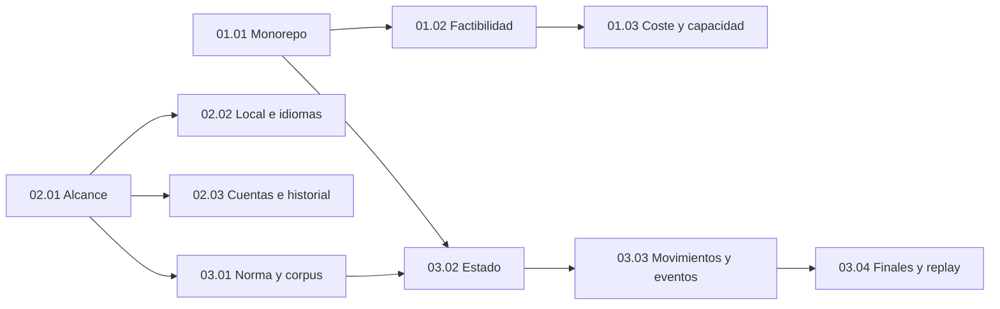

# PLANS — Lotes documentales, gates y estado

> Aprobación posterior: el propietario declaró «APRUEBO LOTE 1» el 2026-10-21 para el contenido revisado en HEAD e38cc84950858e072c1a3f06ffbf854cf7e544f5. PR #1 integrado por squash en main: 329b7c1059e8a74f191c256870734e8ae8259966. Este registro prevalece sobre menciones históricas de revisión pendiente; no acredita producto probado. Los permisos actuales se consultan en AGENTS y PLANS.

ID: PLANS · Versión: 0.3 · Fecha: 2026-10-21 · Estado documental: EN_REVISIÓN · Owner: C.

## Autorización y estado actual

- Gate 0: recibido del propietario el 2026-10-21: «APRUEBO INVENTARIO DOCUMENTAL».
- Historial: la restricción inicial de lote 1 fue satisfecha; la instrucción posterior «APRUEBO LOTE 1» autoriza su integración condicionada y la generación/publicación documental del lote 2.
- Inventario autorizado: [81 Markdown](docs/index.md#inventario),40 specs y 41 documentos de soporte.
- Permiso actual: exactamente diez nuevas specs del lote 2 más actualización necesaria de registros; lotes 3–6 sin autorización.
- Estado de ejecución documental: `LOTE_1_APROBADO_LOTE_2_EN_REVISIÓN`.
- Lote 1 APROBADO por el propietario; diez specs nuevas y cuatro registros de integración del lote 2 quedan EN_REVISIÓN.
- Estado del producto: implementación no iniciada, proveedores no conectados, pruebas de producto no ejecutadas, despliegues no realizados.

La aprobación de inventario no aprueba anticipadamente el contenido. Un reporte emitido por el agente no sustituye aceptación humana. La instrucción más reciente del propietario prevalece si restringe una continuación.

## Fuentes y estado de partida

Se leyó el maestro íntegro:569 líneas,60.815 bytes, Anexo A con 246 decisiones únicas. No se encontró registro separado en repositorio o junto al maestro. La copia [SRC](docs/sources/TOGUZ_PROMPT_MAESTRO_CODEX.md) conserva SHA-256:

```text
28C24C498829FCFAD410F07AAA6BD036D5A33382294401E11E86D486E4ECBBEF
```

ETAPA 0 e inicio de lote 1: árbol de trabajo vacío salvo.git, rama inicial master sin commits, sin remotos configurados. No había AGENTS aplicables en raíz o superiores inspeccionados. No se renombra la rama ni se crea historial. La existencia actual de documentación no cambia el estado del producto.

Jerarquía y requisitos: [REG](docs/decision-register.md), [CONF](docs/conflicts.md), [11.01](docs/specs/11-orchestration/11.01-document-standard-and-change-control.md).

## Secuencia documental autorizable

| Lote | Archivos nuevos | Contenido | Gate de revisión |
|---|---:|---|---|
|1|31|Fuentes, registro, preliminares, ocho ADR, raíces, índice/matriz/conflictos y 11.01–11.02|APRUEBO LOTE 1|
|2|10|Dominios 01,02 y 03; arquitectura, producto y motor|APRUEBO LOTE 2|
|3|11|05,07 y 06; servicios, identidad, datos y multiplayer|APRUEBO LOTE 3|
|4|8|04 y 08; visual, IA y aprendizaje|APRUEBO LOTE 4|
|5|20|09,10,11.03, ocho planes de fase y tres documentos harness|APRUEBO LOTE 5|
|6|1|Auditoría documental integral y reporte de pendientes|APRUEBO LOTE 6|

Las frases son gates de aceptación/revisión definidos por el maestro. Antes de cualquier escritura siguiente se comprobará la autorización humana efectiva, incluidas restricciones posteriores. Esta sesión termina tras entregar lote 1.

Los lotes 2–6 podrán actualizar índices, matriz, conflictos y documentos raíz pertinentes cuando estén autorizados; no agregar rutas fuera del inventario sin aprobación. Los cambios semánticos de documentos ya aprobados exigen procedimiento de cambio, no solo un chequeo editorial.

## Dependencias y paralelismo

[IDX](docs/index.md#inventario) contiene el manifiesto y las dependencias individuales de 40 specs. La numeración clasifica dominios; no obliga a implementarlos en orden numérico.

- Fijar fuente/IDs y normas comunes antes de integrar preliminares y ADR.
- Lote 2: arquitectura/producto en paralelo; motor depende del cotejo normativo y de su contrato de estado.
- Lote 3: límites 05.01 → identidad 07.01/07.02 → HTTP 05.02 → transacciones 05.03 → eventos 05.04 → perfiles/Elo07.03/07.04 → salas/reconciliación/recuperación 06.
- Lote 4: visual y aprendizaje en archivos independientes; consolidar equivalencia de eventos y accesibilidad.
- Lote 5: calidad y operación en paralelo; hitos/harness se cierran tras consolidarlas.
- Un autor por archivo, revisores sin escritura concurrente. Coordinación integra nombres, enlaces y matriz.

La capacidad operativa propuesta es coordinador más hasta tres especialistas activos, sin convertir ese número en requisito de producto. Los roles pueden agruparse, y no se delegan pasos dependientes de un gate no recibido.

## Hitos futuros — solo resumen de planificación

Las rutas PH-00–PH-07 se redactarán en lote 5; aquí se conserva el resumen exigido para orientar la documentación. No se ejecutan ni se simula su cierre.

| Hito previsto | Dependencias | Resultado demostrable futuro / aceptación | Evidencia y riesgos | Autorización |
|---|---|---|---|---|
|[PH-00](docs/index.md#phase-00) Factibilidad|01.02,05,10.01 y decisiones fuente|Go/Gin, motor compartido, Neon, Ably, comunicación protegida y transacción confirmables en cuatro proyectos|Builds/despliegues/logs/consumos; runtime beta, módulos y coste POR_VERIFICAR|Independiente para spike y cualquier recurso externo; pago siempre expreso|
|[PH-01](docs/index.md#phase-01) Motor|PH-00 y dominio 03 contrastado|Motor puro, corpus normativo, ilegales sin mutación y conservación 162|Unitarias/propiedades/fuzz/simulación observadas; RISK-01|Aprobación de implementación del hito|
|[PH-02](docs/index.md#phase-02) Contratos, datos e invitados|PH-01;05 y 07.01/07.02|Comandos autorizados/idempotentes y persistencia atómica con invitado verificable|DB real, contratos, concurrencia y acceso cruzado; RISK-05/07/09|Aprobación de implementación; migraciones/entornos según alcance|
|[PH-03](docs/index.md#phase-03) Cliente accesible y 3 D|PH-02;04|Partida mediante HTML y mejora 3 D progresiva sobre mismos estados/eventos|E 2 E/teclado/lector/visual/móvil; no claim FPS sin medir|Aprobación de implementación y revisiones visuales incrementales|
|[PH-04](docs/index.md#phase-04) Multiplayer privado|PH-03;06|Dos participantes, reconexión 24 h, duplicados seguros y reconciliación sin Ably|E 2 E dos contextos y fallos; cuotas, sesiones y expiración|Aprobación de implementación e integración externa|
|[PH-05](docs/index.md#phase-05) IA, práctica y tutorial|PH-04;08|IA fácil/normal legal, cancelación, respaldo; undo/redo y tutorial ES/EN en HTML/3D|Corpus/torneos de prueba/recursos/E2E; fuerza no acreditada antes de medir|Aprobación de implementación del hito|
|[PH-06](docs/index.md#phase-06) Cuentas, Elo y estadísticas|PH-05;07|OIDC, perfiles, historial, ranked y agregados atómicos, exportación/borrado|Pruebas de identidad/privacidad/ranking/concurrencia; política legal pendiente|Aprobación de implementación y configuración de proveedor|
|[PH-07](docs/index.md#phase-07) Hardening y portafolio|PH-06;09/10|DoD con evidencias, restauración ensayada, observabilidad y demo aceptada|Resultados reproducibles, revisión, rollback; licencia y coste|Aprobación de release/publicación/despliegue según acción|

La secuencia es propuesta documental, sin fechas ni costes garantizados. Mantiene IA básica, clasificación y estadísticas avanzadas en el lanzamiento comprometido. PH-00 no autoriza desplegar por estar descrito.

<a id="informe-lote-1"></a>

## Informe del lote 1

### Archivos y alcance

Se crean únicamente las 31 rutas siguientes; no había archivos de trabajo preexistentes que modificar. SRC se copia íntegramente, sin editar el original. No se generan stubs de otros lotes.

| ID | Archivo creado | Owner funcional | Estado |
|---|---|---|---|
| AGENTS | [AGENTS.md](AGENTS.md) | C | Nuevo; EN_REVISIÓN |
| GOALS | [GOALS.md](GOALS.md) | C | Nuevo; EN_REVISIÓN |
| PLANS | [PLANS.md](PLANS.md) | C | Nuevo; EN_REVISIÓN |
| PROMPTS | [PROMPTS.md](PROMPTS.md) | C | Nuevo; EN_REVISIÓN |
| README | [README.md](README.md) | C | Nuevo; EN_REVISIÓN |
| SRC | [docs/sources/TOGUZ_PROMPT_MAESTRO_CODEX.md](docs/sources/TOGUZ_PROMPT_MAESTRO_CODEX.md) | C | Nuevo; EN_REVISIÓN |
| REG | [docs/decision-register.md](docs/decision-register.md) | C | Nuevo; EN_REVISIÓN |
| CONF | [docs/conflicts.md](docs/conflicts.md) | C | Nuevo; EN_REVISIÓN |
| IDX | [docs/index.md](docs/index.md) | C | Nuevo; EN_REVISIÓN |
| TRZ | [docs/traceability.md](docs/traceability.md) | C | Nuevo; EN_REVISIÓN |
| PRE-01 | [docs/preliminares/PRE-01.md](docs/preliminares/PRE-01.md) | A | Nuevo; EN_REVISIÓN |
| PRE-02 | [docs/preliminares/PRE-02.md](docs/preliminares/PRE-02.md) | C | Nuevo; EN_REVISIÓN |
| PRE-03 | [docs/preliminares/PRE-03.md](docs/preliminares/PRE-03.md) | M | Nuevo; EN_REVISIÓN |
| PRE-04 | [docs/preliminares/PRE-04.md](docs/preliminares/PRE-04.md) | V | Nuevo; EN_REVISIÓN |
| PRE-05 | [docs/preliminares/PRE-05.md](docs/preliminares/PRE-05.md) | S | Nuevo; EN_REVISIÓN |
| PRE-06 | [docs/preliminares/PRE-06.md](docs/preliminares/PRE-06.md) | S | Nuevo; EN_REVISIÓN |
| PRE-07 | [docs/preliminares/PRE-07.md](docs/preliminares/PRE-07.md) | S | Nuevo; EN_REVISIÓN |
| PRE-08 | [docs/preliminares/PRE-08.md](docs/preliminares/PRE-08.md) | I | Nuevo; EN_REVISIÓN |
| PRE-09 | [docs/preliminares/PRE-09.md](docs/preliminares/PRE-09.md) | Q | Nuevo; EN_REVISIÓN |
| PRE-10 | [docs/preliminares/PRE-10.md](docs/preliminares/PRE-10.md) | A | Nuevo; EN_REVISIÓN |
| PRE-11 | [docs/preliminares/PRE-11.md](docs/preliminares/PRE-11.md) | C | Nuevo; EN_REVISIÓN |
| ADR-0001 | [docs/adr/ADR-0001-three-go-services-and-data-ownership.md](docs/adr/ADR-0001-three-go-services-and-data-ownership.md) | A | Nuevo; EN_REVISIÓN |
| ADR-0002 | [docs/adr/ADR-0002-single-versioned-go-engine.md](docs/adr/ADR-0002-single-versioned-go-engine.md) | M | Nuevo; EN_REVISIÓN |
| ADR-0003 | [docs/adr/ADR-0003-rest-contracts-and-versioned-events.md](docs/adr/ADR-0003-rest-contracts-and-versioned-events.md) | S | Nuevo; EN_REVISIÓN |
| ADR-0004 | [docs/adr/ADR-0004-postgres-authority-and-postcommit-ably.md](docs/adr/ADR-0004-postgres-authority-and-postcommit-ably.md) | S | Nuevo; EN_REVISIÓN |
| ADR-0005 | [docs/adr/ADR-0005-session-and-service-trust-boundaries.md](docs/adr/ADR-0005-session-and-service-trust-boundaries.md) | S | Nuevo; EN_REVISIÓN |
| ADR-0006 | [docs/adr/ADR-0006-vercel-hobby-and-zero-cost-guardrails.md](docs/adr/ADR-0006-vercel-hobby-and-zero-cost-guardrails.md) | A | Nuevo; EN_REVISIÓN |
| ADR-0007 | [docs/adr/ADR-0007-3d-and-accessible-html-view.md](docs/adr/ADR-0007-3d-and-accessible-html-view.md) | V | Nuevo; EN_REVISIÓN |
| ADR-0008 | [docs/adr/ADR-0008-ranked-results-and-elo-ownership.md](docs/adr/ADR-0008-ranked-results-and-elo-ownership.md) | S | Nuevo; EN_REVISIÓN |
| 11.01 | [docs/specs/11-orchestration/11.01-document-standard-and-change-control.md](docs/specs/11-orchestration/11.01-document-standard-and-change-control.md) | C | Nuevo; EN_REVISIÓN |
| 11.02 | [docs/specs/11-orchestration/11.02-ownership-delegation-and-context.md](docs/specs/11-orchestration/11.02-ownership-delegation-and-context.md) | C | Nuevo; EN_REVISIÓN |

Los autores efectivos fueron: coordinador para diez archivos raíz/fuente/registro/índice/matriz/conflictos/plan/prompts; especialista `preliminares` para once PRE; especialista `adr` para ocho ADR; especialista `specs_gobierno` para 11.01–11.02. Se delegó conforme al §9 del maestro y PRE-11.C1–C 4. La coordinación revisa las 21 entregas delegadas y conserva responsabilidad de integración. Los roles funcionales del índice no se confunden con personas o agentes permanentes del producto.

### Decisiones referenciadas y cobertura

- Fuente:246 decisiones APROBADO en Anexo A, con conteos 17/18/22/25/24/20/24/24/24/24/24.
- Registro: texto literal con IDs y destino canónico.
- Once preliminares: contexto y consecuencias, sin fingir cuestionarios originales.
- Ocho ADR: decisiones existentes, alternativas y riesgos; documentos EN_REVISIÓN.
- Matriz:246 rutas canónicas;17 decisiones tienen spec redactada EN_REVISIÓN (13 en 11.01 y 4 en 11.02);229 esperan sus specs de lotes 2–5.
- No se utiliza 246/246 para afirmar que las 40 specs o el producto están completos.

### Verificaciones efectivamente realizadas

Estado: `AUDITORÍA_DOCUMENTAL_REALIZADA`; contenido pendiente de aprobación humana. Se ejecutaron análisis de texto en memoria con PowerShell/.NET y revisión cruzada, sin instalar herramientas ni guardar verificadores ejecutables.

| Comprobación observada | Resultado |
|---|---|
| Alcance de archivos | 31 de 31 rutas autorizadas; cero faltantes, cero inesperadas; todas `.md` |
| Fuente archivada | 60.815 bytes y SHA-256 idéntico al original; original sin editar |
| Registro literal | 246 decisiones, mismo orden y texto que Anexo A; cero diferencias |
| Preliminares | 246 IDs propios enlazados, conteos PRE 17/18/22/25/24/20/24/24/24/24/24; cero faltantes |
| Matriz | 246 filas únicas; todos los destinos coinciden con la asignación canónica autorizada |
| Estado de cobertura | 17 filas SPEC_EN_REVISIÓN y 229 PENDIENTE_LOTE; ninguna implica software completo |
| Inventario | 81 entradas y 40 especificaciones; solo el subconjunto de lote 1 existe |
| Dependencias | 40 nodos de specs, sin diferencias respecto al inventario ni ciclos de redacción |
| Enlaces locales | 1.830 enlaces comprobados; cero archivos o anchors faltantes |
| Estructura Markdown | Fences equilibrados, anchors explícitos sin duplicados y tablas con columnas coherentes |
| Metadata | 30 documentos generados EN_REVISIÓN; SRC conserva literalmente el estado histórico de la fuente |
| Specs 11.01 y 11.02 | 17 apartados cada una; catálogo de verificación documental para sus 13 y 4 decisiones |
| Espacios finales | Cero hallazgos en documentos generados; SRC se conserva sin normalización |
| Git | 31 archivos nuevos no seguidos, rama inicial master sin commits; diff --check sin salida |

El análisis de enlaces excluye ejemplos en fences y código inline. Las referencias externas se identifican por procedencia; no se volvió a comprobar su contenido en lote 1 ni se ejecutó una integración. No se utilizó renderizador de Markdown/Mermaid ni se acreditan capturas visuales. Git diff --check no cubre archivos no seguidos: se complementó con lectura y comprobaciones directas de los nuevos Markdown. Ningún resultado corresponde a pruebas de producto.

Revisión cruzada real: el autor de preliminares revisó las ocho ADR; el autor de ADR revisó los once PRE; el autor de gobierno revisó los diez archivos integrados por coordinación. Coordinación comprobó alcance, texto canónico, matriz, grafo, enlaces y formato de los 31 archivos, y revisó los límites críticos de autoridad, credenciales y Elo. No quedaron hallazgos semánticos bloqueantes del lote documental.

Correcciones integradas: referencias exactas y espaciado en prosa; Go/Gin frente a Node/Fastify en PRE-01; atributos de cookies en PRE-07; PRE-10 aclara que umbrales activan revisión y que los disparadores de degradación siguen por especificar. Esta última integración fue asumida por coordinación tras confirmar el cese de escritura del autor, sin coedición concurrente. Ninguna corrección cambia el texto aprobado del registro.

### Dependencias, contradicciones y riesgos pendientes

No hay contradicción con documentación previa, porque no existía. [CONF](docs/conflicts.md) mantiene 14 riesgos abiertos y 3 matices de fuente: IDs de ejemplo, realismo estilizado y ampliaciones de undo/tablas. Ningún riesgo técnico se marca resuelto por la generación documental.

Las dependencias futuras figuran como entradas planificadas del índice; no se crean archivos para hacerlas parecer satisfechas. El reglamento formal y la factibilidad Go/Vercel condicionan el cierre de las specs afectadas y la implementación futura.

### Criterios pendientes y gate

Pendiente: revisión humana de los 31 documentos, aceptación o correcciones del lote 1 y resolución posterior de los riesgos por sus owners. Ninguna ADR o spec generada se marca APROBADO automáticamente. Faltan los 50 archivos de lotes 2–6, fuera de la autorización actual.

Tras la auditoría de integración se detiene el trabajo y se solicita **«APRUEBO LOTE 1»**. La autorización de implementación, instalaciones, servicios, pruebas de producto, cambios Git o despliegues es independiente.

**NO se ha implementado, instalado, desplegado ni modificado código.** El único resultado de esta sesión son Markdown del lote 1.

## Autorización posterior de publicación en GitHub

El 2026-10-21 el propietario autorizó crear el repositorio público `toguz-kumalak` en la cuenta personal autenticada, configurar Git local, crear `.gitignore`, publicar la base existente y presentar las specs disponibles por PR sin fusionarlo. Esto constituye autorización independiente de Git/publicación; no es «APRUEBO LOTE 1» ni autoriza nuevos lotes o implementación. El informe del lote 1 anterior conserva el estado observado al generarlo.

La sesión de GitHub CLI activa se verificó por API como cuenta personal `SebasChaconDev`, con alcance `repo`. La credencial anterior de otra cuenta estaba inválida e inactiva y no se utiliza. La identidad de los commits se configura solo en este repositorio usando el alias público y correo noreply de GitHub, sin publicar el correo personal configurado globalmente.

Distribución preparada: commit inicial de 29 Markdown y `.gitignore` en `main`; rama `docs/specs-lote-01` con las specs existentes 11.01 y 11.02 y enlaces relativos integrados. En la base, sus referencias apuntan a la rama de revisión para evitar destinos locales ausentes. No se generan las specs de infraestructura del lote 2 ni se usa un título que las dé por existentes. Las dos ramas se publican juntas cuando sea posible y el PR queda abierto, sin merge.

La copia íntegra del maestro está en `docs/sources/TOGUZ_PROMPT_MAESTRO_CODEX.md`. No existe un archivo separado llamado `TOGUZ_REGISTRO_DECISIONES_PRE01_PRE11.md`; `docs/decision-register.md` ya conserva literalmente sus 246 decisiones fuente con procedencia verificable, por lo que no se crea un duplicado nominal. No hay ZIP que publicar, bases de datos, secretos o artefactos compilados en el inventario actual. Los directorios futuros `docs/phases/` y `harness/` permanecen pendientes, sin stubs.

Antes de publicar se aplica detección local de patrones de secretos y nombres sensibles, contraste de archivos/rutas y validación de enlaces/IDs. Un resultado sin hallazgos indica ausencia de patrones detectados, no una garantía universal. No se imprimen valores candidatos. La verificación remota de ramas, árboles, commits y PR se realiza antes de declarar publicación lograda en el informe al propietario. La elección de licencia sigue pendiente; no se añade licencia.

## Cierre verificado del lote 1 y autorización del lote 2

El propietario declaró «APRUEBO LOTE 1» y autorizó integrar PR #1 si HEAD=e38cc84950858e072c1a3f06ffbf854cf7e544f5. Se comprobaron 27 archivos: dos specs y 25 correcciones de referencias exclusivamente, sin diferencias adicionales. GitHub informó MERGEABLE/CLEAN, cero checks fallidos, sin protección ni reglas obligatorias de main. El squash es 329b7c1059e8a74f191c256870734e8ae8259966; GitHub confirmó ambas specs en main. No se usó force push ni se eludieron protecciones.

Los registros de aprobación se actualizan sin cambiar las 246 formulaciones fuente. Se autoriza después la rama docs/specs-lote-02 desde main actualizado, exactamente las diez rutas del inventario, auditoría documental y PR sin fusionar. La revisión final exige «APRUEBO LOTE 2»; no hay autorización para implementación ni lote 3. Los informes anteriores son históricos y conservan lo observado en su fecha.

<a id="informe-lote-2"></a>

## Lote 2 — Matriz de trabajo e informe de ejecución documental

Estado de ejecución: LOTE_2_EN_CURSO. Se parte de main 624518495e2a81aa5928576f769820345df6cdc0, que registra aprobación de lote 1 después del squash 329b7c1059e8a74f191c256870734e8ae8259966. Rama propia: `docs/specs-lote-02`. El propietario autoriza exactamente diez nuevas specs Markdown y actualización necesaria de registros. No están autorizados lote 3, implementación, instalaciones, pruebas de producto ni servicios externos.

### Matriz de asignación y fuentes

| ID | Ruta autorizada | Owner / autor efectivo | Dependencias de redacción | Decisiones canónicas |
|---|---|---|---|---|
| [01.01](docs/index.md#spec-01-01) | `docs/specs/01-infrastructure/01.01-stack-monorepo.md` | A / lote2_infra | Registro y norma documental | [PRE-01.A1](docs/decision-register.md#pre-01-a1), [PRE-01.A2](docs/decision-register.md#pre-01-a2), [PRE-01.A3](docs/decision-register.md#pre-01-a3), [PRE-01.A4](docs/decision-register.md#pre-01-a4), [PRE-01.C3](docs/decision-register.md#pre-01-c3) |
| [01.02](docs/index.md#spec-01-02) | `docs/specs/01-infrastructure/01.02-platform-feasibility.md` | A / lote2_infra | 01.01 | [PRE-01.B2](docs/decision-register.md#pre-01-b2), [PRE-01.C1](docs/decision-register.md#pre-01-c1), [PRE-01.C4](docs/decision-register.md#pre-01-c4), [PRE-05.F4](docs/decision-register.md#pre-05-f4) |
| [01.03](docs/index.md#spec-01-03) | `docs/specs/01-infrastructure/01.03-cost-capacity-evolution.md` | A / lote2_infra | 01.02 | [PRE-01.C2](docs/decision-register.md#pre-01-c2), [PRE-01.D3](docs/decision-register.md#pre-01-d3) |
| [02.01](docs/index.md#spec-02-01) | `docs/specs/02-product/02.01-scope-and-modes.md` | C / lote2_producto | Registro y norma documental | [PRE-02.A1](docs/decision-register.md#pre-02-a1), [PRE-02.A2](docs/decision-register.md#pre-02-a2), [PRE-02.A3](docs/decision-register.md#pre-02-a3), [PRE-02.A4](docs/decision-register.md#pre-02-a4), [PRE-02.E3](docs/decision-register.md#pre-02-e3) |
| [02.02](docs/index.md#spec-02-02) | `docs/specs/02-product/02.02-local-flows-and-i18n.md` | C / lote2_producto | 02.01 | [PRE-02.B3](docs/decision-register.md#pre-02-b3), [PRE-02.D3](docs/decision-register.md#pre-02-d3), [PRE-05.C4](docs/decision-register.md#pre-05-c4) |
| [02.03](docs/index.md#spec-02-03) | `docs/specs/02-product/02.03-accounts-history-and-licensing.md` | C / lote2_producto | 02.01 | [PRE-01.D4](docs/decision-register.md#pre-01-d4), [PRE-02.B1](docs/decision-register.md#pre-02-b1), [PRE-02.B2](docs/decision-register.md#pre-02-b2), [PRE-02.D2](docs/decision-register.md#pre-02-d2) |
| [03.01](docs/index.md#spec-03-01) | `docs/specs/03-game-engine/03.01-normative-rules-and-corpus.md` | M / lote2_normativa | 02.01 | [PRE-03.A3](docs/decision-register.md#pre-03-a3), [PRE-03.C1](docs/decision-register.md#pre-03-c1), [PRE-03.E1](docs/decision-register.md#pre-03-e1) |
| [03.02](docs/index.md#spec-03-02) | `docs/specs/03-game-engine/03.02-state-indices-and-invariants.md` | M / lote2_normativa | 01.01, 03.01 | [PRE-03.A4](docs/decision-register.md#pre-03-a4), [PRE-03.B1](docs/decision-register.md#pre-03-b1), [PRE-03.B4](docs/decision-register.md#pre-03-b4), [PRE-03.E2](docs/decision-register.md#pre-03-e2) |
| [03.03](docs/index.md#spec-03-03) | `docs/specs/03-game-engine/03.03-moves-and-semantic-events.md` | M / lote2_normativa | 03.02 | [PRE-02.C1](docs/decision-register.md#pre-02-c1), [PRE-03.B2](docs/decision-register.md#pre-03-b2), [PRE-03.B3](docs/decision-register.md#pre-03-b3), [PRE-03.B5](docs/decision-register.md#pre-03-b5), [PRE-03.C2](docs/decision-register.md#pre-03-c2), [PRE-03.C3](docs/decision-register.md#pre-03-c3) |
| [03.04](docs/index.md#spec-03-04) | `docs/specs/03-game-engine/03.04-outcomes-repetition-and-replay.md` | M / lote2_normativa | 03.03 | [PRE-02.C4](docs/decision-register.md#pre-02-c4), [PRE-02.D1](docs/decision-register.md#pre-02-d1), [PRE-03.A1](docs/decision-register.md#pre-03-a1), [PRE-03.A2](docs/decision-register.md#pre-03-a2), [PRE-03.C4](docs/decision-register.md#pre-03-c4), [PRE-03.E3](docs/decision-register.md#pre-03-e3) |

Son **42 decisiones con spec canónica en lote 2**: PRE-01=11, PRE-02=13, PRE-03=16, PRE-05=2. Las referencias cruzadas adicionales no trasladan propiedad canónica. Las 17 decisiones de gobierno de lote 1 tienen specs APROBADAS; las 42 nuevas quedarán EN_REVISIÓN y las otras 187 mantendrán specs futuras pendientes. Las 246 formulaciones fuente no se alteran.

### Propiedad y secuencia

Arquitectura y producto se redactan en paralelo en rutas independientes. La investigación normativa es solo lectura al principio. El autor del motor recibe después 01.01 y 02.01 entregadas, fuentes reglamentarias y restricciones; redacta 03.01 → 03.02 → 03.03 → 03.04 en orden, sin que otro autor cambie esos contratos. Coordinación escribe únicamente registros de integración, audita y comunica revisiones antes de corregir archivos de autores activos.

Las propuestas de diseño de contratos no son nuevas reglas oficiales. Si falta evidencia normativa, el apartado afectado se marca BLOQUEADO_PARA_APROBACIÓN_NORMATIVA; el documento puede entregarse EN_REVISIÓN con la discrepancia abierta, sin ejecutar algoritmos ni reemplazar decisiones.

### Dependencias concretas del lote 2

Flecha = requisito de redacción hacia consumidor; registros y norma 11.01/11.02 se consultan transversalmente, sin introducir aristas inversas.



La falta de una interpretación normativa no se resuelve mediante el orden de redacción: el consumidor conserva el bloqueo y no puede aprobar el algoritmo afectado.

### Estado de auditoría y gate

### Comprobaciones documentales observadas

| Control | Resultado |
|---|---|
| Alcance físico | 42 archivos: 41 Markdown y .gitignore existente; exactamente diez specs nuevas y cuatro registros actualizados respecto a main 6245184. Sin rutas de lotes 3–6. |
| Inventario | 81 entradas y 40 specs conservadas; diez rutas nuevas coinciden exactamente con lote 2. |
| Estructura y estado | Diez specs v0.1 EN_REVISIÓN, 17 apartados numerados 1–17 cada una; los dos documentos de gobierno aprobados conservan sus 17. |
| Fuente canónica | 246 decisiones únicas, texto y orden exactos entre SRC/REG; 246 filas de trazabilidad únicas y 246 destinos originales intactos. |
| Cobertura | 17 decisiones con spec APROBADA + 42 con spec EN_REVISIÓN + 187 futuras = 246; 42 VP canónicos presentes y conectados con AC existentes. |
| Dependencias | 40 nodos comparados con inventario original, sin aristas cambiadas ni ciclos. |
| Enlaces/formato | 2413 vínculos locales comprobados; cero enlaces/anclas ausentes, IDs explícitos duplicados, fences desequilibrados o filas con columnas incoherentes. |
| Ejemplos | Tres bloques JSON completos analizados como datos; 14 estados numéricos de siete pares DER con dimensiones/rangos y suma 162 antes/después. No se ejecutó motor ni se probó alcanzabilidad. |
| Integridad/seguridad | Copia SRC conserva SHA256 original; solo Markdown autorizado modificado/creado; escaneo de patrones no detectó credenciales, correos privados ni archivos sensibles. .gitignore permanece sin cambios. |
| Producto | No implementado, compilado, probado, instalado, conectado ni desplegado. POC-01–11 y evidencias técnicas permanecen PENDIENTE. |

Los controles se ejecutaron en memoria sobre texto y Git; no se escribieron verificadores en el repositorio. Los procedimientos de producto descritos en las specs no se ejecutaron. El detalle de cobertura se mantiene en [TRZ](docs/traceability.md), los bloqueos en [CONF](docs/conflicts.md) y el inventario en [IDX](docs/index.md).

### Contribuciones y revisión observadas

- `lote2_infra`: autor único de 01.01–01.03; revisión independiente de producto y motor, sin editar rutas ajenas.
- `lote2_producto`: autor único de 02.01–02.03; revisión independiente de arquitectura y cotejo de cuotas oficiales.
- `lote2_normativa`: investigación normativa inicialmente solo lectura; autor único de 03.01–03.04 tras recibir dependencias estables. Leyó íntegramente N1; documentó acceso parcial/indexado a N2/AUX sin fingir vigencia.
- Coordinación: cierre condicionado del lote 1, matriz y briefs, lectura y revisión de contratos/fuentes, integración de cuatro registros, armonización de versiones en 02.02 después del cese del autor, auditoría y publicación. No se coeditaron contratos con autores activos.

Hallazgos corregidos: pipes de enums dentro de tablas; POC-06 distinguió secretos de servidor y tokens cliente previstos, conservando HttpOnly/access en memoria y prohibición de tokens en URL/logs; FAC-01 dejó claro que Game/AI, sin imponerlo a Identity, importan el motor; 02.02 alineó nombres propuestos de versiones con 03.02; 03.04 completó 81–81/equal_score, matriz resultado/causa/ganador/source y AC-09 tras hallazgo coincidente del coordinador y revisor independiente. La revisión posterior verificó esa corrección conservando los bloqueos. No se modificó ninguna decisión fuente ni se cerraron los 14 riesgos técnicos.

### Fuentes y bloqueos de aprobación

Consulta 2026-10-21: N1 [PDF inglés de dos páginas](https://mindsportsolympiad.com/wp-content/uploads/2021/07/Rules-toguz-en-official.pdf), leído completo; N2 [Asociación, Astana 2013, artículo 375](https://9kumalak.com/index.php/zhyldy-zhospar/375-ojyn-a-idasy-men-erezheleri), texto recuperado por búsqueda, apertura directa fallida; [AUX-509](https://9kumalak.com/index.php/zhyldy-zhospar/509-to-yz-mala-a-idasy-men-erezhesi), solo indexación. No se autentican firma, edición vigente o traducción oficial por el mero alojamiento.

[RISK-01](docs/conflicts.md#risk-01) conserva NORM-01 edición/vigencia, NORM-02 atsyrau/recogida/prioridad terminal y NORM-03 equivalencia/ventana/actor de reclamación como **BLOQUEADO_PARA_APROBACIÓN_NORMATIVA**. No se demostró contradicción contra PRE-03.A1/A3. La comparación con implementación independiente sigue PENDIENTE. Las fichas sintéticas de 03.01 son derivaciones manuales con alcanzabilidad UNPROVEN.

Infraestructura cita [Vercel Go](https://vercel.com/docs/functions/runtimes/go), [Hobby](https://vercel.com/docs/plans/hobby), [monorepos](https://vercel.com/docs/monorepos), [Neon precios](https://neon.com/pricing)/[pooling](https://neon.com/docs/connect/connection-pooling), [Ably Free](https://ably.com/docs/platform/pricing/free)/[límites](https://ably.com/docs/platform/pricing/limits). Son documentos oficiales fechados, no mediciones de cuenta. Go beta/empaquetado, capacidad gratuita, regiones y consumo siguen POR_VERIFICAR; POC-01–11 no se ejecutó. Licencia, procedencia de recursos, jurisdicción/retención y política de replay compartido permanecen pendientes de decisión/diseño.

### Recomendación para revisión humana

Revisar primero los tres bloqueos normativos y el convenio de índices/contexto/versiones; después contratos de transición/eventos/replay y la matriz de factibilidad/coste; finalmente escenarios de producto y permisos de historial. Aprobar el lote documental no equivale a aceptar algoritmos bloqueados ni autoriza código, proveedores, PoC o lote 3. Una resolución normativa futura debe identificar fuente, alcance y aprobación; se conservan los PRE originales.


La entrega se publica mediante PR hacia main con título `docs: lote 2 — architecture, product and Go game engine specifications`, sin fusionarlo. Se solicitará «APRUEBO LOTE 2» y se detendrá el trabajo; ese gate sigue PENDIENTE de respuesta humana explícita.
