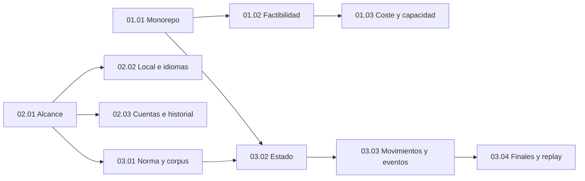
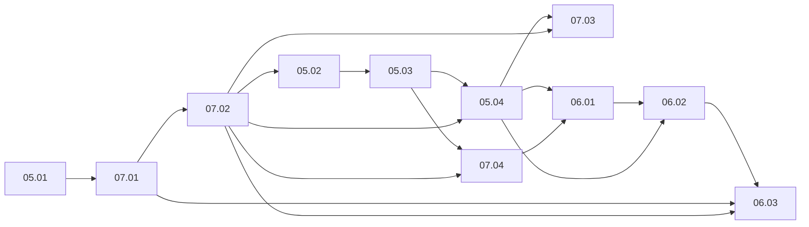

# PLANS — Lotes documentales, gates y estado

> **Autorización posterior vigente — 2026-10-25.** El propietario autoriza completar los pasos necesarios para preparar lote4; se cierra documentalmente lote3 para integración y el spike acredita GO_REMOTE acotado, con recursos propios retirados. [Registro fiel y límites](PLANS.md#preparacion-lote-4) sustituye las paradas históricas siguientes. No se genera lote4 ni se implementa producto en este cierre.

> Autorización posterior vigente: el propietario autoriza generar y publicar exclusivamente el lote 3 documental en docs/specs-lote-03: once specs EN_REVISIÓN, registros necesarios y PR contra main sin fusionar. Esta instrucción sustituye las paradas históricas de lotes anteriores; no autoriza producto, lote 4, infraestructura o pagos.

> Aprobación posterior del lote 2: el propietario declaró «APRUEBO LOTE 2» y autorizó fusionar PR #2 en main. Contenido aprobado: HEAD 598ac9a4fc6ce14cf512785fb1c4160fafb4eb9e; integrado por squash 1f401af8d76794981bbcfdf9a3aa1831cf2621f5 (2026-10-21T21:10:14Z). Este registro sustituye las menciones históricas a revisión pendiente o prohibición de esa fusión. No autoriza lote 3 ni implementación; el producto sigue sin verificar.

> Aprobación posterior: el propietario declaró «APRUEBO LOTE 1» el 2026-10-21 para el contenido revisado en HEAD e38cc84950858e072c1a3f06ffbf854cf7e544f5. PR #1 integrado por squash en main: 329b7c1059e8a74f191c256870734e8ae8259966. Este registro prevalece sobre menciones históricas de revisión pendiente; no acredita producto probado. Los permisos actuales se consultan en AGENTS y PLANS.

ID: PLANS · Versión: 0.8 · Fecha: 2026-10-25 · Estado documental: APROBADO · Owner: C.

## Autorización y estado actual

- Gate 0: recibido del propietario el 2026-10-21: «APRUEBO INVENTARIO DOCUMENTAL».
- Historial: la restricción inicial de lote 1 fue satisfecha; la instrucción posterior «APRUEBO LOTE 1» autoriza su integración condicionada y la generación/publicación documental del lote 2.
- Inventario autorizado: [81 Markdown](docs/index.md#inventario),40 specs y 41 documentos de soporte.
- Permiso actual posterior: «AUTORIZO LA GENERACIÓN Y PUBLICACIÓN DOCUMENTAL DEL LOTE 3». Once specs inventariadas, cinco registros necesarios y PR desde docs/specs-lote-03 contra main sin fusionar; sin producto ni lote 4. La aprobación e integración de PR #2 permanecen como base verificada.
- Estado de ejecución documental: `LOTE_3_EN_REVISIÓN`. Lotes 1 y 2 y TK-N1-1.0.0 APROBADOS; once specs del lote 3 redactadas para PR sin fusionar y gate humano pendiente.
- Lotes 1 y 2 APROBADOS e integrados; 59 decisiones con spec aprobada. Lote 3 cubre 66 decisiones adicionales EN_REVISIÓN; 121 conservan spec futura. Generar/publicar no aprueba el contenido.
- Estado del producto: implementación no iniciada, proveedores no conectados, pruebas de producto no ejecutadas, despliegues no realizados.

La aprobación de inventario no aprueba anticipadamente el contenido. Un reporte emitido por el agente no sustituye aceptación humana. La instrucción más reciente del propietario prevalece si restringe una continuación.

## Fuentes y estado de partida

Se leyó el maestro íntegro:569 líneas,60.815 bytes, Anexo A con 246 decisiones únicas. No se encontró registro separado en repositorio o junto al maestro. La copia [SRC](docs/sources/TOGUZ_PROMPT_MAESTRO_CODEX.md) conserva SHA-256:

```text
28C24C498829FCFAD410F07AAA6BD036D5A33382294401E11E86D486E4ECBBEF
```

ETAPA 0 e inicio de lote 1: árbol de trabajo vacío salvo.git, rama inicial master sin commits, sin remotos configurados. No había AGENTS aplicables en raíz o superiores inspeccionados. No se renombra la rama ni se crea historial. La existencia actual de documentación no cambia el estado del producto.

Jerarquía y requisitos: [REG](docs/decision-register.md), [CONF](docs/conflicts.md), [11.01](docs/specs/11-orchestration/11.01-document-standard-and-change-control.md).

## Secuencia documental autorizable

| Lote | Archivos nuevos | Contenido | Gate de revisión |
|---|---:|---|---|
|1|31|Fuentes, registro, preliminares, ocho ADR, raíces, índice/matriz/conflictos y 11.01–11.02|APRUEBO LOTE 1|
|2|10|Dominios 01,02 y 03; arquitectura, producto y motor|APRUEBO LOTE 2|
|3|11|05,07 y 06; servicios, identidad, datos y multiplayer|APRUEBO LOTE 3|
|4|8|04 y 08; visual, IA y aprendizaje|APRUEBO LOTE 4|
|5|20|09,10,11.03, ocho planes de fase y tres documentos harness|APRUEBO LOTE 5|
|6|1|Auditoría documental integral y reporte de pendientes|APRUEBO LOTE 6|

Las frases son gates de aceptación/revisión definidos por el maestro. Antes de cualquier escritura siguiente se comprobará la autorización humana efectiva, incluidas restricciones posteriores. Esta sesión termina tras entregar lote 1.

Los lotes 2–6 podrán actualizar índices, matriz, conflictos y documentos raíz pertinentes cuando estén autorizados; no agregar rutas fuera del inventario sin aprobación. Los cambios semánticos de documentos ya aprobados exigen procedimiento de cambio, no solo un chequeo editorial.

## Dependencias y paralelismo

[IDX](docs/index.md#inventario) contiene el manifiesto y las dependencias individuales de 40 specs. La numeración clasifica dominios; no obliga a implementarlos en orden numérico.

- Fijar fuente/IDs y normas comunes antes de integrar preliminares y ADR.
- Lote 2: arquitectura/producto en paralelo; motor depende del cotejo normativo y de su contrato de estado.
- Lote 3: límites 05.01 → identidad 07.01/07.02 → HTTP 05.02 → transacciones 05.03 → eventos 05.04 → perfiles/Elo07.03/07.04 → salas/reconciliación/recuperación 06.
- Lote 4: visual y aprendizaje en archivos independientes; consolidar equivalencia de eventos y accesibilidad.
- Lote 5: calidad y operación en paralelo; hitos/harness se cierran tras consolidarlas.
- Un autor por archivo, revisores sin escritura concurrente. Coordinación integra nombres, enlaces y matriz.

La capacidad operativa propuesta es coordinador más hasta tres especialistas activos, sin convertir ese número en requisito de producto. Los roles pueden agruparse, y no se delegan pasos dependientes de un gate no recibido.

## Hitos futuros — solo resumen de planificación

Las rutas PH-00–PH-07 se redactarán en lote 5; aquí se conserva el resumen exigido para orientar la documentación. No se ejecutan ni se simula su cierre.

| Hito previsto | Dependencias | Resultado demostrable futuro / aceptación | Evidencia y riesgos | Autorización |
|---|---|---|---|---|
|[PH-00](docs/index.md#phase-00) Factibilidad|01.02,05,10.01 y decisiones fuente|Go/Gin, motor compartido, Neon, Ably, comunicación protegida y transacción confirmables en cuatro proyectos|Builds/despliegues/logs/consumos; runtime beta, módulos y coste POR_VERIFICAR|Independiente para spike y cualquier recurso externo; pago siempre expreso|
|[PH-01](docs/index.md#phase-01) Motor|PH-00 y dominio 03 contrastado|Motor puro, corpus normativo, ilegales sin mutación y conservación 162|Unitarias/propiedades/fuzz/simulación observadas; RISK-01|Aprobación de implementación del hito|
|[PH-02](docs/index.md#phase-02) Contratos, datos e invitados|PH-01;05 y 07.01/07.02|Comandos autorizados/idempotentes y persistencia atómica con invitado verificable|DB real, contratos, concurrencia y acceso cruzado; RISK-05/07/09|Aprobación de implementación; migraciones/entornos según alcance|
|[PH-03](docs/index.md#phase-03) Cliente accesible y 3 D|PH-02;04|Partida mediante HTML y mejora 3 D progresiva sobre mismos estados/eventos|E 2 E/teclado/lector/visual/móvil; no claim FPS sin medir|Aprobación de implementación y revisiones visuales incrementales|
|[PH-04](docs/index.md#phase-04) Multiplayer privado|PH-03;06|Dos participantes, reconexión 24 h, duplicados seguros y reconciliación sin Ably|E 2 E dos contextos y fallos; cuotas, sesiones y expiración|Aprobación de implementación e integración externa|
|[PH-05](docs/index.md#phase-05) IA, práctica y tutorial|PH-04;08|IA fácil/normal legal, cancelación, respaldo; undo/redo y tutorial ES/EN en HTML/3D|Corpus/torneos de prueba/recursos/E2E; fuerza no acreditada antes de medir|Aprobación de implementación del hito|
|[PH-06](docs/index.md#phase-06) Cuentas, Elo y estadísticas|PH-05;07|OIDC, perfiles, historial, ranked y agregados atómicos, exportación/borrado|Pruebas de identidad/privacidad/ranking/concurrencia; política legal pendiente|Aprobación de implementación y configuración de proveedor|
|[PH-07](docs/index.md#phase-07) Hardening y portafolio|PH-06;09/10|DoD con evidencias, restauración ensayada, observabilidad y demo aceptada|Resultados reproducibles, revisión, rollback; licencia y coste|Aprobación de release/publicación/despliegue según acción|

La secuencia es propuesta documental, sin fechas ni costes garantizados. Mantiene IA básica, clasificación y estadísticas avanzadas en el lanzamiento comprometido. PH-00 no autoriza desplegar por estar descrito.

<a id="informe-lote-1"></a>

## Informe del lote 1

### Archivos y alcance

Se crean únicamente las 31 rutas siguientes; no había archivos de trabajo preexistentes que modificar. SRC se copia íntegramente, sin editar el original. No se generan stubs de otros lotes.

| ID | Archivo creado | Owner funcional | Estado |
|---|---|---|---|
| AGENTS | [AGENTS.md](AGENTS.md) | C | Nuevo; EN_REVISIÓN |
| GOALS | [GOALS.md](GOALS.md) | C | Nuevo; EN_REVISIÓN |
| PLANS | [PLANS.md](PLANS.md) | C | Nuevo; EN_REVISIÓN |
| PROMPTS | [PROMPTS.md](PROMPTS.md) | C | Nuevo; EN_REVISIÓN |
| README | [README.md](README.md) | C | Nuevo; EN_REVISIÓN |
| SRC | [docs/sources/TOGUZ_PROMPT_MAESTRO_CODEX.md](docs/sources/TOGUZ_PROMPT_MAESTRO_CODEX.md) | C | Nuevo; EN_REVISIÓN |
| REG | [docs/decision-register.md](docs/decision-register.md) | C | Nuevo; EN_REVISIÓN |
| CONF | [docs/conflicts.md](docs/conflicts.md) | C | Nuevo; EN_REVISIÓN |
| IDX | [docs/index.md](docs/index.md) | C | Nuevo; EN_REVISIÓN |
| TRZ | [docs/traceability.md](docs/traceability.md) | C | Nuevo; EN_REVISIÓN |
| PRE-01 | [docs/preliminares/PRE-01.md](docs/preliminares/PRE-01.md) | A | Nuevo; EN_REVISIÓN |
| PRE-02 | [docs/preliminares/PRE-02.md](docs/preliminares/PRE-02.md) | C | Nuevo; EN_REVISIÓN |
| PRE-03 | [docs/preliminares/PRE-03.md](docs/preliminares/PRE-03.md) | M | Nuevo; EN_REVISIÓN |
| PRE-04 | [docs/preliminares/PRE-04.md](docs/preliminares/PRE-04.md) | V | Nuevo; EN_REVISIÓN |
| PRE-05 | [docs/preliminares/PRE-05.md](docs/preliminares/PRE-05.md) | S | Nuevo; EN_REVISIÓN |
| PRE-06 | [docs/preliminares/PRE-06.md](docs/preliminares/PRE-06.md) | S | Nuevo; EN_REVISIÓN |
| PRE-07 | [docs/preliminares/PRE-07.md](docs/preliminares/PRE-07.md) | S | Nuevo; EN_REVISIÓN |
| PRE-08 | [docs/preliminares/PRE-08.md](docs/preliminares/PRE-08.md) | I | Nuevo; EN_REVISIÓN |
| PRE-09 | [docs/preliminares/PRE-09.md](docs/preliminares/PRE-09.md) | Q | Nuevo; EN_REVISIÓN |
| PRE-10 | [docs/preliminares/PRE-10.md](docs/preliminares/PRE-10.md) | A | Nuevo; EN_REVISIÓN |
| PRE-11 | [docs/preliminares/PRE-11.md](docs/preliminares/PRE-11.md) | C | Nuevo; EN_REVISIÓN |
| ADR-0001 | [docs/adr/ADR-0001-three-go-services-and-data-ownership.md](docs/adr/ADR-0001-three-go-services-and-data-ownership.md) | A | Nuevo; EN_REVISIÓN |
| ADR-0002 | [docs/adr/ADR-0002-single-versioned-go-engine.md](docs/adr/ADR-0002-single-versioned-go-engine.md) | M | Nuevo; EN_REVISIÓN |
| ADR-0003 | [docs/adr/ADR-0003-rest-contracts-and-versioned-events.md](docs/adr/ADR-0003-rest-contracts-and-versioned-events.md) | S | Nuevo; EN_REVISIÓN |
| ADR-0004 | [docs/adr/ADR-0004-postgres-authority-and-postcommit-ably.md](docs/adr/ADR-0004-postgres-authority-and-postcommit-ably.md) | S | Nuevo; EN_REVISIÓN |
| ADR-0005 | [docs/adr/ADR-0005-session-and-service-trust-boundaries.md](docs/adr/ADR-0005-session-and-service-trust-boundaries.md) | S | Nuevo; EN_REVISIÓN |
| ADR-0006 | [docs/adr/ADR-0006-vercel-hobby-and-zero-cost-guardrails.md](docs/adr/ADR-0006-vercel-hobby-and-zero-cost-guardrails.md) | A | Nuevo; EN_REVISIÓN |
| ADR-0007 | [docs/adr/ADR-0007-3d-and-accessible-html-view.md](docs/adr/ADR-0007-3d-and-accessible-html-view.md) | V | Nuevo; EN_REVISIÓN |
| ADR-0008 | [docs/adr/ADR-0008-ranked-results-and-elo-ownership.md](docs/adr/ADR-0008-ranked-results-and-elo-ownership.md) | S | Nuevo; EN_REVISIÓN |
| 11.01 | [docs/specs/11-orchestration/11.01-document-standard-and-change-control.md](docs/specs/11-orchestration/11.01-document-standard-and-change-control.md) | C | Nuevo; EN_REVISIÓN |
| 11.02 | [docs/specs/11-orchestration/11.02-ownership-delegation-and-context.md](docs/specs/11-orchestration/11.02-ownership-delegation-and-context.md) | C | Nuevo; EN_REVISIÓN |

Los autores efectivos fueron: coordinador para diez archivos raíz/fuente/registro/índice/matriz/conflictos/plan/prompts; especialista `preliminares` para once PRE; especialista `adr` para ocho ADR; especialista `specs_gobierno` para 11.01–11.02. Se delegó conforme al §9 del maestro y PRE-11.C1–C 4. La coordinación revisa las 21 entregas delegadas y conserva responsabilidad de integración. Los roles funcionales del índice no se confunden con personas o agentes permanentes del producto.

### Decisiones referenciadas y cobertura

- Fuente:246 decisiones APROBADO en Anexo A, con conteos 17/18/22/25/24/20/24/24/24/24/24.
- Registro: texto literal con IDs y destino canónico.
- Once preliminares: contexto y consecuencias, sin fingir cuestionarios originales.
- Ocho ADR: decisiones existentes, alternativas y riesgos; documentos EN_REVISIÓN.
- Matriz:246 rutas canónicas;17 decisiones tienen spec redactada EN_REVISIÓN (13 en 11.01 y 4 en 11.02);229 esperan sus specs de lotes 2–5.
- No se utiliza 246/246 para afirmar que las 40 specs o el producto están completos.

### Verificaciones efectivamente realizadas

Estado: `AUDITORÍA_DOCUMENTAL_REALIZADA`; contenido pendiente de aprobación humana. Se ejecutaron análisis de texto en memoria con PowerShell/.NET y revisión cruzada, sin instalar herramientas ni guardar verificadores ejecutables.

| Comprobación observada | Resultado |
|---|---|
| Alcance de archivos | 31 de 31 rutas autorizadas; cero faltantes, cero inesperadas; todas `.md` |
| Fuente archivada | 60.815 bytes y SHA-256 idéntico al original; original sin editar |
| Registro literal | 246 decisiones, mismo orden y texto que Anexo A; cero diferencias |
| Preliminares | 246 IDs propios enlazados, conteos PRE 17/18/22/25/24/20/24/24/24/24/24; cero faltantes |
| Matriz | 246 filas únicas; todos los destinos coinciden con la asignación canónica autorizada |
| Estado de cobertura | 17 filas SPEC_EN_REVISIÓN y 229 PENDIENTE_LOTE; ninguna implica software completo |
| Inventario | 81 entradas y 40 especificaciones; solo el subconjunto de lote 1 existe |
| Dependencias | 40 nodos de specs, sin diferencias respecto al inventario ni ciclos de redacción |
| Enlaces locales | 1.830 enlaces comprobados; cero archivos o anchors faltantes |
| Estructura Markdown | Fences equilibrados, anchors explícitos sin duplicados y tablas con columnas coherentes |
| Metadata | 30 documentos generados EN_REVISIÓN; SRC conserva literalmente el estado histórico de la fuente |
| Specs 11.01 y 11.02 | 17 apartados cada una; catálogo de verificación documental para sus 13 y 4 decisiones |
| Espacios finales | Cero hallazgos en documentos generados; SRC se conserva sin normalización |
| Git | 31 archivos nuevos no seguidos, rama inicial master sin commits; diff --check sin salida |

El análisis de enlaces excluye ejemplos en fences y código inline. Las referencias externas se identifican por procedencia; no se volvió a comprobar su contenido en lote 1 ni se ejecutó una integración. No se utilizó renderizador de Markdown/Mermaid ni se acreditan capturas visuales. Git diff --check no cubre archivos no seguidos: se complementó con lectura y comprobaciones directas de los nuevos Markdown. Ningún resultado corresponde a pruebas de producto.

Revisión cruzada real: el autor de preliminares revisó las ocho ADR; el autor de ADR revisó los once PRE; el autor de gobierno revisó los diez archivos integrados por coordinación. Coordinación comprobó alcance, texto canónico, matriz, grafo, enlaces y formato de los 31 archivos, y revisó los límites críticos de autoridad, credenciales y Elo. No quedaron hallazgos semánticos bloqueantes del lote documental.

Correcciones integradas: referencias exactas y espaciado en prosa; Go/Gin frente a Node/Fastify en PRE-01; atributos de cookies en PRE-07; PRE-10 aclara que umbrales activan revisión y que los disparadores de degradación siguen por especificar. Esta última integración fue asumida por coordinación tras confirmar el cese de escritura del autor, sin coedición concurrente. Ninguna corrección cambia el texto aprobado del registro.

### Dependencias, contradicciones y riesgos pendientes

No hay contradicción con documentación previa, porque no existía. [CONF](docs/conflicts.md) mantiene 14 riesgos abiertos y 3 matices de fuente: IDs de ejemplo, realismo estilizado y ampliaciones de undo/tablas. Ningún riesgo técnico se marca resuelto por la generación documental.

Las dependencias futuras figuran como entradas planificadas del índice; no se crean archivos para hacerlas parecer satisfechas. El reglamento formal y la factibilidad Go/Vercel condicionan el cierre de las specs afectadas y la implementación futura.

### Criterios pendientes y gate

Pendiente: revisión humana de los 31 documentos, aceptación o correcciones del lote 1 y resolución posterior de los riesgos por sus owners. Ninguna ADR o spec generada se marca APROBADO automáticamente. Faltan los 50 archivos de lotes 2–6, fuera de la autorización actual.

Tras la auditoría de integración se detiene el trabajo y se solicita **«APRUEBO LOTE 1»**. La autorización de implementación, instalaciones, servicios, pruebas de producto, cambios Git o despliegues es independiente.

**NO se ha implementado, instalado, desplegado ni modificado código.** El único resultado de esta sesión son Markdown del lote 1.

## Autorización posterior de publicación en GitHub

El 2026-10-21 el propietario autorizó crear el repositorio público `toguz-kumalak` en la cuenta personal autenticada, configurar Git local, crear `.gitignore`, publicar la base existente y presentar las specs disponibles por PR sin fusionarlo. Esto constituye autorización independiente de Git/publicación; no es «APRUEBO LOTE 1» ni autoriza nuevos lotes o implementación. El informe del lote 1 anterior conserva el estado observado al generarlo.

La sesión de GitHub CLI activa se verificó por API como cuenta personal `SebasChaconDev`, con alcance `repo`. La credencial anterior de otra cuenta estaba inválida e inactiva y no se utiliza. La identidad de los commits se configura solo en este repositorio usando el alias público y correo noreply de GitHub, sin publicar el correo personal configurado globalmente.

Distribución preparada: commit inicial de 29 Markdown y `.gitignore` en `main`; rama `docs/specs-lote-01` con las specs existentes 11.01 y 11.02 y enlaces relativos integrados. En la base, sus referencias apuntan a la rama de revisión para evitar destinos locales ausentes. No se generan las specs de infraestructura del lote 2 ni se usa un título que las dé por existentes. Las dos ramas se publican juntas cuando sea posible y el PR queda abierto, sin merge.

La copia íntegra del maestro está en `docs/sources/TOGUZ_PROMPT_MAESTRO_CODEX.md`. No existe un archivo separado llamado `TOGUZ_REGISTRO_DECISIONES_PRE01_PRE11.md`; `docs/decision-register.md` ya conserva literalmente sus 246 decisiones fuente con procedencia verificable, por lo que no se crea un duplicado nominal. No hay ZIP que publicar, bases de datos, secretos o artefactos compilados en el inventario actual. Los directorios futuros `docs/phases/` y `harness/` permanecen pendientes, sin stubs.

Antes de publicar se aplica detección local de patrones de secretos y nombres sensibles, contraste de archivos/rutas y validación de enlaces/IDs. Un resultado sin hallazgos indica ausencia de patrones detectados, no una garantía universal. No se imprimen valores candidatos. La verificación remota de ramas, árboles, commits y PR se realiza antes de declarar publicación lograda en el informe al propietario. La elección de licencia sigue pendiente; no se añade licencia.

## Cierre verificado del lote 1 y autorización del lote 2

El propietario declaró «APRUEBO LOTE 1» y autorizó integrar PR #1 si HEAD=e38cc84950858e072c1a3f06ffbf854cf7e544f5. Se comprobaron 27 archivos: dos specs y 25 correcciones de referencias exclusivamente, sin diferencias adicionales. GitHub informó MERGEABLE/CLEAN, cero checks fallidos, sin protección ni reglas obligatorias de main. El squash es 329b7c1059e8a74f191c256870734e8ae8259966; GitHub confirmó ambas specs en main. No se usó force push ni se eludieron protecciones.

Los registros de aprobación se actualizan sin cambiar las 246 formulaciones fuente. Se autoriza después la rama docs/specs-lote-02 desde main actualizado, exactamente las diez rutas del inventario, auditoría documental y PR sin fusionar. La revisión final exige «APRUEBO LOTE 2»; no hay autorización para implementación ni lote 3. Los informes anteriores son históricos y conservan lo observado en su fecha.

<a id="informe-lote-2"></a>

## Lote 2 — Matriz de trabajo e informe de ejecución documental

Estado de ejecución: LOTE_2_EN_CURSO. Se parte de main 624518495e2a81aa5928576f769820345df6cdc0, que registra aprobación de lote 1 después del squash 329b7c1059e8a74f191c256870734e8ae8259966. Rama propia: `docs/specs-lote-02`. El propietario autoriza exactamente diez nuevas specs Markdown y actualización necesaria de registros. No están autorizados lote 3, implementación, instalaciones, pruebas de producto ni servicios externos.

### Matriz de asignación y fuentes

| ID | Ruta autorizada | Owner / autor efectivo | Dependencias de redacción | Decisiones canónicas |
|---|---|---|---|---|
| [01.01](docs/index.md#spec-01-01) | `docs/specs/01-infrastructure/01.01-stack-monorepo.md` | A / lote2_infra | Registro y norma documental | [PRE-01.A1](docs/decision-register.md#pre-01-a1), [PRE-01.A2](docs/decision-register.md#pre-01-a2), [PRE-01.A3](docs/decision-register.md#pre-01-a3), [PRE-01.A4](docs/decision-register.md#pre-01-a4), [PRE-01.C3](docs/decision-register.md#pre-01-c3) |
| [01.02](docs/index.md#spec-01-02) | `docs/specs/01-infrastructure/01.02-platform-feasibility.md` | A / lote2_infra | 01.01 | [PRE-01.B2](docs/decision-register.md#pre-01-b2), [PRE-01.C1](docs/decision-register.md#pre-01-c1), [PRE-01.C4](docs/decision-register.md#pre-01-c4), [PRE-05.F4](docs/decision-register.md#pre-05-f4) |
| [01.03](docs/index.md#spec-01-03) | `docs/specs/01-infrastructure/01.03-cost-capacity-evolution.md` | A / lote2_infra | 01.02 | [PRE-01.C2](docs/decision-register.md#pre-01-c2), [PRE-01.D3](docs/decision-register.md#pre-01-d3) |
| [02.01](docs/index.md#spec-02-01) | `docs/specs/02-product/02.01-scope-and-modes.md` | C / lote2_producto | Registro y norma documental | [PRE-02.A1](docs/decision-register.md#pre-02-a1), [PRE-02.A2](docs/decision-register.md#pre-02-a2), [PRE-02.A3](docs/decision-register.md#pre-02-a3), [PRE-02.A4](docs/decision-register.md#pre-02-a4), [PRE-02.E3](docs/decision-register.md#pre-02-e3) |
| [02.02](docs/index.md#spec-02-02) | `docs/specs/02-product/02.02-local-flows-and-i18n.md` | C / lote2_producto | 02.01 | [PRE-02.B3](docs/decision-register.md#pre-02-b3), [PRE-02.D3](docs/decision-register.md#pre-02-d3), [PRE-05.C4](docs/decision-register.md#pre-05-c4) |
| [02.03](docs/index.md#spec-02-03) | `docs/specs/02-product/02.03-accounts-history-and-licensing.md` | C / lote2_producto | 02.01 | [PRE-01.D4](docs/decision-register.md#pre-01-d4), [PRE-02.B1](docs/decision-register.md#pre-02-b1), [PRE-02.B2](docs/decision-register.md#pre-02-b2), [PRE-02.D2](docs/decision-register.md#pre-02-d2) |
| [03.01](docs/index.md#spec-03-01) | `docs/specs/03-game-engine/03.01-normative-rules-and-corpus.md` | M / lote2_normativa | 02.01 | [PRE-03.A3](docs/decision-register.md#pre-03-a3), [PRE-03.C1](docs/decision-register.md#pre-03-c1), [PRE-03.E1](docs/decision-register.md#pre-03-e1) |
| [03.02](docs/index.md#spec-03-02) | `docs/specs/03-game-engine/03.02-state-indices-and-invariants.md` | M / lote2_normativa | 01.01, 03.01 | [PRE-03.A4](docs/decision-register.md#pre-03-a4), [PRE-03.B1](docs/decision-register.md#pre-03-b1), [PRE-03.B4](docs/decision-register.md#pre-03-b4), [PRE-03.E2](docs/decision-register.md#pre-03-e2) |
| [03.03](docs/index.md#spec-03-03) | `docs/specs/03-game-engine/03.03-moves-and-semantic-events.md` | M / lote2_normativa | 03.02 | [PRE-02.C1](docs/decision-register.md#pre-02-c1), [PRE-03.B2](docs/decision-register.md#pre-03-b2), [PRE-03.B3](docs/decision-register.md#pre-03-b3), [PRE-03.B5](docs/decision-register.md#pre-03-b5), [PRE-03.C2](docs/decision-register.md#pre-03-c2), [PRE-03.C3](docs/decision-register.md#pre-03-c3) |
| [03.04](docs/index.md#spec-03-04) | `docs/specs/03-game-engine/03.04-outcomes-repetition-and-replay.md` | M / lote2_normativa | 03.03 | [PRE-02.C4](docs/decision-register.md#pre-02-c4), [PRE-02.D1](docs/decision-register.md#pre-02-d1), [PRE-03.A1](docs/decision-register.md#pre-03-a1), [PRE-03.A2](docs/decision-register.md#pre-03-a2), [PRE-03.C4](docs/decision-register.md#pre-03-c4), [PRE-03.E3](docs/decision-register.md#pre-03-e3) |

Son **42 decisiones con spec canónica en lote 2**: PRE-01=11, PRE-02=13, PRE-03=16, PRE-05=2. Las referencias cruzadas adicionales no trasladan propiedad canónica. Las 17 decisiones de gobierno de lote 1 tienen specs APROBADAS; las 42 nuevas quedarán EN_REVISIÓN y las otras 187 mantendrán specs futuras pendientes. Las 246 formulaciones fuente no se alteran.

### Propiedad y secuencia

Arquitectura y producto se redactan en paralelo en rutas independientes. La investigación normativa es solo lectura al principio. El autor del motor recibe después 01.01 y 02.01 entregadas, fuentes reglamentarias y restricciones; redacta 03.01 → 03.02 → 03.03 → 03.04 en orden, sin que otro autor cambie esos contratos. Coordinación escribe únicamente registros de integración, audita y comunica revisiones antes de corregir archivos de autores activos.

Las propuestas de diseño de contratos no son nuevas reglas oficiales. Si falta evidencia normativa, el apartado afectado se marca BLOQUEADO_PARA_APROBACIÓN_NORMATIVA; el documento puede entregarse EN_REVISIÓN con la discrepancia abierta, sin ejecutar algoritmos ni reemplazar decisiones.

### Dependencias concretas del lote 2

Flecha = requisito de redacción hacia consumidor; registros y norma 11.01/11.02 se consultan transversalmente, sin introducir aristas inversas.



La falta de una interpretación normativa no se resuelve mediante el orden de redacción: el consumidor conserva el bloqueo y no puede aprobar el algoritmo afectado.

### Estado de auditoría y gate

### Comprobaciones documentales observadas en entrega inicial 9d06677

| Control | Resultado |
|---|---|
| Alcance físico | 42 archivos: 41 Markdown y .gitignore existente; exactamente diez specs nuevas y cuatro registros actualizados respecto a main 6245184. Sin rutas de lotes 3–6. |
| Inventario | 81 entradas y 40 specs conservadas; diez rutas nuevas coinciden exactamente con lote 2. |
| Estructura y estado | Diez specs v0.1 EN_REVISIÓN, 17 apartados numerados 1–17 cada una; los dos documentos de gobierno aprobados conservan sus 17. |
| Fuente canónica | 246 decisiones únicas, texto y orden exactos entre SRC/REG; 246 filas de trazabilidad únicas y 246 destinos originales intactos. |
| Cobertura | 17 decisiones con spec APROBADA + 42 con spec EN_REVISIÓN + 187 futuras = 246; 42 VP canónicos presentes y conectados con AC existentes. |
| Dependencias | 40 nodos comparados con inventario original, sin aristas cambiadas ni ciclos. |
| Enlaces/formato | 2413 vínculos locales comprobados; cero enlaces/anclas ausentes, IDs explícitos duplicados, fences desequilibrados o filas con columnas incoherentes. |
| Ejemplos | Tres bloques JSON completos analizados como datos; 14 estados numéricos de siete pares DER con dimensiones/rangos y suma 162 antes/después. No se ejecutó motor ni se probó alcanzabilidad. |
| Integridad/seguridad | Copia SRC conserva SHA256 original; solo Markdown autorizado modificado/creado; escaneo de patrones no detectó credenciales, correos privados ni archivos sensibles. .gitignore permanece sin cambios. |
| Producto | No implementado, compilado, probado, instalado, conectado ni desplegado. POC-01–11 y evidencias técnicas permanecen PENDIENTE. |

Los controles se ejecutaron en memoria sobre texto y Git; no se escribieron verificadores en el repositorio. Los procedimientos de producto descritos en las specs no se ejecutaron. El detalle de cobertura se mantiene en [TRZ](docs/traceability.md), los bloqueos en [CONF](docs/conflicts.md) y el inventario en [IDX](docs/index.md).

### Contribuciones y revisión observadas

- `lote2_infra`: autor único de 01.01–01.03; revisión independiente de producto y motor, sin editar rutas ajenas.
- `lote2_producto`: autor único de 02.01–02.03; revisión independiente de arquitectura y cotejo de cuotas oficiales.
- `lote2_normativa`: investigación normativa inicialmente solo lectura; autor único de 03.01–03.04 tras recibir dependencias estables. Leyó íntegramente N1; documentó acceso parcial/indexado a N2/AUX sin fingir vigencia.
- Coordinación: cierre condicionado del lote 1, matriz y briefs, lectura y revisión de contratos/fuentes, integración de cuatro registros, armonización de versiones en 02.02 después del cese del autor, auditoría y publicación. No se coeditaron contratos con autores activos.

Hallazgos corregidos: pipes de enums dentro de tablas; POC-06 distinguió secretos de servidor y tokens cliente previstos, conservando HttpOnly/access en memoria y prohibición de tokens en URL/logs; FAC-01 dejó claro que Game/AI, sin imponerlo a Identity, importan el motor; 02.02 alineó nombres propuestos de versiones con 03.02; 03.04 completó 81–81/equal_score, matriz resultado/causa/ganador/source y AC-09 tras hallazgo coincidente del coordinador y revisor independiente. La revisión posterior verificó esa corrección conservando los bloqueos. No se modificó ninguna decisión fuente ni se cerraron los 14 riesgos técnicos.

### Fuentes y bloqueos de aprobación

Consulta 2026-10-21: N1 [PDF inglés de dos páginas](https://mindsportsolympiad.com/wp-content/uploads/2021/07/Rules-toguz-en-official.pdf), leído completo; N2 [Asociación, Astana 2013, artículo 375](https://9kumalak.com/index.php/zhyldy-zhospar/375-ojyn-a-idasy-men-erezheleri), texto recuperado por búsqueda, apertura directa fallida; [AUX-509](https://9kumalak.com/index.php/zhyldy-zhospar/509-to-yz-mala-a-idasy-men-erezhesi), solo indexación. No se autentican firma, edición vigente o traducción oficial por el mero alojamiento.

[RISK-01](docs/conflicts.md#risk-01) conserva NORM-01 edición/vigencia, NORM-02 atsyrau/recogida/prioridad terminal y NORM-03 equivalencia/ventana/actor de reclamación como **BLOQUEADO_PARA_APROBACIÓN_NORMATIVA**. No se demostró contradicción contra PRE-03.A1/A3. La comparación con implementación independiente sigue PENDIENTE. Las fichas sintéticas de 03.01 son derivaciones manuales con alcanzabilidad UNPROVEN.

Infraestructura cita [Vercel Go](https://vercel.com/docs/functions/runtimes/go), [Hobby](https://vercel.com/docs/plans/hobby), [monorepos](https://vercel.com/docs/monorepos), [Neon precios](https://neon.com/pricing)/[pooling](https://neon.com/docs/connect/connection-pooling), [Ably Free](https://ably.com/docs/platform/pricing/free)/[límites](https://ably.com/docs/platform/pricing/limits). Son documentos oficiales fechados, no mediciones de cuenta. Go beta/empaquetado, capacidad gratuita, regiones y consumo siguen POR_VERIFICAR; POC-01–11 no se ejecutó. Licencia, procedencia de recursos, jurisdicción/retención y política de replay compartido permanecen pendientes de decisión/diseño.

### Recomendación para revisión humana

Revisar primero los tres bloqueos normativos y el convenio de índices/contexto/versiones; después contratos de transición/eventos/replay y la matriz de factibilidad/coste; finalmente escenarios de producto y permisos de historial. Aprobar el lote documental no equivale a aceptar algoritmos bloqueados ni autoriza código, proveedores, PoC o lote 3. Una resolución normativa futura debe identificar fuente, alcance y aprobación; se conservan los PRE originales.


La entrega se publica mediante PR hacia main con título `docs: lote 2 — architecture, product and Go game engine specifications`, sin fusionarlo. Se solicitará «APRUEBO LOTE 2» y se detendrá el trabajo; ese gate sigue PENDIENTE de respuesta humana explícita.


<a id="correccion-normativa-lote-2"></a>

## Corrección normativa posterior a auditoría externa — 2026-10-21

El propietario declara **NO APRUEBO TODAVÍA EL LOTE 2**. Autoriza investigar/corregir documentos existentes y actualizar PR#2, conservando PRE-01–PRE-11, rama y gate. Base de esta corrección: `9d06677409df185559edcd028b367edca41652c4`; PR abierto, sin revisiones/comentarios públicos en GitHub al inspeccionarlo (la auditoría fue comunicada por el propietario). No se presume que ausencia de comentario público invalide su revisión externa.

### Trabajo y propiedad

Coordinación fue único escritor de siete rutas:03.01,03.02,03.03,03.04,CONF,TRZ y PLANS. `normativa_edicion` investigó fuentes primarias y revisó interpretación en modo de solo lectura; `referencia_independiente` investigó y examinó software/test publicados y después revisó su documentación, sin instalar, clonar, ejecutar motores/pruebas o modificar archivos. Los cuatro contratos se entregaron estables antes de las revisiones. No se crearon documentos nuevos, ni cambió inventario/REG/SRC ni las seis specs01/02.

### Resultado normativo y alternativas sometidas al propietario

**No se consiguió una edición de juego completa con aprobación/fecha/vigencia verificables.** N1 se conserva como referencia documental íntegra identificada, no edición federativa adoptada; N2 y AUX-509 como textos distintos con acceso parcial. [03.01§3](docs/specs/03-game-engine/03.01-normative-rules-and-corpus.md#3-decisiones-fuente-y-autoridad) registra fuentes, fechas, autoridades observadas y límites, distinguiendo Toguz Kumalak de Toguz Korgool/Bestemshe.

Se examinó el [reglamento federativo del torneo escolar Almaty2023](https://mankala.cz/download/togyzqumalaqjun2023.pdf), fecha impresa2023-07-01,§VII pp.3/8; remite a reglas de Federación Mundial sin identificar edición de juego. La [noticia gubernamental del torneo2023-11-13](https://www.gov.kz/memleket/entities/vko-bilim/press/news/details/652688) declara uso de reglas aprobadas por Comité, sin acto ni texto. Ni fecha de torneo ni membrete prueban vigencia de N1/N2.

La [matriz NM-01–10](docs/specs/03-game-engine/03.01-normative-rules-and-corpus.md#matriz-normativa) relaciona fuente/cláusula/interpretación/algoritmo previsto/caso y estado. Avances: reclamante es un participante según N1; dos textos de ofertas difieren1/2; adicional y remanentes aparecen en N2/AUX-509; artículo didáctico KazAST2023 contempla continuidad al repoblar rival, sin valor de norma adoptada. Siguen abiertos:
- NORM-01: edición/adopción y vigencia.
- NORM-02: frontera de agotamiento, adicional/origen, repoblación/continuidad, recogida y prioridad terminal.
- NORM-03: campos de igualdad, historia contada, inicial/consecutividad, habilitación por turno y ventana de reclamación.
- NORM-04: texto/política de número y momento de ofertas, sin incorporar límite nuevo al MVP.

**Solicitud de decisión humana concreta:** A) identificar/aportar edición completa y aclaraciones vinculantes; o B) aprobar una adaptación del producto explícita/versionada que resuelva cada punto, diferenciada de norma federativa. La opciónB no se autoriza por pedir correcciones. No se escoge una interpretación por resultados de un motor ni por mayoría de páginas. Los PRE no se alteran; gate APRUEBO LOTE 2 continúa pendiente.

### Corpus y referencia independiente

[REF-01](docs/specs/03-game-engine/03.01-normative-rules-and-corpus.md#referencia-independiente): Mind-Sports-Games/strategygames, commit`16e9e824624c54e3963053c13f2901d809f12d2a`, fecha2026-10-06T13:28:24Z, versión declarada`10.2.1-s3-ps15`, MIT. Selección/inspección textual realizadas; comparación ejecutada PENDIENTE. Variante9×2/162 y tuz, desactiva repetición; reparto anticipado al agotarse rival no valida movimiento adicional ni cierre normativo. No se incorporó código externo.

[Corpus corregido](docs/specs/03-game-engine/03.01-normative-rules-and-corpus.md#corpus-corregido):
- Inicial publicadoN1 y dos casos anteriores de una jugada reclasificados con ruta manual.
- PATH-REF-01: secuencia publicada de seis jugadas, siete estados completos0–6 derivados manualmente, puntuaciones y tuz contrastados con expectativas textuales del test; alcanzabilidad documental condicionada a reglas comunes, sin replay observado.
- PUB-TEACH-A7: acción/captura publicada en artículo didáctico, salida completa derivada; no se afirmó transcripción de un diagrama no inspeccionado.
- ATS-DRAIN/DRAW/REFEED: material completo y alternativas de siembra/recogida, sin salida reglamentaria aceptada.
- SYN-END-82/81 y SYN-AGREEMENT: evaluación y consentimiento; REP-2/3/TURN/REV/UNAUTH y OFFER-POLICY: ledgers sintéticos/negativos de contrato, sin ciclo legal inventado.
- Queda pendiente una secuencia legal verificada de triple repetición y oráculos de atsyrau adoptados. No se declara corpus exhaustivo.

03.02–03.04 preservan invariantes y separan perfil de reglas, ledger/ocurrencias/caché, candidato de atsyrau, error de regla no resuelta y ausencia de transición oficial parcial. No se restringe reclamante al jugador de turno por intuición. REF-01 marca tuz1; adaptador conceptual la convierte a cero lógico. Aprobación de contratos propuestos aún pendiente.

### Verificación de esta corrección

Controles documentales realizados en memoria, sin motor ni pruebas de producto:
- Siete rutas modificadas respecto a9d06677; cero altas/bajas. Árbol conserva42 archivos (41Markdown y .gitignore existente); inventario81/40 y diez specs de lote2 sin cambio.
- Diez specs con17 apartados1–17 cada una; cuatro03.* v0.2 y seis01/02 v0.1, todas EN_REVISIÓN. Las dos specs de gobierno conservan aprobación.
- 246 textos fuente/REG idénticos y en orden;246 filas únicas y destinos canónicos originales. Cobertura17/42/187 inalterada;42VP enlazan AC existentes.
- 2448 vínculos locales sin destinos/anclas ausentes; tablas/fences/IDs explícitos sin errores. Tres ejemplos JSON completos analizados como datos.
-31 estados numéricos completos de corpus suman162:14 anteriores y17 añadidos. Esto comprueba aritmética, no prueba todos alcanzables; rutaPATH se revisó paso a paso por separado.
- CopiaSRC conserva SHA256 original28C24C498829FCFAD410F07AAA6BD036D5A33382294401E11E86D486E4ECBBEF. Índice y246 asignaciones no cambian; grafo40 nodos sin ciclos.
- Detección de patrones de credenciales/archivos sensibles sin hallazgos; git diff --check sin errores. No se crearon herramientas ejecutables, fixtures de producto, dependencias ni recursos externos.

### Revisión y parada de la corrección previa, anterior a AD-NORM-001

Revisión independiente real, posterior a entrega estable:
- normativa_edicion contrastó03.01§§3/5/11/16 y03.04§§7/8/16: sin falsas resoluciones o autoridad inflada. Señaló localizador textual dependiente de lengua enN5; coordinación lo cambió por tercer párrafo narrativo. Reconfirmó AUX-CONT punto9 como didáctico.
- referencia_independiente revisó commit/versión/licencia/código y las seis transicionesPATH, sumas y adaptación de tuz; sin hallazgos bloqueantes. No examinó de nuevo procedencia académica, cubierta por revisión normativa.
- Coordinación integró las revisiones, corrigió orden/continuidad de tablasAC y comprobó contratos, trazabilidad, estados y fuente. Ambas revisiones son documentales; ninguna acredita adopción normativa o ejecución.

Actualizar el mismo PR#2 con commit descriptivo y comprobación remota de HEAD/archivos; conservar título, base main y estado abierto sin fusionar. Entregar reglas referenciadas, límites, casos y preguntas. El propietario no ha emitido «APRUEBO LOTE 2» y esta investigación no lo sustituye. No continuar a implementación o lote 3.


<a id="adopcion-tk-n1-100"></a>

## Adenda vigente — adopción definitiva TK-N1-1.0.0, 2026-10-21

La instrucción expresa del propietario adopta íntegramente `TOGUZ_RESOLUCION_NORMATIVA_V1.md`:103 líneas,12.274 bytes, SHA256 `9330B3116357225429BC85466BA48E9937C7D434AFE117AA633CA2A04A61DDE5`. Se leyó completa. [REG/AD-NORM-001](docs/decision-register.md#ad-norm-001) conserva transcripción íntegra y autoridad. El aviso anterior de adjunto ausente quedó superado al proporcionarse su ruta; no se había editado nada durante esa espera.

**Reglas completas y aprobadas:** TK-N1-1.0.0 define atsyrau, triple repetición, reclamación y finalización sin bloqueos normativos pendientes. N1 es fuente contractual única; las convenciones digitales de la resolución se atribuyen al propietario. No se comprobó ni se afirma vigencia federativa/certificación de torneo. Quedan sustituidas las solicitudes previas de edición/adaptación y comparaciones para decidir comportamiento.

### Alcance y ejecución

Base de la actualización: `62fe22328c5c9c4d00dfb294b3bc3efc15708f06` en docs/specs-lote-02, PR#2 abierto. Coordinación escribe exclusivamente ocho Markdown existentes: cuatro specs03.*,REG,CONF,TRZ y PLANS. No nuevas rutas, cambios de arquitectura/funcionalidades ni reescritura de246 decisiones. Las cuatro specs pasan a v0.3 EN_REVISIÓN; la adenda/reglas están APROBADAS y la verificación de producto sigue PENDIENTE.

NORM-01/02/03: **RESUELTO_POR_DECISIÓN_DE_PRODUCTO** para este perfil. NORM-04 de fuentes excluidas: NO_APLICA_AL_PERFIL; no se importan límites1/2 ni ventana de reloj. La historia de investigación se conserva identificada como anterior/sustituida en CONF y Git. No hay nuevas elecciones normativas para TK-N1-1.0.0. Un perfil futuro requiere otra autorización expresa y no se agrega a los lotes siguientes.

No se consultaron reglamentos/motores externos en esta actualización ni se reabrió la decisión. PRE-09 conserva pruebas automatizadas de integridad/corrección: unitarias, propiedades, fuzzing, simulaciones, historia/replay, integración y E2E pertinentes; no ejecutadas por esta misión documental. Los fallos de pruebas futuras se corrigen contra este perfil, sin cambiarlo silenciosamente.

### Decisiones y casos integrados

| Grupo | Aplicación |
|---|---|
| R-01–R-04 | Inicio/ciclo, piedra única/N−1, captura par rival, tuz automático permitido y depósitos al propietario |
| R-05 | Completar efectos; target≥82 → equal81–81 → turno rival → atsyrau → aparición activa; terminal prevalece sobre repetición |
| R-06 | Siguiente sin piedras, resultado por su kazán, sin adicional/barrido/transferencia de remanentes; terminal conserva162 |
| R-07 | Clave exacta reglas/board/kazanes/tuz/turno; inicial cuenta1; confirmados completos activos;≥3 habilita a ambos participantes hasta siguiente movimiento/cierre, revisión atómica sin penalización por rechazo |
| R-08 |162, pureza, Game autoridad, Go único, versiones y replay con perfil original |

Los14ACC están copiados literalmente en [03.01§14](docs/specs/03-game-engine/03.01-normative-rules-and-corpus.md#14-criterios-de-aceptación) y relacionados con consumidores en [TRZ](docs/traceability.md#adenda-tk-n1-100). Estados completos: siete pares DER existentes más ACC04-SECOND (tuz previo), ACC06 (siguiente con60 pierde), ACC07 (siguiente con81 empata/K80–81), ACC08 (actor vacío no pierde prematuramente), ACC09 (82 precede) y REP-P/variaciones para contrato. Se revisa162 y clasificación, no se afirma que sintéticos sean partidas alcanzables.

ACC14 se ejercita como contrato del orden/ramas con detector controlado: tras terminal no se consulta/concede repetición. No se fabrica ledger que presente como activo un estado ya terminal. Las secuencias legales/historia de integración y resultados observados son obligaciones futuras de calidad, no pendientes reglamentarias.

### Verificación de adopción y revisión

Comprobaciones documentales en memoria:

- 42 archivos físicos (41 Markdown y .gitignore existente), ocho modificaciones y cero altas/bajas respecto a62fe223; inventario81 rutas/40specs conservado.
- Diez specs de lote2 con17 secciones1–17; cuatro motor v0.3, seis infraestructura/producto v0.1, todas EN_REVISIÓN. REG v0.3 y CONF/TRZ/PLANS v0.5 integran adendas, sin autoaprobar el lote.
- 246 decisiones fuente/REG únicas, literales y ordenadas;246 destinos canónicos sin cambios, cobertura17/42/187 y42VP→AC.
- Ocho reglas R-01–08 y14 filas ACC copiadas literalmente del archivo completo. Transcripción íntegra de la resolución en REG comprobada como texto, distinguiendo normalización de saltos de su SHA256 original.
- 2423 vínculos locales, sin enlaces/anclas ausentes, IDs explícitos duplicados, fences abiertos o columnas incoherentes. Tres bloques JSON completos analizados como datos; inicial con count1.
- 25 estados numéricos completos con dimensiones9/9/2, cantidades no negativas y total162; revisión manual de transiciones/propietarios, sin ejecutar motor ni declarar alcanzabilidad de sintéticos.
- Copia SRC mantiene SHA256 original28C24C498829FCFAD410F07AAA6BD036D5A33382294401E11E86D486E4ECBBEF. Resolución original mantiene9330B3116357225429BC85466BA48E9937C7D434AFE117AA633CA2A04A61DDE5.
- Grafo de40 specs sin ciclos, sin cambiar dependencias. Búsqueda de bloqueos normativos activos en03.* sin remanentes; NORMATIVE_RULE_UNRESOLVED queda solo para perfil desconocido/corrupto.
- Escaneo de patrones sensibles sin hallazgos y git diff --check sin errores. No código, archivos ejecutables, instalación, pruebas de producto, conexiones de proveedores ni despliegue.

Revisión real posterior a entrega estable, limitada al archivo adoptado y al repositorio, sin web ni fuentes/motores externos:
- review_tk_n1 contrastó cuatro specs,8R/14ACC y semántica completa; no encontró elecciones normativas activas ni certificación falsa.
- review_tk_acc contrastó14ACC,25estados/tuzyks, JSON inicial y las transiciones especiales; confirmó distinción sintético/alcanzable, confirmación oficial y rollback.
- Ambos señalaron falta de separador Markdown en tablaACC y «depósito en origen» en ejemplo de9piedras. Coordinación añadió separador, corrigió a «una piedra conservada en origen» y explicitó que StoneSown solo llega al origen si el recorrido retorna. Los controles afectados se repitieron.
- Los revisores no escribieron ni ejecutaron producto. Coordinación conserva autoría única de las ocho rutas; decisión APROBADA y documentación EN_REVISIÓN se mantienen separadas.

### Estado final y parada

Publicar commit y actualizar el PR#2 existente, preservando título/base/rama y sin fusionar. Informar ocho archivos, ocho reglas/catorceACC y resultados documentales. **El perfil está completo y sin bloqueos normativos; el lote2 espera aceptación documental.** No considerar «APRUEBO LOTE 2» recibido por adoptar reglas. Detenerse al actualizar el PR; sin código, proveedores, pruebas de producto, instalación, lote3 o despliegue.

<a id="cierre-lote-2"></a>

## Cierre vigente — lote 2 aprobado e integrado, 2026-10-21

Instrucción expresa del propietario: «APRUEBO LOTE 2. Fusiona el Pull Request #2 en main, verifica la integración y actualiza los estados documentales correspondientes. Detente al terminar. No inicies el lote 3 ni implementes código hasta recibir nuevas instrucciones».

Se comprobó PR #2 OPEN/MERGEABLE/CLEAN en HEAD `598ac9a4fc6ce14cf512785fb1c4160fafb4eb9e`, cuenta personal SebasChaconDev, árbol limpio y auditoría documental sin errores. Se fusionó por squash con coincidencia obligatoria de ese HEAD, sin eludir protecciones. Resultado: [PR #2](https://github.com/SebasChaconDev/toguz-kumalak/pull/2) MERGED, commit `1f401af8d76794981bbcfdf9a3aa1831cf2621f5`, fecha `2026-10-21T21:10:14Z`. GitHub no tenía comprobaciones CI configuradas; no se atribuyen pruebas de producto.

La actualización local de main fue fast-forward. La comparación completa entre el árbol integrado y el HEAD aprobado devolvió cero diferencias antes de registrar esta aprobación. La aprobación se refiere al contenido de ese HEAD; las ediciones posteriores son exclusivamente estados, evidencia de integración y permisos de continuidad.

Alcance de cierre: 19 Markdown existentes, cero altas/bajas: las diez specs de lote 2, AGENTS, GOALS, PROMPTS, README, PLANS, IDX, REG, CONF y TRZ. Las specs pasan a APROBADO con revisión menor de metadatos, sin cambiar su cuerpo aprobado; las menciones a EN_REVISIÓN o gates pendientes dentro del texto conservado describen fases anteriores y quedan sustituidas por el recibo superior. Los registros actualizan versiones/estado y evidencia. Las 246 decisiones originales, las ocho reglas adoptadas, los catorce ACC, el corpus y PRE-09 permanecen intactos.

Cobertura actual: 59 decisiones con spec APROBADA, cero con spec EN_REVISIÓN y 187 con spec futura; las 246 conservan destino canónico. Inventario de 81 entradas/40 specs, 41 Markdown físicos y .gitignore, sin rutas de lote 3. Las verificaciones documentales y la comprobación remota del cierre se realizan antes de declarar terminado; no son pruebas de implementación.

Controles de cierre ejecutados: 42 archivos físicos sin altas/bajas; 246 textos fuente/REG literales y ordenados; 246 destinos canónicos sin cambios; cobertura 59/0/187; 2423 enlaces locales sin errores de rutas/anclas, tablas, IDs o fences; 17 secciones en cada spec. Comparación de los diez cuerpos aprobados sin diferencias salvo recibo, versión y estado; transcripción íntegra de la resolución intacta. DAG de 40 specs sin ciclos ni dependencias modificadas. Fuente maestra, preliminares, ADR y gobierno 11.* sin cambios; SHA256 de SRC conservado. Escaneo de patrones sensibles sin hallazgos y diff documental sin errores. La publicación del recibo se verifica después contra main remoto, conservando PR #2 en estado MERGED.

Este cierre prevalece sobre informes históricos de espera o prohibición de fusionar PR #2. TK-N1-1.0.0 sigue completo sin bloqueos normativos pendientes. Los riesgos técnicos y las pruebas futuras permanecen POR_VERIFICAR. **Trabajo detenido: ninguna autorización de lote 3, código, instalaciones, pruebas de producto o despliegues.**

<a id="lote-3"></a>

## Lote 3 — plan de ejecución documental autorizado, 2026-10-21

Fuente de autorización: solicitud íntegra adjunta «TOGUZ KUMALAK — EJECUCIÓN DOCUMENTAL DEL LOTE 3». El propietario autoriza once specs y cinco registros existentes (AGENTS mínimo, PLANS, IDX, TRZ, CONF), rama `docs/specs-lote-03`, commits/push/PR sin fusión. Base verificada `main=aaeeace21860305091c0351bedb0aca0df386816`; PR #2 MERGED por squash `1f401af8d76794981bbcfdf9a3aa1831cf2621f5`, HEAD aprobado `598ac9a4fc6ce14cf512785fb1c4160fafb4eb9e`. Remoto correcto SebasChaconDev/toguz-kumalak, fetch y fast-forward sin cambios, árbol limpio, rama de lote 3 inexistente antes de crearla. No se sobrescribió trabajo ajeno.

Este plan es exclusivamente documental. Se adapta el flujo de planificación a PLANS, ruta expresamente autorizada; no se generan planes auxiliares, archivos de producto o pruebas ejecutables.

- [x] Inspección inicial, PR #2, origen/base, permiso y once rutas exactas.
- [x] Consolidar fuentes y contratos en orden topológico: 05.01 → 07.01 → 07.02 → 05.02 → 05.03 → 05.04 → 07.03/07.04 → 06.01 → 06.02 → 06.03, respetando dependencias adicionales del índice.
- [x] Redactar once specs v0.1 EN_REVISIÓN, diecisiete secciones y 66 decisiones canónicas: 05.01=5, 05.02=4, 05.03=8, 05.04=4, 07.01=8, 07.02=6, 07.03=7, 07.04=6, 06.01=6, 06.02=6, 06.03=6.
- [x] Integrar índice, trazabilidad y riesgos/propuestas sin cambiar REG, ADR o specs aprobadas.
- [x] Auditar estructura, fuentes, contratos y casos negativos con revisión independiente de autores; corregir por dueño de cada archivo.
- [x] Verificar diff, fuentes/246 decisiones, 14 ACC, enlaces, DAG, alcance y secretos; publicar rama y PR con título prescrito.
- [x] Confirmar HEAD/archivos remotos, entregar informe EN_REVISIÓN, solicitar «APRUEBO LOTE 3» y detenerse.

Propiedad: coordinación es autora única de los cinco registros; los especialistas redactan specs en rutas exclusivas. Tras cada entrega y cese explícito, coordinación puede integrar correcciones en la spec estable y consolidar contratos compartidos, sin escritores simultáneos. No se redacta una spec dependiente hasta recibir su entrada consolidada. Revisión independiente solo lectura. Las asignaciones y entregas reales se registran en el informe final; el plan no acredita participación ejecutada.

Invariantes: tres servicios Go; Identity y Game con SQL separado; AI sin DB inicial y sin autoridad; motor puro TK-N1-1.0.0 y sus 14 ACC intactos; OpenAPI3.1/REST como contrato; PostgreSQL commit antes de Ably; sin exactly-once, outbox/Redis/colas obligatorios ni cambios reglamentarios. PRE-09 se conserva. Producto/pruebas/factibilidad de infraestructura permanecen POR_VERIFICAR.

Las decisiones de detalle no fijadas por el propietario se rotulan PROPUESTA con un contrato concreto para revisión, impactos y casos de validación. Una contradicción real se registra con alternativas y autorización requerida; no se resuelve cambiando una fuente aprobada.


<a id="informe-lote-3"></a>

## Informe de lote 3 — entrega para revisión documental

### Inventario, cobertura y dependencias

Base main verificada: aaeeace21860305091c0351bedb0aca0df386816. Lotes1/2 aprobados e integrados; PR2 MERGED y perfil TK-N1-1.0.0/AD-NORM-001 preservados. Nueva rama docs/specs-lote-03, sin sobrescribir trabajo previo. Se crean exactamente estas once rutas Markdown v0.1 EN_REVISIÓN:

| ID | Documento | Decisiones canónicas |
|---|---|---|
| 05.01 | [docs/specs/05-backend/05.01-service-boundaries-and-hexagonal-design.md](docs/specs/05-backend/05.01-service-boundaries-and-hexagonal-design.md) | 5 |
| 05.02 | [docs/specs/05-backend/05.02-http-openapi-and-errors.md](docs/specs/05-backend/05.02-http-openapi-and-errors.md) | 4 |
| 05.03 | [docs/specs/05-backend/05.03-transactions-data-and-migrations.md](docs/specs/05-backend/05.03-transactions-data-and-migrations.md) | 8 |
| 05.04 | [docs/specs/05-backend/05.04-event-schemas-and-postcommit-publication.md](docs/specs/05-backend/05.04-event-schemas-and-postcommit-publication.md) | 4 |
| 06.01 | [docs/specs/06-multiplayer/06.01-rooms-invitations-and-ranked-lifecycle.md](docs/specs/06-multiplayer/06.01-rooms-invitations-and-ranked-lifecycle.md) | 6 |
| 06.02 | [docs/specs/06-multiplayer/06.02-ably-notifications-and-reconciliation.md](docs/specs/06-multiplayer/06.02-ably-notifications-and-reconciliation.md) | 6 |
| 06.03 | [docs/specs/06-multiplayer/06.03-recovery-multitab-and-partial-failures.md](docs/specs/06-multiplayer/06.03-recovery-multitab-and-partial-failures.md) | 6 |
| 07.01 | [docs/specs/07-identity-data/07.01-oidc-guests-and-session-lifecycle.md](docs/specs/07-identity-data/07.01-oidc-guests-and-session-lifecycle.md) | 8 |
| 07.02 | [docs/specs/07-identity-data/07.02-tokens-authorization-and-service-identity.md](docs/specs/07-identity-data/07.02-tokens-authorization-and-service-identity.md) | 6 |
| 07.03 | [docs/specs/07-identity-data/07.03-profiles-history-and-data-rights.md](docs/specs/07-identity-data/07.03-profiles-history-and-data-rights.md) | 7 |
| 07.04 | [docs/specs/07-identity-data/07.04-elo-leaderboard-and-statistics.md](docs/specs/07-identity-data/07.04-elo-leaderboard-and-statistics.md) | 6 |

Únicos existentes modificados: AGENTS.md (permiso operativo mínimo), PLANS.md (plan/informe), docs/index.md (once entregas/estados), docs/traceability.md (66 filas/consumidores/casos) y docs/conflicts.md (riesgos/propuestas). No cambios en README/GOALS/PROMPTS/REG/SRC/ADR/specs aprobadas/.gitignore. Total PR: once altas y cinco modificaciones, cero bajas, solo Markdown.

Cobertura: 66 PRE únicos en lote3 (PRE01=4, PRE02=1, PRE05=20, PRE06=18, PRE07=23), con VP→AC exactos en sus specs y evidencia de producto PENDIENTE. Repositorio:59 decisiones SPEC_APROBADO,66 SPEC_EN_REVISIÓN,121 futuras;246 con dueño único sin reasignación. [Matriz completa](docs/traceability.md#lote-3-cobertura), [18 casos críticos](docs/traceability.md#lote-3-casos-criticos), [14 ACC consumidores](docs/traceability.md#lote-3-acc-consumidores).

Grafo de40 specs sin ciclos y sin cambiar ninguna dependencia inventariada. Orden aplicado:



El diagrama muestra el subgrafo del lote; entradas aprobadas01.02/02.03/03.04 y las demás aristas se conservan en [IDX](docs/index.md#dependencias-de-redacción). 07.03/07.04 se redactaron tras consolidar sus entradas, antes del dominio06; no se inventó un ciclo por una referencia de consulta.

### Contratos y decisiones técnicas para revisión

- Solo Identity/Game/AI Go/Gin, SQL exclusivo por dueño, AI sin persistencia inicial. Mismo motor Go puro/versión resuelta en Game y AI; frontend/Ably nunca adjudican resultados.
- REST/OpenAPI3.1.1 propuesto:61 operaciones v1, RFC9457, revisiones uint64 como strings, límites por operación, domain-json/1/JCS y binding S2S de operación/método/body/path/query. Generadores/validadores y releases compatibles siguen POR_VERIFICAR.
- PostgreSQL/pgx5/sqlc/Goose/Neon previstos: guardas humanas UUIDASC→roomsASC→gamesASC→ratingsASC→derivados, relojes frescos tras locks, recibos durables antes de stale/turno en retries y final/ambos Elo/agregados atómicos. Commit incierto se resuelve con la misma intención; ningún HTTP durante SQL/locks ni garantía distribuida Identity/Game.
- Eventos semánticos versionados frente a Notice mínimo privado. Commit conocido precede publicación acotada; fallo/crash puede perder aviso. Sin exactly-once, Redis/colas/outbox obligatorios; reconciliación REST y replay persistido oficial. Canales/capacidades Ably message-subscribe exactos, sin permisos publish/presence/history del navegador.
- OIDC Google Code+PKCE y credenciales propias ES256/JWKS; usuario/S2S/Ably separados. Access900s, guest sliding48h/horizonte firmado, refresh prepare/commit con proof/CSRF persistentes y recibo cifrado; revocación/rotación y ventanas residuales explícitas. Vínculo G→U existente solo historial terminado congelado, sin activas/recibos G/Elo retroactivo.
- API pública batch por playerIds O aliases registrados exactos, correlación por consulta y sin SQL cruzado/barrido del ranking. Perfil mínimo, alias/avatar propuestos, grants de replay terminado para guest/user y exportaciones propias per_owner sin snapshot entre bases.
- Borrado prepare/confirm instala ticket y nonce antes de revocar. Primera confirmación exige sesión vigente/10min; seguimiento30d sirve solo a la misma raíz/fase. Barrier ACK_REVOKED separado de cleanup con política aprobada/ACK_CLEANUP_COMPLETE; rival/finales/Elo íntegros y sin forfeit por borrar. Política jurídica/retención RISK10 pendiente, sin certificación de cumplimiento.
- Elo1200/K32/diez provisionales intactos; fórmula binary64/redondeo único orientado UUID, enteros auditables y ambas variaciones en una tx. Admisión3 inicios por par/24h es PROPUESTA previa a Start, nunca veto retroactivo. Métricas de captura/tuz por owner sin doble conteo, ranking vivo y rebuild de una sola política.
- Salas privadas de dos, pending30min inactividad frente a recuperación activa24h por participante; colores aleatorios una vez y rankedEligible inmutable. Custodia cifrada separada de receipts, entrada por código sin resolver público y revancha nueva sin reabrir terminal. ReadyConsent guarda evidencia verificada de ambos sin JWT; fase explícita en GameView. Fábrica pura r0 se adapta solo en metadata al Start oficial, con count1. Rematch mantiene oldGameRevision y usa RematchView/TTL10min con polling15s máximo40 lecturas/10min visible. Detalles de sincronización/actividad/multipestaña se concretan en06.02–06.03.

Ningún detalle técnico nuevo se atribuye a las246 decisiones aprobadas. Los parámetros/formatos nuevos se distinguen como PROPUESTA y su comportamiento como POR_VERIFICAR. PRE09 conserva pruebas automatizadas de integridad/corrección previstas. TK-N1-1.0.0 y sus14ACC siguen completos, sin bloqueos normativos pendientes.

### Revisión independiente y correcciones integradas

Asignación real: l3_backend redactó05.*, l3_identity07.01–07.03, l3_data07.04 y l3_multiplayer06.*; coordinación leyó íntegramente las entregas y consolidó contratos tras cada cese. l3_review_arch revisó independientemente las seis primeras specs y07.03; l3_backend revisó07.04 completa y sus cálculos/contratos. Revisión06 y auditoría final: l3_review_arch leyó íntegramente06.01–06.03 y comprobó cada integración focal posterior. l3_backend contrastó IDX/TRZ reales contra las fuentes:81 entradas,40 specs,80 aristas,246 propietarios,18 casos críticos y14ACC consumidores. Un autor por archivo, revisores solo lectura; ningún informe de autor se aceptó como prueba suficiente.

Hallazgos corregidos en nuevas specs, sin cambios semánticos a fuentes aprobadas: retención de cookies refresh/CSRF antes de perder respuesta; cursor ranking vivo sin snapshot inventado; pasos cleanup separados para no fijar policy=null; política LogoutAll explícita sin step-up indefinido; admisión por código sin roomId previo; custodia de invitación fuera de receipt y reseal al cambiar expiry; seat estable separado de color aleatorio; expiry24h solo activa y tiempo después de locks; history_entries padre común y eventos asociados una sola vez; parser uint64 antes de coerción numeric; alias exacto por API; proof delete antes de revocación. Revisión focal posterior confirmó coherencia. Las inconsistencias de borradores se corrigieron antes de publicar; no se alteró un requisito aprobado ni se solicitó cambiar el perfil normativo. Precisiones finales corregidas: RoomView con fase/adjunto separado, ReadyConsent y revisión inicial oficial; cap de todos los GET/POST sololectura de pantalla, activityVersion obligatoria por UUID; ActivityDecision histórica frente a proyección actual, estados recoverable/expiry_pending/ended, allowedActions vacío mientras expiry_pending, cuotas de actividad y detección de regresión contra ambos participantes. En TRZ se corrigió competencia sobre la misma expectedRevision y se añadió F-SAL-03/11 para30min. Revisiones focales posteriores sin remanentes.

### Auditoría observada y límites

Controles documentales finales observados sobre el árbol integrado:

- 53 archivos físicos:52 Markdown y .gitignore existente; once altas y cinco modificaciones autorizadas, sin archivos vacíos/ajenos ni rutas físicas de lotes4–6. Once specs nuevas EN_REVISIÓN con secciones1–17;23 specs físicas conservan17 secciones.
- 246 decisiones SRC/REG literales y ordenadas;246 propietarios únicos iguales al mapa inicial. Cobertura59/66/121 y66 VP→99 AC en las nuevas specs, con175 casos futuros previstos; no tests de producto ejecutados. Inventario81 entradas/40 specs,80 aristas idénticas y DAG sin ciclos.
- Matrices de18 casos críticos y14ACC consumidores revisadas. R-01–R-08,14ACC, AD-NORM-001, PRE09, fuentes/ADR/preliminares/specs aprobadas sin cambios frente a base.
- 3.172 enlaces locales comprobados: cero rutas/anclas ausentes, IDs explícitos duplicados, tablas incoherentes o fences abiertos. Cero restos PENDIENTE_LOTE_3 en nuevas specs; futuros lotes4/5 conservan sus marcas.
- 13 bloques JSON de las once specs analizados sin errores. Dos schemas Markdown05.04: tres ejemplos positivos aceptados (incluido aviso06.02) y dos mutaciones negativas rechazadas con PowerShell7.6.5 Test-Json en memoria. No ejecutados generadores/runtime Go/TS ni demostradas todas las restricciones semánticas por ese chequeo.
- Seis ejemplos aritméticos W/D/L y ambos órdenes de finales concurrentes1199/1201 revisados; ejemplo temporal06.03 conserva86.400s por fila y mínimo. Cálculo documental no prueba una implementación o alcanzabilidad de trayectorias.
- SRC conserva SHA25628C24C498829FCFAD410F07AAA6BD036D5A33382294401E11E86D486E4ECBBEF igual al original. Resolución original conserva9330B3116357225429BC85466BA48E9937C7D434AFE117AA633CA2A04A61DDE5; REG íntegro sin cambios. Comprobación Git de rutas protegidas sin diferencias.
- Escaneo de53 archivos sin coincidencias de patrones sensibles/archivos de secretos; diff --check sin errores. No equivale a auditoría de seguridad del producto. Sin hooks activos o CI local de producto ejecutada. l3_backend reprodujo independientemente estos conteos, enlaces, esquemas y escaneo final desde los archivos reales; no encontró nuevos hallazgos.

Las únicas verificaciones acreditadas son documentales: lectura humana asistida, análisis de texto/JSON/esquemas y aritmética en memoria. No se generaron archivos Go/TS/SQL ni se compiló o ejecutó producto, pruebas unitarias/integración/E2E, migraciones o servicios; los ejemplos permanecen dentro de bloques Markdown. No se instalaron dependencias, realizaron conexiones operativas a Google/Neon/Ably/Vercel/Stripe, activaron pagos o desplegaron recursos. Git/GitHub se utilizan únicamente para publicación documental autorizada.

### Riesgos, aprobación y publicación

Persisten RISK02/03/04/05/06/07/08/09/10/11/12/13/14 en los alcances técnicos ya registrados; redactar contratos no demuestra runtime Go/Vercel, empaquetado, cuotas/capacidad, Neon/pools, SDK, cookies/proveedores, seguridad, rendimiento, fuerza IA, restauración o licencias. RISK10 exige jurisdicción/política/versiones/alcance de retención y mínimos deportivos antes de completar limpieza; no inventar anonimización. Las propuestas numéricas, alias, plazos, cadencias y admisión requieren revisión del lote. [CONF](docs/conflicts.md#lote-3-riesgos) conserva dueños/impacto/evidencia pendiente. No hay elección reglamentaria nueva para TK-N1-1.0.0.

Publicación verificada: [PR #3](https://github.com/SebasChaconDev/toguz-kumalak/pull/3), título exacto prescrito, base main y head docs/specs-lote-03, OPEN y mergedAt=null. Commit inicial de las especificaciones: `69c1b31b92f14f47454f2d24761a05f6dc3b50a3`, igual a HEAD remoto comprobado al crear el PR. GitHub confirmó16 rutas exactas: once altas y cinco modificaciones Markdown; ningún código o lote4. Cuenta personal CLI SebasChaconDev; conector inspeccionado ligado a otra cuenta, sin cambiar sus autenticaciones. Árbol local limpio tras el primer push. Main permanece aaeeace21860305091c0351bedb0aca0df386816 y PR2 conserva su integración.

El PR no reporta comprobaciones CI; no se atribuyen pruebas de producto. Este recibo y checklist se publican en un segundo commit exclusivamente de PLANS, sin cambiar specs o cobertura. El SHA anterior identifica la entrega de contenido; el HEAD vigente tras el recibo se verifica en GitHub y en la entrega final. No fusión, force push, implementación, proveedores operativos, pagos, despliegues o lote4.

Estado final: LOTE_3_EN_REVISIÓN, pendiente del gate humano **«APRUEBO LOTE 3»**. Publicación no equivale a aprobación. No fusionar, generar lote4, implementar, probar producto o modificar infraestructura. Trabajo detenido para revisión del propietario.
<a id="preparacion-lote-4"></a>

## Cierre autorizado de lote3 y preparación de lote4 — 2026-10-25

Instrucción posterior literal del propietario: «Autorizo los pasos y requerimientos que sean necesarios para poder empezar a desarrollar lote 4. Aplica lo necesario y cuando todo esté listo para lote 4 avisa».

Autoridad: esta instrucción responde a los requisitos expuestos para continuar, incluidos cerrar el spike y el lote3. Coordinación la aplica como autorización para completar su revisión/corrección documental e integración. **No se atribuye la frase literal «APRUEBO LOTE 3»**, que el propietario no escribió. La autorización posterior sustituye la parada anterior de no fusionar exclusivamente para este cierre. Las propuestas técnicas conservan su naturaleza PROPUESTA; aprobar la documentación no reescribe246 PRE ni acredita implementación.

Estado de esta entrega previa a integración: **LOTE_3_APROBADO_DOCUMENTALMENTE / READY_PENDING_PR3_MERGE**. Contenido revisado9db0f3e9d4bf1fb642697103d9232bcfaef42205; dos precisiones menores05.02 corregidas: JoinRoomByCode usa K01-000000000000 conforme a06.01 y cierre funcional exige F-HTTP-01–16. Once specs v0.2 APROBADO; cuerpos restantes conservados. Revisión independiente lot3_readiness_review leyó las once completas: sin Critical/Important y solo esas dos Minor.

Spike: [commit publicado504caa5](https://github.com/SebasChaconDev/toguz-kumalak/commit/504caa5d8d4f538e131e1beffc8843cb8938772a), [auditoría y límites](https://github.com/SebasChaconDev/toguz-kumalak/blob/504caa5d8d4f538e131e1beffc8843cb8938772a/spikes/infra-feasibility/REMOTE_AUDIT.md#remote-close-20261025). GO_LOCAL original intacto y GO_REMOTE experimental con revisión independiente, C6 medido y retirada final. Ocho builds acumulados,0USD adicional contratado, sin upgrades. SQL80 técnico previsto superado:117 operaciones reconstruidas/instrumentadas declaradas, sin fingir contador wire exacto. Cookie/roles/OIDC/transacciones/Ably reales no equivalen a sesiones, motor completo o IA del producto. El código experimental permanece en su rama; **no se integra en main**.

Se reconfirmó GitHub personal SebasChaconDev, PR3 abierto/mergeable en su HEAD esperado, cero workflows y hooks; Vercel quedó sin proyectos/deployments. Publicar la rama del spike no activó un proyecto Vercel vinculado identificado. No se hicieron escrituras sobre Neon9 Stones ni las dos apps Ably preexistentes.

Trazabilidad al cerrar:125 decisiones con SPEC_APROBADO,0 SPEC_EN_REVISIÓN y121 futuras;246 propietarios canónicos intactos. Lote3 conserva66 VP→99 AC y175 pruebas futuras. PRE-09, TK-N1-1.0.0,14ACC, fuente y ADR aprobados sin cambios.

### Siguiente trabajo preparado, todavía no iniciado

Inventario exacto de lote4: ocho specs y55 decisiones, con rutas conservadas en [IDX](docs/index.md#inventario):

- 04.01 navegación/accesibilidad;04.02 tablero/assets/cámara/materiales;04.03 interacción/animación/audio;04.04 rendimiento/alternativa HTML.
- 08.01 búsqueda/heurística/límites;08.02 orquestación/respaldo/métricas;08.03 práctica reversible/escenarios;08.04 tutorial/ayudas/replay educativo.

Orden del DAG:04.01→04.02/04.03→04.04;08.01→08.02 y08.03→08.04, conservando todas las entradas cruzadas inventariadas. No se crean archivos vacíos. Redacción deberá concretar presupuestos IA todavía propuestos, contexto de repetición en transposiciones, respaldo legal y práctica reversible sin autorizar escenarios del cliente como estado oficial.

Política jurídica/retención, generadores/SDK, restauración, seguridad completa, p95/rendimiento/fuerza IA y pruebas PRE-09 siguen pendientes antes de implementar lo afectado; no bloquean redactar04/08. El cierre prepara exclusivamente la **siguiente etapa documental**. No se empieza lote4 ni código del producto en este turno. Después de verificar merge/main y publicar el recibo final, informar y detenerse.

Comprobaciones de este cierre antes de publicar: 18 modificaciones Markdown y cero altas/código; 246 PRE literales y propietarios intactos;125/0/121;11 specs APROBADO con17 secciones y13 ejemplos JSON válidos. Revisor independiente reprodujo40 nodos/80 aristas sin ciclos,66 VP→99 AC/175 casos futuros y3.195 enlaces sin destinos/anclas ausentes. Fuente conserva28C24C498829FCFAD410F07AAA6BD036D5A33382294401E11E86D486E4ECBBEF; AD-NORM-001 intacta; diff --check limpio. Son comprobaciones documentales, no pruebas del producto.
