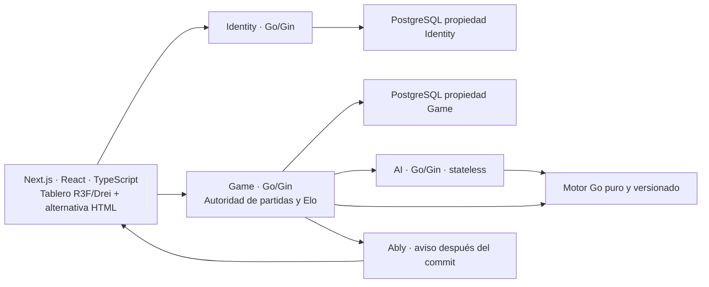

# Toguz Kumalak

> **Estado vigente — 2026-10-25: READY_FOR_LOTE_4_DOCUMENTATION.** PR #3 integrado en main mediante c50ba9f; GO_REMOTE experimental cerrado y recursos remotos propios retirados. [Recibo verificado](PLANS.md#lote-3-integrado-verificado) prevalece sobre los cortes históricos siguientes. El lote 4 aún no se ha generado; el producto no está implementado.

> Aprobación posterior del lote 2: el propietario declaró «APRUEBO LOTE 2» y autorizó fusionar PR #2 en main. Contenido aprobado: HEAD 598ac9a4fc6ce14cf512785fb1c4160fafb4eb9e; integrado por squash 1f401af8d76794981bbcfdf9a3aa1831cf2621f5 (2026-10-21T21:10:14Z). Este registro sustituye las menciones históricas a revisión pendiente o prohibición de esa fusión. No autoriza lote 3 ni implementación; el producto sigue sin verificar.

> Aprobación posterior: el propietario declaró «APRUEBO LOTE 1» el 2026-10-21 para el contenido revisado en HEAD e38cc84950858e072c1a3f06ffbf854cf7e544f5. PR #1 integrado por squash en main: 329b7c1059e8a74f191c256870734e8ae8259966. Este registro prevalece sobre menciones históricas de revisión pendiente; no acredita producto probado. Los permisos actuales se consultan en AGENTS y PLANS.

ID: README · Versión: 0.4 · Fecha: 2026-10-25 · Estado documental: APROBADO · Owner: C.

**Estado actual: lotes 1, 2 y 3 aprobados documentalmente e integrados en main. Lote 4 documental preparado, todavía no iniciado.** El spike remoto tiene evidencia publicada y sus recursos fueron retirados. No hay aplicación jugable ni pruebas de producto acreditadas.

Repositorio público de portafolio `SebasChaconDev/toguz-kumalak`: `main` contiene los 52 Markdown de los lotes 1 a 3 y `.gitignore`. El [PR #1](https://github.com/SebasChaconDev/toguz-kumalak/pull/1) fue integrado por squash 329b7c1059e8a74f191c256870734e8ae8259966 tras aprobación humana y verificación del HEAD autorizado. Las diez specs del lote 2 fueron aprobadas e integradas mediante [PR #2](https://github.com/SebasChaconDev/toguz-kumalak/pull/2), squash `1f401af8d76794981bbcfdf9a3aa1831cf2621f5`. El [PR #3](https://github.com/SebasChaconDev/toguz-kumalak/pull/3) se integró mediante squash c50ba9f58edd386100364cb396bf69f15d2d3a20. La aprobación documental no acredita implementación.

## Producto previsto

Plataforma web del juego tradicional de 18 pozos y 162 piedras, con partidas locales de dos personas, salas privadas online, IA básica, práctica reversible, tutorial, historiales, perfiles, clasificación Elo y estadísticas avanzadas. Español e inglés forman parte del MVP. El lanzamiento comprometido conserva MVP base y ampliado; la secuencia de entregas no elimina capacidades aprobadas.

El propietario adoptó TK-N1-1.0.0, con N1 como fuente normativa contractual única y convenciones digitales expresas; sin certificación federativa atribuida al producto. [GOALS](GOALS.md) recoge alcance y límites; el [registro de246 decisiones](docs/decision-register.md) conserva la voluntad aprobada del propietario.

## Arquitectura prevista

Las flechas muestran responsabilidades previstas, no conexiones existentes. Identity gestiona cuentas/sesiones; Game valida identidad y recurso, aplica el motor y confirma PostgreSQL; AI propone jugadas que Game revalida. Los avisos Ably no sustituyen el estado recuperable por REST. No hay SQL cruzado entre servicios.

Se prevén cuatro proyectos Vercel Hobby, Neon PostgreSQL, OpenAPI 3.1, sqlc/pgx/v5/Goose y módulos Go independientes. El coste objetivo es 0 USD/mes. El empaquetado del motor compartido, runtime Go beta, cuotas e integración permanecen POR_VERIFICAR.

## Experiencia y desafíos de ingeniería

- Tablero físico premium propio, cámara controlada, materiales PBR y animación desde eventos semánticos del motor.
- Interfaz React/HTML accesible, móvil y jugable cuando WebGL falla; sin segundo motor de reglas en JavaScript.
- Concurrencia, idempotencia, recuperación 24 h y notificaciones perdidas sin perder autoridad PostgreSQL.
- Identidad invitada recuperable, OIDC/PKCE, JWKS y separación entre credenciales de usuario, servicio y canales.
- Resultados, Elo y agregados atómicos en Game; práctica, invitados e IA sin efectos competitivos.
- IA limitada por tiempo/nodos/memoria, legalidad y cancelación, con fallback verificado por Game.

## Documentación y revisión

| Entrada | Contenido |
|---|---|
| [Índice e inventario](docs/index.md) | 81 rutas de inventario, 41 Markdown entregados y aprobados; 40 rutas futuras |
| [Registro](docs/decision-register.md) | 246 decisiones literales y sustituciones |
| [Trazabilidad](docs/traceability.md) | Decisión→spec→fase→componente→prueba→evidencia |
| [Conflictos](docs/conflicts.md) | Estado de riesgos técnicos, adendas y cierre normativo TK-N1-1.0.0 |
| [Plan y reporte del lote](PLANS.md) | Alcance, verificaciones, autorizaciones y próximos gates |
| [Norma documental](docs/specs/11-orchestration/11.01-document-standard-and-change-control.md) | Plantilla, aceptación y gestión de cambios |
| [Orquestación](docs/specs/11-orchestration/11.02-ownership-delegation-and-context.md) | Propietarios, briefs y revisión |
| [AGENTS](AGENTS.md) / [PROMPTS](PROMPTS.md) | Límites operativos y trabajo futuro autorizable |

## Calidad prevista y evidencia actual

Se planifican TDD de motor/transacciones/autorización, fuzzing y race en Go, PostgreSQL real efímero en CI, contratos, Playwright, pruebas visuales y objetivo WCAG 2.2 AA. No se han ejecutado estos controles de producto. Los objetivos de FPS 60/30, cobertura 90/80 y métricas de IA/latencia no son resultados medidos.

Solo se realizan comprobaciones de documentación; su evidencia y límites constan en el reporte del lote. No se publica un estado de CI, benchmark, despliegue o demo que no exista.

## Uso, publicación y licencia

No hay instrucciones ejecutables de arranque: todavía no existen código ni dependencias instalables del proyecto. Los pasos de implementación se documentarán en sus lotes y se ejecutarán únicamente bajo autorización independiente.

La demo de portafolio está prevista, sin URL ni fecha acreditada. La licencia no ha sido elegida; el objetivo de repositorio público no sustituye esa decisión. Los recursos visuales y sonoros serán originales o autorizados, con procedencia documentada. RDomino es una referencia de experiencia, sin permiso de copia.

**Gates de lotes 1 y 2 satisfechos por aprobación humana.** No hay autorización de lote 3 ni implementación. Trabajo detenido tras verificar la integración y publicar los estados.
