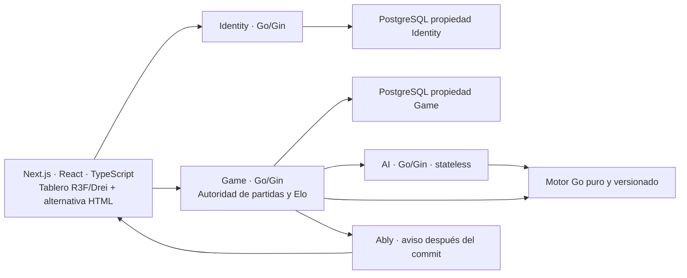

# Toguz Kumalak

ID: README · Versión: 0.1 · Fecha: 2026-10-21 · Estado documental: EN_REVISIÓN · Owner: C.

**Estado actual: arquitectura documental en curso. Implementación no iniciada.** El lote 1 contiene bases, decisiones, ADR y normas de trabajo pendientes de revisión humana. No hay aplicación jugable, demo desplegada, pruebas de producto o proveedores conectados acreditados.

Publicación documental autorizada: repositorio público de portafolio `SebasChaconDev/toguz-kumalak`. La base `main` contiene 29 Markdown y `.gitignore`; las dos especificaciones existentes, 11.01 y 11.02, se presentan en `docs/specs-lote-01` mediante un PR sin fusionar. Los enlaces a esas specs desde la base apuntan a la rama de revisión; en la rama del PR se conservan relativos. Publicar no equivale a aprobar el lote ni a implementar el producto.

## Producto previsto

Plataforma web del juego tradicional de 18 pozos y 162 piedras, con partidas locales de dos personas, salas privadas online, IA básica, práctica reversible, tutorial, historiales, perfiles, clasificación Elo y estadísticas avanzadas. Español e inglés forman parte del MVP. El lanzamiento comprometido conserva MVP base y ampliado; la secuencia de entregas no elimina capacidades aprobadas.

El reglamento deberá cotejarse con una fuente normativa identificada. [GOALS](GOALS.md) recoge alcance y límites; el [registro de246 decisiones](docs/decision-register.md) conserva la voluntad aprobada del propietario.

## Arquitectura prevista

Las flechas muestran responsabilidades previstas, no conexiones existentes. Identity gestiona cuentas/sesiones; Game valida identidad y recurso, aplica el motor y confirma PostgreSQL; AI propone jugadas que Game revalida. Los avisos Ably no sustituyen el estado recuperable por REST. No hay SQL cruzado entre servicios.

Se prevén cuatro proyectos Vercel Hobby, Neon PostgreSQL, OpenAPI 3.1, sqlc/pgx/v5/Goose y módulos Go independientes. El coste objetivo es 0 USD/mes. El empaquetado del motor compartido, runtime Go beta, cuotas e integración permanecen POR_VERIFICAR.

## Experiencia y desafíos de ingeniería

- Tablero físico premium propio, cámara controlada, materiales PBR y animación desde eventos semánticos del motor.
- Interfaz React/HTML accesible, móvil y jugable cuando WebGL falla; sin segundo motor de reglas en JavaScript.
- Concurrencia, idempotencia, recuperación 24 h y notificaciones perdidas sin perder autoridad PostgreSQL.
- Identidad invitada recuperable, OIDC/PKCE, JWKS y separación entre credenciales de usuario, servicio y canales.
- Resultados, Elo y agregados atómicos en Game; práctica, invitados e IA sin efectos competitivos.
- IA limitada por tiempo/nodos/memoria, legalidad y cancelación, con fallback verificado por Game.

## Documentación y revisión

| Entrada | Contenido |
|---|---|
| [Índice e inventario](docs/index.md) | 81 rutas aprobadas, lotes y dependencias; solo 31 se generan en lote 1 |
| [Registro](docs/decision-register.md) | 246 decisiones literales y sustituciones |
| [Trazabilidad](docs/traceability.md) | Decisión→spec→fase→componente→prueba→evidencia |
| [Conflictos](docs/conflicts.md) |14 riesgos abiertos y 3 matices textuales |
| [Plan y reporte del lote](PLANS.md) | Alcance, verificaciones, autorizaciones y próximos gates |
| [Norma documental](https://github.com/SebasChaconDev/toguz-kumalak/blob/docs/specs-lote-01/docs/specs/11-orchestration/11.01-document-standard-and-change-control.md) | Plantilla, aceptación y gestión de cambios |
| [Orquestación](https://github.com/SebasChaconDev/toguz-kumalak/blob/docs/specs-lote-01/docs/specs/11-orchestration/11.02-ownership-delegation-and-context.md) | Propietarios, briefs y revisión |
| [AGENTS](AGENTS.md) / [PROMPTS](PROMPTS.md) | Límites operativos y trabajo futuro autorizable |

## Calidad prevista y evidencia actual

Se planifican TDD de motor/transacciones/autorización, fuzzing y race en Go, PostgreSQL real efímero en CI, contratos, Playwright, pruebas visuales y objetivo WCAG 2.2 AA. No se han ejecutado estos controles de producto. Los objetivos de FPS 60/30, cobertura 90/80 y métricas de IA/latencia no son resultados medidos.

Solo se realizan comprobaciones de documentación; su evidencia y límites constan en el reporte del lote. No se publica un estado de CI, benchmark, despliegue o demo que no exista.

## Uso, publicación y licencia

No hay instrucciones ejecutables de arranque: todavía no existen código ni dependencias instalables del proyecto. Los pasos de implementación se documentarán en sus lotes y se ejecutarán únicamente bajo autorización independiente.

La demo de portafolio está prevista, sin URL ni fecha acreditada. La licencia no ha sido elegida; el objetivo de repositorio público no sustituye esa decisión. Los recursos visuales y sonoros serán originales o autorizados, con procedencia documentada. RDomino es una referencia de experiencia, sin permiso de copia.

**Gate vigente: revisión del lote 1.** Su generación no autoriza lote 2 ni implementación.
