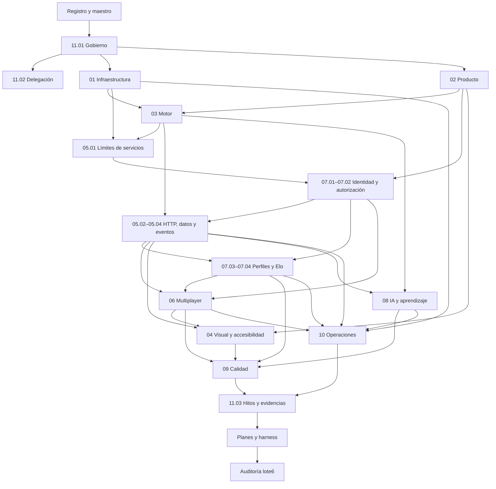

# IDX — Índice e inventario documental

> **Estado vigente — 2026-10-26: LOTE_5_APROBADO_DOCUMENTALMENTE.** PR #5 integrado en main por 6579ca930a9081f773b390ce61f6bc80cc6b1ae7, desde HEAD aprobado 9ff1a2857d0b91b9cf7925a4c36de30e377cef3d. [Recibo de aprobación e integración](../PLANS.md#cierre-lote-5) prevalece sobre cortes históricos: veinte documentos del lote5 aprobados y246decisiones con especificación redactada y aprobada documentalmente. L4-P01, retención y demás propuestas siguen pendientes de aprobación específica. Detenerse: sin producto, workflows, proveedores/despliegues o lote6.

> **Estado vigente — 2026-10-26: LOTE_5_EN_REVISIÓN.** Veinte documentos del lote5 autorizados para redacción/revisión y PR sin fusión; [alcance vigente](../PLANS.md#ejecucion-lote-5) prevalece sobre cortes históricos. Lotes1–4 APROBADOS/integrados;180decisiones con spec aprobada y66 con spec EN_REVISIÓN. L4-P01 sigue PROPUESTA pendiente de aprobación de contratos; sin implementación, recursos/despliegues o lote6.

> **Estado vigente — 2026-10-26: LOTE_4_APROBADO_DOCUMENTALMENTE.** PR #4 integrado en main por `d5dccfbe0a55c78ddc7c2c0396ead9fd2bfad910`, desde el HEAD aprobado `3ef3f7cbfd3bfc4aea837d9f1b0b414be064e8ee`. [Recibo de aprobación e integración](../PLANS.md#cierre-lote-4) prevalece sobre los cortes históricos. L4-P01 sigue PROPUESTA pendiente de aprobación de contratos antes de implementación. Detenerse: no producto, despliegues o lote 5.

> **Estado vigente — 2026-10-26: LOTE_4_EN_REVISIÓN.** Generación y publicación documental de ocho specs autorizadas en `docs/specs-lote-04`, para revisión y PR contra main sin fusionar. [Plan y alcance](../PLANS.md#ejecucion-lote-4) prevalecen sobre los cortes históricos siguientes. Los lotes 1–3 están integrados; no se autoriza producto, infraestructura o lote 5.

> **Estado vigente — 2026-10-25: READY_FOR_LOTE_4_DOCUMENTATION.** PR #3 integrado en main mediante c50ba9f; GO_REMOTE experimental cerrado y recursos remotos propios retirados. [Recibo verificado](../PLANS.md#lote-3-integrado-verificado) prevalece sobre los cortes históricos siguientes. El lote 4 aún no se ha generado; el producto no está implementado.

> Corte histórico de autorización del lote 3, superado por su integración y por el permiso posterior del lote 4: once specs inicialmente EN_REVISIÓN y PR sin fusión. Consultar el encabezado y PLANS para el alcance vigente.

> Aprobación posterior del lote 2: el propietario declaró «APRUEBO LOTE 2» y autorizó fusionar PR #2 en main. Contenido aprobado: HEAD 598ac9a4fc6ce14cf512785fb1c4160fafb4eb9e; integrado por squash 1f401af8d76794981bbcfdf9a3aa1831cf2621f5 (2026-10-21T21:10:14Z). Este registro sustituye las menciones históricas a revisión pendiente o prohibición de esa fusión. No autoriza lote 3 ni implementación; el producto sigue sin verificar.

> Aprobación posterior: el propietario declaró «APRUEBO LOTE 1» el 2026-10-21 para el contenido revisado en HEAD e38cc84950858e072c1a3f06ffbf854cf7e544f5. PR #1 integrado por squash en main: 329b7c1059e8a74f191c256870734e8ae8259966. Este registro prevalece sobre menciones históricas de revisión pendiente; no acredita producto probado. Los permisos actuales se consultan en AGENTS y PLANS.

ID: IDX · Versión: 0.10 · Fecha: 2026-10-26 · Estado documental: APROBADO · Owner: C.

## Estado de la entrega

El inventario aprobado conserva **81 archivos Markdown:40 especificaciones y41 documentos de soporte**. Lotes1–5 APROBADOS documentalmente e integrados en main:80Markdown y .gitignore,40specs aprobadas y246decisiones con spec redactada/aprobada; cero en revisión o sin redactar. Los ochoPH y tresharness del lote5 también están APROBADOS documentalmente. Solo AUD-01 del lote6 continúa como ruta futura, sin autorización para generarlo. La aprobación no aprueba contratos L4-P01, retención u otras propuestas específicas ni acredita implementación. Las246 PRE y AD-NORM-001 permanecen intactas.

Inicio recomendado: [README](../README.md), [objetivos](../GOALS.md), [plan y reporte](../PLANS.md), [registro](decision-register.md), [trazabilidad](traceability.md), [conflictos](conflicts.md), [norma 11.01](specs/11-orchestration/11.01-document-standard-and-change-control.md) y [orquestación 11.02](specs/11-orchestration/11.02-ownership-delegation-and-context.md).

## Convenciones

Distribución vigente: `main` contiene los lotes1–4; PR #4 MERGED mediante squash `d5dccfbe0a55c78ddc7c2c0396ead9fd2bfad910`. [Cierre del lote4](../PLANS.md#cierre-lote-4): aprobación documental y parada, sin producto, despliegues o lote5. Los registros siguientes conservan los cortes históricos.

B/M/A: complejidad relativa baja/media/alta, sin fechas prometidas. Owners funcionales C coordinación/producto; A arquitectura/operación; M motor; S servicios/identidad/multiplayer; V UX/3D; I IA/aprendizaje; Q calidad. El autor efectivo y las revisiones de esta entrega constan en PLANS.

Los vínculos de lotes1–4 apuntan a archivos entregados al cierre respectivo. Las rutas futuras se muestran como texto y se enlazan mediante el anchor de esta entrada, nunca mediante un vínculo que aparente un archivo existente. Estado futuro `PENDIENTE_LOTE_N` no equivale a deferimiento aprobado de la funcionalidad.

## Inventario autorizado

### Lote 1 — 31 archivos

| ID | Archivo o ruta prevista | Propósito / entradas y dependencias | Owner | Complejidad | Estado |
|---|---|---|---|---|---|
| AGENTS | [AGENTS.md](../AGENTS.md) | Instrucciones operativas y límites | C | M | APROBADO |
| GOALS | [GOALS.md](../GOALS.md) | Objetivos y alcance comprometido | C | M | APROBADO |
| PLANS | [PLANS.md](../PLANS.md) | Gates, lotes y roadmap documental | C | M | APROBADO |
| PROMPTS | [PROMPTS.md](../PROMPTS.md) | Briefs y prompts de trabajo autorizable | C | M | APROBADO |
| README | [README.md](../README.md) | Presentación y estado profesional | C | M | APROBADO |
| SRC | [docs/sources/TOGUZ_PROMPT_MAESTRO_CODEX.md](sources/TOGUZ_PROMPT_MAESTRO_CODEX.md) | Copia íntegra y sin cambios del maestro | C | B | APROBADO |
| REG | [docs/decision-register.md](decision-register.md) | 246 decisiones literales y destinos canónicos | C | M | APROBADO |
| CONF | [docs/conflicts.md](conflicts.md) | Riesgos, discrepancias y validaciones pendientes | C | M | APROBADO |
| IDX | [docs/index.md](index.md) | Inventario y dependencias | C | B | APROBADO |
| TRZ | [docs/traceability.md](traceability.md) | Decisión→spec→fase→componente→verificación→evidencia | C | M | APROBADO |
| PRE-01 | [docs/preliminares/PRE-01.md](preliminares/PRE-01.md) | Contexto de 17 decisiones de REG; sin reconstruir cuestionarios. | A | M | APROBADO |
| PRE-02 | [docs/preliminares/PRE-02.md](preliminares/PRE-02.md) | Contexto de 18 decisiones de REG; sin reconstruir cuestionarios. | C | M | APROBADO |
| PRE-03 | [docs/preliminares/PRE-03.md](preliminares/PRE-03.md) | Contexto de 22 decisiones de REG; sin reconstruir cuestionarios. | M | M | APROBADO |
| PRE-04 | [docs/preliminares/PRE-04.md](preliminares/PRE-04.md) | Contexto de 25 decisiones de REG; sin reconstruir cuestionarios. | V | M | APROBADO |
| PRE-05 | [docs/preliminares/PRE-05.md](preliminares/PRE-05.md) | Contexto de 24 decisiones de REG; sin reconstruir cuestionarios. | S | M | APROBADO |
| PRE-06 | [docs/preliminares/PRE-06.md](preliminares/PRE-06.md) | Contexto de 20 decisiones de REG; sin reconstruir cuestionarios. | S | M | APROBADO |
| PRE-07 | [docs/preliminares/PRE-07.md](preliminares/PRE-07.md) | Contexto de 24 decisiones de REG; sin reconstruir cuestionarios. | S | M | APROBADO |
| PRE-08 | [docs/preliminares/PRE-08.md](preliminares/PRE-08.md) | Contexto de 24 decisiones de REG; sin reconstruir cuestionarios. | I | M | APROBADO |
| PRE-09 | [docs/preliminares/PRE-09.md](preliminares/PRE-09.md) | Contexto de 24 decisiones de REG; sin reconstruir cuestionarios. | Q | M | APROBADO |
| PRE-10 | [docs/preliminares/PRE-10.md](preliminares/PRE-10.md) | Contexto de 24 decisiones de REG; sin reconstruir cuestionarios. | A | M | APROBADO |
| PRE-11 | [docs/preliminares/PRE-11.md](preliminares/PRE-11.md) | Contexto de 24 decisiones de REG; sin reconstruir cuestionarios. | C | M | APROBADO |
| ADR-0001 | [docs/adr/ADR-0001-three-go-services-and-data-ownership.md](adr/ADR-0001-three-go-services-and-data-ownership.md) | Decisión arquitectónica existente; REG y PRE pertinentes; alternativas y validación futura. | A | M | APROBADO |
| ADR-0002 | [docs/adr/ADR-0002-single-versioned-go-engine.md](adr/ADR-0002-single-versioned-go-engine.md) | Decisión arquitectónica existente; REG y PRE pertinentes; alternativas y validación futura. | M | M | APROBADO |
| ADR-0003 | [docs/adr/ADR-0003-rest-contracts-and-versioned-events.md](adr/ADR-0003-rest-contracts-and-versioned-events.md) | Decisión arquitectónica existente; REG y PRE pertinentes; alternativas y validación futura. | S | M | APROBADO |
| ADR-0004 | [docs/adr/ADR-0004-postgres-authority-and-postcommit-ably.md](adr/ADR-0004-postgres-authority-and-postcommit-ably.md) | Decisión arquitectónica existente; REG y PRE pertinentes; alternativas y validación futura. | S | M | APROBADO |
| ADR-0005 | [docs/adr/ADR-0005-session-and-service-trust-boundaries.md](adr/ADR-0005-session-and-service-trust-boundaries.md) | Decisión arquitectónica existente; REG y PRE pertinentes; alternativas y validación futura. | S | M | APROBADO |
| ADR-0006 | [docs/adr/ADR-0006-vercel-hobby-and-zero-cost-guardrails.md](adr/ADR-0006-vercel-hobby-and-zero-cost-guardrails.md) | Decisión arquitectónica existente; REG y PRE pertinentes; alternativas y validación futura. | A | M | APROBADO |
| ADR-0007 | [docs/adr/ADR-0007-3d-and-accessible-html-view.md](adr/ADR-0007-3d-and-accessible-html-view.md) | Decisión arquitectónica existente; REG y PRE pertinentes; alternativas y validación futura. | V | M | APROBADO |
| ADR-0008 | [docs/adr/ADR-0008-ranked-results-and-elo-ownership.md](adr/ADR-0008-ranked-results-and-elo-ownership.md) | Decisión arquitectónica existente; REG y PRE pertinentes; alternativas y validación futura. | S | M | APROBADO |
| 11.01 | [docs/specs/11-orchestration/11.01-document-standard-and-change-control.md](specs/11-orchestration/11.01-document-standard-and-change-control.md) | Norma documental y control de cambios; entradas PRE-11.A1, PRE-11.A2, PRE-11.A3, PRE-11.A4, PRE-11.B1, PRE-11.B2, PRE-11.B3, PRE-11.B4, PRE-11.D4, PRE-11.E1, PRE-11.E4, PRE-11.F1, PRE-11.F3. Dependencias: REG y maestro. | C | A | APROBADO |
| 11.02 | [docs/specs/11-orchestration/11.02-ownership-delegation-and-context.md](specs/11-orchestration/11.02-ownership-delegation-and-context.md) | Propiedad, delegación y contexto; entradas PRE-11.C1, PRE-11.C2, PRE-11.C3, PRE-11.C4. Dependencias: [11.01](#spec-11-01). | C | M | APROBADO |

### Lote 2 — 10 archivos

| ID | Archivo o ruta prevista | Propósito / entradas y dependencias | Owner | Complejidad | Estado |
|---|---|---|---|---|---|
| 01.01 | [docs/specs/01-infrastructure/01.01-stack-monorepo.md](specs/01-infrastructure/01.01-stack-monorepo.md) | Stack, monorepo y desarrollo local; entradas PRE-01.A1, PRE-01.A2, PRE-01.A3, PRE-01.A4, PRE-01.C3. Dependencias: REG y maestro. | A | A | APROBADO |
| 01.02 | [docs/specs/01-infrastructure/01.02-platform-feasibility.md](specs/01-infrastructure/01.02-platform-feasibility.md) | Factibilidad de plataforma y entornos; entradas PRE-01.B2, PRE-01.C1, PRE-01.C4, PRE-05.F4. Dependencias: [01.01](#spec-01-01). | A | A | APROBADO |
| 01.03 | [docs/specs/01-infrastructure/01.03-cost-capacity-evolution.md](specs/01-infrastructure/01.03-cost-capacity-evolution.md) | Coste, capacidad y evolución; entradas PRE-01.C2, PRE-01.D3. Dependencias: [01.02](#spec-01-02). | A | A | APROBADO |
| 02.01 | [docs/specs/02-product/02.01-scope-and-modes.md](specs/02-product/02.01-scope-and-modes.md) | Alcance, modos y MVP; entradas PRE-02.A1, PRE-02.A2, PRE-02.A3, PRE-02.A4, PRE-02.E3. Dependencias: REG y maestro. | C | M | APROBADO |
| 02.02 | [docs/specs/02-product/02.02-local-flows-and-i18n.md](specs/02-product/02.02-local-flows-and-i18n.md) | Flujos locales e internacionalización; entradas PRE-02.B3, PRE-02.D3, PRE-05.C4. Dependencias: [02.01](#spec-02-01). | C | M | APROBADO |
| 02.03 | [docs/specs/02-product/02.03-accounts-history-and-licensing.md](specs/02-product/02.03-accounts-history-and-licensing.md) | Cuentas, historial y licencia; entradas PRE-01.D4, PRE-02.B1, PRE-02.B2, PRE-02.D2. Dependencias: [02.01](#spec-02-01). | C | M | APROBADO |
| 03.01 | [docs/specs/03-game-engine/03.01-normative-rules-and-corpus.md](specs/03-game-engine/03.01-normative-rules-and-corpus.md) | Reglamento normativo y corpus; entradas PRE-03.A3, PRE-03.C1, PRE-03.E1. Dependencias: [02.01](#spec-02-01). | M | A | APROBADO |
| 03.02 | [docs/specs/03-game-engine/03.02-state-indices-and-invariants.md](specs/03-game-engine/03.02-state-indices-and-invariants.md) | Estado, índices e invariantes; entradas PRE-03.A4, PRE-03.B1, PRE-03.B4, PRE-03.E2. Dependencias: [01.01](#spec-01-01), [03.01](#spec-03-01). | M | A | APROBADO |
| 03.03 | [docs/specs/03-game-engine/03.03-moves-and-semantic-events.md](specs/03-game-engine/03.03-moves-and-semantic-events.md) | Movimientos y eventos semánticos; entradas PRE-02.C1, PRE-03.B2, PRE-03.B3, PRE-03.B5, PRE-03.C2, PRE-03.C3. Dependencias: [03.02](#spec-03-02). | M | A | APROBADO |
| 03.04 | [docs/specs/03-game-engine/03.04-outcomes-repetition-and-replay.md](specs/03-game-engine/03.04-outcomes-repetition-and-replay.md) | Resultados, repetición y reproducción; entradas PRE-02.C4, PRE-02.D1, PRE-03.A1, PRE-03.A2, PRE-03.C4, PRE-03.E3. Dependencias: [03.03](#spec-03-03). | M | A | APROBADO |

### Lote 3 — 11 archivos

| ID | Archivo o ruta prevista | Propósito / entradas y dependencias | Owner | Complejidad | Estado |
|---|---|---|---|---|---|
| 05.01 | [docs/specs/05-backend/05.01-service-boundaries-and-hexagonal-design.md](specs/05-backend/05.01-service-boundaries-and-hexagonal-design.md) | Límites de servicios y diseño hexagonal; entradas PRE-05.A1, PRE-05.A2, PRE-05.A3, PRE-05.A4, PRE-05.D1. Dependencias: [01.02](#spec-01-02), [03.04](#spec-03-04). | S | A | APROBADO |
| 05.02 | [docs/specs/05-backend/05.02-http-openapi-and-errors.md](specs/05-backend/05.02-http-openapi-and-errors.md) | HTTP, OpenAPI y errores; entradas PRE-05.B1, PRE-05.B2, PRE-05.B3, PRE-05.B4. Dependencias: [05.01](#spec-05-01), [07.01](#spec-07-01), [07.02](#spec-07-02). | S | A | APROBADO |
| 05.03 | [docs/specs/05-backend/05.03-transactions-data-and-migrations.md](specs/05-backend/05.03-transactions-data-and-migrations.md) | Transacciones, datos y migraciones; entradas PRE-01.B3, PRE-01.B4, PRE-05.C1, PRE-05.C2, PRE-05.C3, PRE-05.D2, PRE-05.D3, PRE-05.D4. Dependencias: [05.02](#spec-05-02), [03.04](#spec-03-04). | S | A | APROBADO |
| 05.04 | [docs/specs/05-backend/05.04-event-schemas-and-postcommit-publication.md](specs/05-backend/05.04-event-schemas-and-postcommit-publication.md) | Eventos y publicación posterior al commit; entradas PRE-05.E1, PRE-05.E2, PRE-05.E3, PRE-05.E4. Dependencias: [05.03](#spec-05-03), [07.02](#spec-07-02). | S | A | APROBADO |
| 06.01 | [docs/specs/06-multiplayer/06.01-rooms-invitations-and-ranked-lifecycle.md](specs/06-multiplayer/06.01-rooms-invitations-and-ranked-lifecycle.md) | Salas, invitaciones y ciclo ranked; entradas PRE-06.A1, PRE-06.A2, PRE-06.A3, PRE-06.A4, PRE-06.D1, PRE-06.D4. Dependencias: [05.04](#spec-05-04), [07.04](#spec-07-04). | S | A | APROBADO |
| 06.02 | [docs/specs/06-multiplayer/06.02-ably-notifications-and-reconciliation.md](specs/06-multiplayer/06.02-ably-notifications-and-reconciliation.md) | Ably y reconciliación; entradas PRE-01.B1, PRE-06.B1, PRE-06.B2, PRE-06.B3, PRE-06.B4, PRE-06.E1. Dependencias: [06.01](#spec-06-01), [05.04](#spec-05-04). | S | A | APROBADO |
| 06.03 | [docs/specs/06-multiplayer/06.03-recovery-multitab-and-partial-failures.md](specs/06-multiplayer/06.03-recovery-multitab-and-partial-failures.md) | Recuperación, pestañas y fallos parciales; entradas PRE-02.C3, PRE-06.C1, PRE-06.C2, PRE-06.C3, PRE-06.C4, PRE-06.E2. Dependencias: [06.02](#spec-06-02), [07.01](#spec-07-01), [07.02](#spec-07-02). | S | A | APROBADO |
| 07.01 | [docs/specs/07-identity-data/07.01-oidc-guests-and-session-lifecycle.md](specs/07-identity-data/07.01-oidc-guests-and-session-lifecycle.md) | OIDC, invitados y ciclo de sesión; entradas PRE-01.B5, PRE-07.A1, PRE-07.A2, PRE-07.A3, PRE-07.A4, PRE-07.B2, PRE-07.B3, PRE-07.F1. Dependencias: [05.01](#spec-05-01), [02.03](#spec-02-03). | S | A | APROBADO |
| 07.02 | [docs/specs/07-identity-data/07.02-tokens-authorization-and-service-identity.md](specs/07-identity-data/07.02-tokens-authorization-and-service-identity.md) | Tokens, autorización e identidad de servicio; entradas PRE-05.F3, PRE-07.B1, PRE-07.B4, PRE-07.C1, PRE-07.C2, PRE-07.C3. Dependencias: [07.01](#spec-07-01). | S | A | APROBADO |
| 07.03 | [docs/specs/07-identity-data/07.03-profiles-history-and-data-rights.md](specs/07-identity-data/07.03-profiles-history-and-data-rights.md) | Perfiles, historial y derechos de datos; entradas PRE-07.C4, PRE-07.D1, PRE-07.D2, PRE-07.D3, PRE-07.D4, PRE-07.F2, PRE-07.F3. Dependencias: [05.04](#spec-05-04), [07.02](#spec-07-02). | S | A | APROBADO |
| 07.04 | [docs/specs/07-identity-data/07.04-elo-leaderboard-and-statistics.md](specs/07-identity-data/07.04-elo-leaderboard-and-statistics.md) | Elo, clasificación y estadísticas; entradas PRE-06.D2, PRE-06.D3, PRE-07.E1, PRE-07.E2, PRE-07.E3, PRE-07.E4. Dependencias: [05.03](#spec-05-03), [03.04](#spec-03-04), [07.02](#spec-07-02). | S | A | APROBADO |

### Lote 4 — 8 archivos

| ID | Archivo o ruta prevista | Propósito / entradas y dependencias | Owner | Complejidad | Estado |
|---|---|---|---|---|---|
| 04.01 | [specs/04-visual-experience/04.01-navigation-and-accessibility.md](specs/04-visual-experience/04.01-navigation-and-accessibility.md) | Navegación y accesibilidad; entradas PRE-04.A4, PRE-04.D1, PRE-04.D2, PRE-04.D3, PRE-04.D4. Dependencias: [02.02](#spec-02-02), [02.03](#spec-02-03), [03.03](#spec-03-03), [05.02](#spec-05-02), [06.01](#spec-06-01), [06.03](#spec-06-03). | V | A | APROBADO |
| 04.02 | [specs/04-visual-experience/04.02-board-assets-camera-and-materials.md](specs/04-visual-experience/04.02-board-assets-camera-and-materials.md) | Tablero, assets, cámara y materiales; entradas PRE-02.E1, PRE-02.E2, PRE-04.A1, PRE-04.A2, PRE-04.A3, PRE-04.B1, PRE-04.B2, PRE-04.B3, PRE-04.B4, PRE-04.B5, PRE-04.F2, PRE-04.F3. Dependencias: [04.01](#spec-04-01), [03.02](#spec-03-02). | V | A | APROBADO |
| 04.03 | [specs/04-visual-experience/04.03-interaction-animation-and-audio.md](specs/04-visual-experience/04.03-interaction-animation-and-audio.md) | Interacción, animación y audio; entradas PRE-04.C1, PRE-04.C2, PRE-04.C3, PRE-04.C4. Dependencias: [04.01](#spec-04-01), [03.03](#spec-03-03), [06.02](#spec-06-02). | V | A | APROBADO |
| 04.04 | [specs/04-visual-experience/04.04-performance-and-html-fallback.md](specs/04-visual-experience/04.04-performance-and-html-fallback.md) | Rendimiento y alternativa HTML; entradas PRE-04.E1, PRE-04.E2, PRE-04.E3, PRE-04.E4. Dependencias: [04.02](#spec-04-02), [04.03](#spec-04-03). | V | A | APROBADO |
| 08.01 | [specs/08-ai-practice/08.01-search-heuristics-and-compute-limits.md](specs/08-ai-practice/08.01-search-heuristics-and-compute-limits.md) | Búsqueda, heurística y límites IA; entradas PRE-03.D3, PRE-03.D4, PRE-03.D5, PRE-08.A2, PRE-08.A4, PRE-08.B1, PRE-08.B2, PRE-08.B3, PRE-08.B4. Dependencias: [03.04](#spec-03-04), [01.02](#spec-01-02). | I | A | APROBADO |
| 08.02 | [specs/08-ai-practice/08.02-ai-orchestration-fallback-and-metrics.md](specs/08-ai-practice/08.02-ai-orchestration-fallback-and-metrics.md) | Orquestación IA, respaldo y métricas; entradas PRE-08.A1, PRE-08.A3, PRE-08.F3, PRE-08.F4. Dependencias: [08.01](#spec-08-01), [05.02](#spec-05-02), [05.03](#spec-05-03), [07.02](#spec-07-02). | I | A | APROBADO |
| 08.03 | [specs/08-ai-practice/08.03-reversible-practice-and-scenarios.md](specs/08-ai-practice/08.03-reversible-practice-and-scenarios.md) | Práctica reversible y escenarios; entradas PRE-02.C2, PRE-03.D1, PRE-03.D2, PRE-08.C1, PRE-08.C2, PRE-08.C3, PRE-08.C4, PRE-08.E1. Dependencias: [02.02](#spec-02-02), [03.04](#spec-03-04), [05.02](#spec-05-02). | I | A | APROBADO |
| 08.04 | [specs/08-ai-practice/08.04-tutorial-hints-and-educational-replay.md](specs/08-ai-practice/08.04-tutorial-hints-and-educational-replay.md) | Tutorial, sugerencias y replay educativo; entradas PRE-02.B4, PRE-04.D5, PRE-08.D1, PRE-08.D2, PRE-08.D3, PRE-08.D4, PRE-08.E2, PRE-08.E3, PRE-08.E4. Dependencias: [08.03](#spec-08-03), [03.03](#spec-03-03). | I | A | APROBADO |

### Lote 5 — 20 archivos

| ID | Archivo o ruta prevista | Propósito / entradas y dependencias | Owner | Complejidad | Estado |
|---|---|---|---|---|---|
| 09.01 | [specs/09-quality/09.01-engine-data-contract-and-ai-verification.md](specs/09-quality/09.01-engine-data-contract-and-ai-verification.md) | Verificación de motor, datos, contratos e IA; entradas PRE-05.F2, PRE-07.F4, PRE-08.F1, PRE-08.F2, PRE-09.A1, PRE-09.A2, PRE-09.A3, PRE-09.A4, PRE-09.B1, PRE-09.B2, PRE-09.B3, PRE-09.B4, PRE-09.C1, PRE-09.C2, PRE-09.C3, PRE-09.C4. Dependencias: [05.04](#spec-05-04), [07.04](#spec-07-04), [08.02](#spec-08-02). | Q | A | APROBADO |
| 09.02 | [specs/09-quality/09.02-ui-e2e-accessibility-and-visual-verification.md](specs/09-quality/09.02-ui-e2e-accessibility-and-visual-verification.md) | Verificación UI, E 2 E, accesibilidad y visual; entradas PRE-04.F1, PRE-06.E3, PRE-09.D1, PRE-09.D2, PRE-09.D3, PRE-09.D4. Dependencias: [04.04](#spec-04-04), [06.03](#spec-06-03), [08.04](#spec-08-04). | Q | A | APROBADO |
| 09.03 | [specs/09-quality/09.03-ci-security-and-release-controls.md](specs/09-quality/09.03-ci-security-and-release-controls.md) | CI, seguridad y controles de release; entradas PRE-01.D1, PRE-09.E1, PRE-09.E2, PRE-09.E3, PRE-09.E4, PRE-09.F3. Dependencias: [09.01](#spec-09-01), [09.02](#spec-09-02). | Q | A | APROBADO |
| 09.04 | [specs/09-quality/09.04-acceptance-performance-and-definition-of-done.md](specs/09-quality/09.04-acceptance-performance-and-definition-of-done.md) | Aceptación, rendimiento y DoD; entradas PRE-03.E4, PRE-06.E4, PRE-09.F1, PRE-09.F2, PRE-09.F4. Dependencias: [09.03](#spec-09-03). | Q | A | APROBADO |
| 10.01 | [specs/10-operations/10.01-deployments-origins-regions-and-secrets.md](specs/10-operations/10.01-deployments-origins-regions-and-secrets.md) | Despliegues, origen, regiones y secretos; entradas PRE-10.A1, PRE-10.A2, PRE-10.A3, PRE-10.A4, PRE-10.B1, PRE-10.B2, PRE-10.B3. Dependencias: [01.03](#spec-01-03), [05.04](#spec-05-04), [07.02](#spec-07-02). | A | A | APROBADO |
| 10.02 | [specs/10-operations/10.02-observability-quotas-and-rate-limits.md](specs/10-operations/10.02-observability-quotas-and-rate-limits.md) | Observabilidad, cuotas y límites de tasa; entradas PRE-10.B4, PRE-10.D1, PRE-10.D2, PRE-10.D3, PRE-10.D4, PRE-10.E1, PRE-10.E2, PRE-10.E3, PRE-10.E4, PRE-01.D2, PRE-05.F1. Dependencias: [10.01](#spec-10-01), [06.03](#spec-06-03), [08.02](#spec-08-02). | A | A | APROBADO |
| 10.03 | [specs/10-operations/10.03-backups-restoration-and-retention.md](specs/10-operations/10.03-backups-restoration-and-retention.md) | Backups, restauración y retención; entradas PRE-10.C1, PRE-10.C2, PRE-10.C3, PRE-10.C4, PRE-10.F3. Dependencias: [10.01](#spec-10-01), [05.03](#spec-05-03), [07.03](#spec-07-03). | A | A | APROBADO |
| 10.04 | [specs/10-operations/10.04-releases-incidents-and-portability.md](specs/10-operations/10.04-releases-incidents-and-portability.md) | Releases, incidentes y portabilidad; entradas PRE-10.F1, PRE-10.F2, PRE-10.F4. Dependencias: [10.02](#spec-10-02), [10.03](#spec-10-03). | A | A | APROBADO |
| 11.03 | [specs/11-orchestration/11.03-milestones-gates-and-evidence.md](specs/11-orchestration/11.03-milestones-gates-and-evidence.md) | Hitos, gates y evidencias; entradas PRE-11.D1, PRE-11.D2, PRE-11.D3, PRE-11.E2, PRE-11.E3, PRE-11.F2, PRE-11.F4. Dependencias: [09.04](#spec-09-04), [10.04](#spec-10-04). | C | A | APROBADO |
| PH-00 | [phases/phase-00-feasibility-spike.md](phases/phase-00-feasibility-spike.md) | Plan futuro PH-00; specs y gate de 11.03. | C | M | APROBADO |
| PH-01 | [phases/phase-01-go-engine.md](phases/phase-01-go-engine.md) | Plan futuro PH-01; specs y gate de 11.03. | C | M | APROBADO |
| PH-02 | [phases/phase-02-contracts-persistence-guests.md](phases/phase-02-contracts-persistence-guests.md) | Plan futuro PH-02; specs y gate de 11.03. | C | M | APROBADO |
| PH-03 | [phases/phase-03-accessible-client-and-3d.md](phases/phase-03-accessible-client-and-3d.md) | Plan futuro PH-03; specs y gate de 11.03. | C | M | APROBADO |
| PH-04 | [phases/phase-04-private-multiplayer.md](phases/phase-04-private-multiplayer.md) | Plan futuro PH-04; specs y gate de 11.03. | C | M | APROBADO |
| PH-05 | [phases/phase-05-ai-practice-tutorial.md](phases/phase-05-ai-practice-tutorial.md) | Plan futuro PH-05; specs y gate de 11.03. | C | M | APROBADO |
| PH-06 | [phases/phase-06-accounts-elo-statistics.md](phases/phase-06-accounts-elo-statistics.md) | Plan futuro PH-06; specs y gate de 11.03. | C | M | APROBADO |
| PH-07 | [phases/phase-07-hardening-and-portfolio.md](phases/phase-07-hardening-and-portfolio.md) | Plan futuro PH-07; specs y gate de 11.03. | C | M | APROBADO |
| H-BUILD | [../harness/build/README.md](../harness/build/README.md) | Consumo futuro de planes por agentes | C | M | APROBADO |
| H-CTX | [../harness/context/README.md](../harness/context/README.md) | Paquetes mínimos de contexto | C | M | APROBADO |
| H-LOG | [../harness/build-log.md](../harness/build-log.md) | Registro factual de trabajo documental | C | B | APROBADO |

### Lote 6 — 1 archivos

| ID | Archivo o ruta prevista | Propósito / entradas y dependencias | Owner | Complejidad | Estado |
|---|---|---|---|---|---|
| AUD-01 | `audits/documentation-readiness.md` | Auditoría documental integral | C | M | PENDIENTE_LOTE_6 |

## Dependencias de redacción

Las flechas indican prerrequisito hacia consumidor. Las referencias de consulta pueden mirar a una entrada futura del índice sin ser un requisito de cierre ni crear un ciclo. Las specs iniciales incorporan calidad aprobada PRE-09; el dominio 09 la consolida después.

### Orden de las bases del lote 1

SRC → REG → inventario/trazabilidad inicial → 11.01 → AGENTS y 11.02 → PROMPTS. PRE y ADR consumen decisiones fuente y pueden redactarse en paralelo tras fijar el formato de referencias. Los índices se integran al final; no son una aprobación semántica del contenido que indexan. GOALS y README expresan el alcance del registro; PLANS documenta estados y autorizaciones.

### Secuencias posteriores

- Lote 2: 01.01 → 01.02 → 01.03; 02.01 → 02.02/02.03; 03.01 → 03.02 → 03.03 → 03.04. Arquitectura y producto admiten trabajo paralelo.
- Lote 3: 05.01 → 07.01 → 07.02 → 05.02 → 05.03 → 05.04 → 07.03/07.04 → 06.01 → 06.02 → 06.03.
- Lote 4: V e I trabajan en archivos independientes; revisión conjunta de eventos, práctica y equivalencia HTML/3D.
- Lote 5: Q y A trabajan en paralelo; 11.03, fases y harness se integran tras consolidar calidad y operación.
- Lote 6: auditoría independiente; los cambios semánticos vuelven al propietario.

El lote 2 está autorizado y entregado para revisión. No hay autorización de redacción para lotes 3–6. [PLANS](../PLANS.md) conserva el gate vigente.

## Estado posterior a aprobación del lote 1

Lote 1 APROBADO por el propietario e integrado en main mediante squash 329b7c1059e8a74f191c256870734e8ae8259966. La autorización actual comprende diez specs del lote 2 y registros necesarios, sin ejecución de producto. Las referencias anteriores a distribución 29+2 describen la publicación previa al merge; main contiene ahora los 31 Markdown. Lotes 3–6 siguen pendientes.

## Integración de lote 2 aprobada

Diez specs del lote 2 APROBADAS, con 17 apartados cada una. Cobertura: 59 decisiones con spec APROBADA, cero con spec EN_REVISIÓN y 187 con spec futura. Se conservan los 40 nodos y las dependencias del inventario original, sin ciclos. El [cierre vigente](../PLANS.md#cierre-lote-2) registra aprobación e integración. TK-N1-1.0.0 está completo sin bloqueos normativos pendientes; [RISK-01](conflicts.md#risk-01) conserva su resolución e historia. Gate «APRUEBO LOTE 2» satisfecho; continuidad detenida.

## Adenda de continuidad — 2026-10-25

Lote3 cierra once especificaciones APROBADAS documentalmente según [autorización posterior](../PLANS.md#preparacion-lote-4). Continúan81 entradas/40 specs,23 specs físicas/52 Markdown; ocho rutas de lote4 y55 decisiones están preparadas y siguen PENDIENTE_LOTE_4 porque no se han generado. No se cambia el DAG de40 specs/80 aristas.

La evidencia del spike vive en su commit publicado, fuera del árbol documental que se integra en main. Este índice distingue factibilidad experimental y pruebas de producto pendientes.
