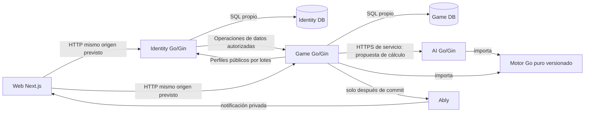

# 05.01 — Límites de servicios y diseño hexagonal

## 1. Identificación y estado

| Campo | Valor |
|---|---|
| ID | `05.01` |
| Dominio | `05 — Backend` |
| Versión | `0.1` |
| Fecha | `2026-10-21` |
| Estado documental | `EN_REVISIÓN` |
| Owner | `S — servicios`; autor backend asignado por coordinación |
| Lote | `3` |
| Naturaleza | Límites de fuente `APROBADO`; puertos, nombres y composición detallados `PROPUESTA`; funcionamiento y factibilidad `POR_VERIFICAR` |
| Perfil consumido | `TK-N1-1.0.0`, adoptado por `AD-NORM-001`; distinto de la revisión del build del motor |

## 2. Objetivo, alcance y valor

Establecer quién decide, quién escribe y cómo se sustituyen los adaptadores dentro de Identity, Game y AI. El desarrollador debe poder ubicar cada caso de uso, reconocer sus dependencias y tratar una caída parcial sin compartir SQL, trasladar reglas al navegador o inventar un cuarto servicio.

Comprende arquitectura hexagonal pragmática, propiedad de datos, puertos internos, contratos semánticos entre servicios y despliegues independientes. Mantiene el lanzamiento base y ampliado de [02.01](../02-product/02.01-scope-and-modes.md), incluidos IA básica, clasificación y estadísticas. Los contratos concretos de sesiones, credenciales, rutas HTTP, tablas, bloqueos y esquemas de notificación pertenecen a sus dueños posteriores; esta spec fija sus fronteras estables, sin simular que ya existen.

La autorización de [AGENTS](../../../AGENTS.md) y [PLANS](../../../PLANS.md#lote-3) permite documentación de lote 3 y PR sin fusionar. No autoriza código, instalaciones, pruebas de producto, proveedores, despliegues ni lote 4. Ninguna propuesta de este documento acredita capacidad, seguridad, coste cero o latencia observados.

## 3. Decisiones fuente y autoridad

Las cinco decisiones canónicas de esta spec conservan texto y autoridad en [REG](../../decision-register.md) y el [maestro íntegro](../../sources/TOGUZ_PROMPT_MAESTRO_CODEX.md), base arquitectónica y Anexo A PRE-05.

| Decisión exacta | Aplicación canónica |
|---|---|
| [PRE-05.A1](../../decision-register.md#pre-05-a1) | Exactamente tres microservicios Go/Gin autónomos y frontend Next.js; §§5–8 |
| [PRE-05.A2](../../decision-register.md#pre-05-a2) | Transporte, aplicación, dominio y adaptadores dentro de cada servicio; §7 |
| [PRE-05.A3](../../decision-register.md#pre-05-a3) | Constructores explícitos e interfaces pequeñas junto al consumidor; §§7–8 y §11 |
| [PRE-05.A4](../../decision-register.md#pre-05-a4) | Módulo y despliegue propios, cuatro proyectos Vercel; §§7 y 15 |
| [PRE-05.D1](../../decision-register.md#pre-05-d1) | Identity DB y Game DB separados por propiedad; AI sin DB inicial; §§5 y 8 |

Fundamento aprobado: [ADR-0001](../../adr/ADR-0001-three-go-services-and-data-ownership.md), límites y datos; [ADR-0002](../../adr/ADR-0002-single-versioned-go-engine.md), motor puro; [ADR-0003](../../adr/ADR-0003-rest-contracts-and-versioned-events.md), HTTP/eventos versionados; [ADR-0004](../../adr/ADR-0004-postgres-authority-and-postcommit-ably.md), commit primero; [ADR-0005](../../adr/ADR-0005-session-and-service-trust-boundaries.md), confianza; [ADR-0006](../../adr/ADR-0006-vercel-hobby-and-zero-cost-guardrails.md), plataforma/coste; [ADR-0008](../../adr/ADR-0008-ranked-results-and-elo-ownership.md), resultado y Elo.

Cruces, sin reclamar propiedad canónica: [PRE-03.B2](../../decision-register.md#pre-03-b2), [PRE-03.B4](../../decision-register.md#pre-03-b4), [PRE-03.B5](../../decision-register.md#pre-03-b5) y [PRE-03.E3](../../decision-register.md#pre-03-e3), pureza/versiones/ayudas/replay; [PRE-05.C1](../../decision-register.md#pre-05-c1), [PRE-05.C2](../../decision-register.md#pre-05-c2), [PRE-05.C3](../../decision-register.md#pre-05-c3) y [PRE-05.E2](../../decision-register.md#pre-05-e2), transacción y aviso; [PRE-07.B1](../../decision-register.md#pre-07-b1), [PRE-07.C2](../../decision-register.md#pre-07-c2) y [PRE-07.C3](../../decision-register.md#pre-07-c3), identidad y permiso; [PRE-07.C4](../../decision-register.md#pre-07-c4), perfiles por API; [PRE-07.E4](../../decision-register.md#pre-07-e4), atomicidad competitiva; [PRE-07.F3](../../decision-register.md#pre-07-f3), eliminación distribuida; [PRE-08.F3](../../decision-register.md#pre-08-f3), respaldo legal ante fallo AI.

[AD-NORM-001](../../decision-register.md#ad-norm-001) prevalece sobre dudas históricas de reglas: el perfil está completo, sin bloqueo normativo pendiente. Los [14 ACC](../03-game-engine/03.01-normative-rules-and-corpus.md#14-criterios-de-aceptación) son obligatorios para consumidores, sin reinterpretación ni consulta a otros reglamentos/motores. Formato/cambios: [11.01](../11-orchestration/11.01-document-standard-and-change-control.md); autor único e integración: [11.02](../11-orchestration/11.02-ownership-delegation-and-context.md).

## 4. Precondiciones, dependencias y consumidores

Dependencias de construcción exactas del [inventario](../../index.md#spec-05-01), ambas `APROBADO` documentalmente:

| Entrada | Contenido consumido | Límite de evidencia |
|---|---|---|
| [01.02](../01-infrastructure/01.02-platform-feasibility.md) | Cuatro proyectos, módulos compartidos, fronteras de entorno y casos POC-01–11 | PoC `PENDIENTE`; no existe GO de plataforma |
| [03.04](../03-game-engine/03.04-outcomes-repetition-and-replay.md) | Resultado/causa, repetición reclamada, precedencia y replay con perfil original | Reglas decididas; implementación/historia/concurrencia sin pruebas ejecutadas |

Contexto aprobado leído: [01.01](../01-infrastructure/01.01-stack-monorepo.md), módulos y stack; [01.03](../01-infrastructure/01.03-cost-capacity-evolution.md), presupuesto/cuotas; [02.01](../02-product/02.01-scope-and-modes.md), modos; [02.02](../02-product/02.02-local-flows-and-i18n.md), simulación local sin offline; [02.03](../02-product/02.03-accounts-history-and-licensing.md), cuentas/datos; [03.01](../03-game-engine/03.01-normative-rules-and-corpus.md), perfil/corpus; [03.02](../03-game-engine/03.02-state-indices-and-invariants.md), estado/versiones; [03.03](../03-game-engine/03.03-moves-and-semantic-events.md), transición/eventos. Las referencias antiguas a revisión pendiente en sus cuerpos están sustituidas por sus recibos superiores de aprobación.

Consumidores documentales de lote 3 aún pendientes de integración: [07.01](../../index.md#spec-07-01), ciclo de identidad; [07.02](../../index.md#spec-07-02), credenciales/autorización; [05.02](../../index.md#spec-05-02), HTTP; [05.03](../../index.md#spec-05-03), persistencia; [05.04](../../index.md#spec-05-04), eventos; [07.03](../../index.md#spec-07-03), perfiles/derechos; [07.04](../../index.md#spec-07-04), Elo; [06.01](../../index.md#spec-06-01)–[06.03](../../index.md#spec-06-03), multiplayer, todos `EN_REVISIÓN` hasta su entrega. Son consumidores, no dependencias inversas de redacción.

Futuros [08.01](../../index.md#spec-08-01)/[08.02](../../index.md#spec-08-02), `PENDIENTE_LOTE_4`, detallarán búsqueda/orquestación AI. [09.01](../../index.md#spec-09-01) y [10.01](../../index.md#spec-10-01)–[10.04](../../index.md#spec-10-04), `PENDIENTE_LOTE_5`, consolidarán pruebas/operación. No se crean stubs para resolver referencias.

## 5. Invariantes, entidades y propiedad

| Unidad | Propiedad y autoridad exclusiva | Datos o acciones excluidos |
|---|---|---|
| Identity Service, Go + Gin | Usuarios UUID, invitados, asociación OIDC, sesiones/refresh, alias, avatar generado y perfil de identidad público | No escribe partidas, movimientos, resultados, Elo ni agregados Game |
| Game Service, Go + Gin | Salas/participantes, partidas oficiales, comandos, movimientos, estados/contexto, resultados, historial/replay, estadísticas, Elo y agregados | No lee/escribe SQL Identity, no custodia refresh o tokens Google |
| AI Service, Go + Gin | Evaluación y propuesta acotada de movimientos con motor compartido | Sin DB inicial, sesión de usuario propia, commit Game, Elo o publicación oficial |
| Web Next.js | Presentación, intención y estado visual/local según 02.02 | Sin acceso SQL, reglas TypeScript ni autoridad de resultado; no es cuarto microservicio de dominio |
| Motor Go | Cálculo puro de legalidad, transición y eventos bajo versiones explícitas | Sin sesiones, Gin, PostgreSQL/pgx, Ably, UI, reloj de infraestructura ni red |

Game referencia sujetos por UUID estable; alias o correo no son claves de control de una partida. Identidad de sesión y color del motor son entidades diferentes: Game resuelve participante↔color. La vinculación invitada y eliminación cruzan servicios mediante operaciones autorizadas, nunca mediante SQL cruzado o una transacción ACID distribuida supuesta.

Identity y Game conservan credenciales, migraciones y repositorios propios. La distribución física entre bases/esquemas/proyectos Neon sigue pendiente de 05.03 y [RISK-09](../../conflicts.md#risk-09), sin relajación de aislamiento. AI carece de credencial DB inicial. Datos efímeros en memoria no son única copia de sesión, partida, comando idempotente o proceso distribuido recuperable.

Solo Game oficializa una transición tras commit. Aplicar el motor, recibir AI, renderizar o recibir Ably no equivale a confirmar. Resultado y causa se conservan separados; solo ranked explícita entre dos registrados con elegibilidad fijada al inicio altera Elo. Invitado, local, IA, práctica, casual e inconclusa no lo alteran; vincular después no reclasifica.

`rulesVersion=TK-N1-1.0.0` se conserva en cada partida/solicitud de cálculo/replay. Versiones de esquema de estado, registro de movimientos, eventos, revisión Game y revisión de build son distintas. Game/AI deben resolver una implementación compatible del mismo perfil; no se importa el motor en Identity por conveniencia. Ninguna optimización reabre atsyrau, repetición o precedencia.

## 6. Requisitos funcionales y no funcionales

| ID | Requisito y naturaleza |
|---|---|
| HEX-01 | `APROBADO`: exactamente Identity, Game y AI en Go/Gin, autónomos por dominio; frontend separado. Base/ampliado. |
| HEX-02 | `APROBADO`: cada servicio separa transporte, aplicación, dominio y adaptadores; casos de uso no contienen SQL, llamadas Gin o SDK Ably incrustados. |
| HEX-03 | `APROBADO`: construir dependencias explícitamente; interfaces pequeñas definidas donde se consumen, sin registro global mutable ni framework DI obligatorio. |
| HEX-04 | `APROBADO`: módulo y despliegue propios desde monorepo, cuatro proyectos Vercel; no convertir un fallo de build en permiso para unificar servicios. |
| HEX-05 | `APROBADO`: dos propietarios SQL, ningún acceso cruzado; AI stateless inicial. |
| HEX-06 | `APROBADO` por cruces: Game conserva autenticación/autorización, revisión/idempotencia, motor y transacción; Ably posterior al commit. |
| HEX-07 | `APROBADO` por cruces: motor único puro/versionado; simulación local/práctica separada de escritura oficial, sin offline inferido. |
| HEX-08 | `PROPUESTA`: puertos mínimos y categorías de fallos de §§7–8; distinguir efecto confirmado, rechazado e incierto para recuperar sin duplicar. |
| HEX-09 | `POR_VERIFICAR`: builds autónomos, aislamiento efectivo, cancelación AI, compatibilidad de contratos y capacidad/cuotas en la PoC futura 01.02. |

No se fijan SLO, umbrales de fuerza IA, duraciones de llamadas, aforo ni tamaños de pool como hechos aprobados. Los límites de seguridad/consumo deberán concretarse en los dueños canónicos y validarse, sin infraestructura preventiva obligatoria.

## 7. Diseño técnico y responsabilidades

### Dirección de dependencias

La siguiente organización interna es `PROPUESTA` que concreta A2/A3, manteniendo el mapa candidato de 01.01. Los nombres no crean directorios de producto ahora.

```text
                raíz de composición por servicio
                  construye e inyecta objetos
                          |
Gin / entrada HTTP ----> aplicación ----> dominio
                             |
                      interfaces consumidoras
                             ^
                adaptadores SQL / HTTP / proveedor

Game aplicación ------> motor Go puro <------ AI búsqueda
Identity dominio        (sin dependencia hacia servicios)
```

| Capa | Responsabilidad | Dependencia permitida / prohibida |
|---|---|---|
| Transporte Gin | Decodificar/limitar entrada, invocar verificación de confianza, adaptar DTO y mapear errores seguros | Consume aplicaciones/puertos; no ejecuta queries o reglas de siembra |
| Aplicación | Orquestar caso de uso, permisos de recurso, unidad transaccional y efectos externos separados | Consume dominio/interfaces; no importa adaptadores concretos ni contexto Gin |
| Dominio | Entidades/invariantes del servicio y políticas de negocio; Game compone motor y ciclo oficial | No importa Gin, SQL/driver, Ably o interior de otro servicio |
| Adaptadores | Implementar repositorios/puertos, validar respuestas externas, traducir fallos | Dependen del contrato consumidor; no deciden permisos por defecto ni final deportivo |
| Raíz de composición | Cargar configuración autorizada, construir repositorios, verificadores, clientes y casos de uso | Único punto de unión de implementaciones; falla ante dependencia obligatoria ausente |

Identity aplicación orquesta OIDC/sesiones/vínculos y repositorios propios; su dominio no conoce tablas Game. Game aplicación orquesta comandos y lecturas de sus agregados; el motor resuelve reglas y la aplicación resuelve renuncia/acuerdo/reclamación autorizados según 03.04. AI aplicación valida solicitante de servicio y presupuesto de trabajo, ejecuta búsqueda cancelable y devuelve propuesta; no llama una operación Game para aplicar su propia respuesta.

`PROPUESTA`: separar puertos de lectura pública de perfil, verificación de principal, cálculo AI y publicación. Un repositorio universal con CRUD de usuarios/partidas/ratings mezclaría permisos y responsabilidades. Las interfaces se añaden por caso de uso real; no se crea una interfaz por struct ni un contenedor de dependencias accesible desde el dominio.

### Unidades y comunicación



Las flechas Identity→Game de vinculación/eliminación son coordinación de procesos con dueños y acuses, no escritura remota ni dependencia de login en cada movimiento. El mismo origen web no acredita seguridad entre despliegues. AI permanece protegido para servicios; el navegador solicita la capacidad correspondiente mediante la interfaz autorizada de Game, sin credencial de servicio expuesta.

Los proyectos/módulos candidatos `services/identity`, `services/game`, `services/ai` y `apps/web` conservan carácter `PROPUESTA` de 01.01. Cada raíz permite build/arranque local propios; Game y AI resuelven motor compartido con revisión identificable. La compatibilidad de artefactos no relaja FAC-01 de 01.02: la PoC futura debe demostrar la misma revisión/versiones del motor resuelto en ambos consumidores. `go.work` de desarrollo no demuestra resolución aislada Vercel. El adaptador pequeño `http.Handler`/Gin y portabilidad futura a contenedores preservan casos de uso, sin requerir servidor persistente ni desplegar ahora.

## 8. Contratos, tipos, errores y versiones

### Puertos internos propuestos

Estos contratos son semánticos de aplicación, `PROPUESTA`. No son structs SQL compartidos, JWT, rutas REST ni firmas definitivas compiladas. Cada operación con I/O acepta contexto cancelable y devuelve error tipado; el motor puro recibe solo datos de dominio y contexto reglamentario explícito.

| Puerto / consumidor | Entrada → salida | Obligación / autoridad |
|---|---|---|
| `PrincipalVerifier`, transporte/aplicación de cada servicio | Material de autenticación según 07.02 → principal verificado o rechazo | No aceptar UUID/rol arbitrario del body. Game valida localmente el acceso firmado con material confiable, sin llamada Identity por movimiento |
| Repositorios de sesión/usuario, aplicación Identity | Identidad/operación validada → registro/resultado propio | Solo Identity DB; refresco, revocación y vínculo los concreta 07.01 |
| `PublicProfileReader`, consultas Game | Conjunto de UUID permitidos → perfiles públicos por UUID y ausencias explícitas | API Identity agrupada, límites 07.03/05.02; jamás correo/refresh o DB Identity |
| `PublicAliasResolver`, búsqueda de ranking Game | Alias registrados públicos exactos → UUID/perfil o ausencia por consulta | Mismo adaptador/API pública por lotes Identity con selector aliases de05.02/07.03; no escanear todo el ranking, nuevo servicio, scope privado o SQL cruzado |
| `GameUnitOfWork`, comandos Game | Operación sobre agregado/revisión/idempotencia → resultado confirmado o fallo | Todos los repositorios necesarios usan la misma transacción Game; no expone conexión SQL al dominio; detalles en 05.03 |
| Motor compartido, Game/AI | Estado/movimiento/contexto y versiones compatibles → transición completa/eventos o error sin mutación | 03.02/03.03/03.04; no genera IDs de red, credenciales ni efectos externos |
| `AIPlanner`, aplicación Game | Posición/contexto/versiones y presupuesto autorizado → propuesta asociada a base o fallo | Llamada protegida a AI; no puede confirmar estado, resultado o Elo |
| `CommittedPublisher`, aplicación Game después de transacción | Referencia y datos mínimos de commit confirmado → resultado del intento de publicación | Prohibido invocarlo antes del commit; su fallo no revierte SQL; esquema en 05.04 |
| Puertos de operaciones de datos, Identity/Game | Operación autorizada con identificador estable y alcance de titular → acuse/estado verificable | Idempotencia y recuperación entre propietarios; semántica final en 07.01/07.03, sin ACID distribuido |

El principal es un concepto interno con sujeto verificado y permisos efectivos; su representación, claims y origen pertenecen a 07.02. Un principal de servicio no se convierte en participante. La aplicación recibe intención de usuario ya validada en transporte y vuelve a comprobar permiso sobre el recurso. Decodificar un DTO o verificar una firma por sí solo no autoriza una jugada.

### Fronteras entre servicios estabilizadas para consumidores

| Interacción | Datos mínimos semánticos | Prohibición / dueño del detalle |
|---|---|---|
| Identity acredita identidad propia; Game consume prueba | UUID estable, clase invitado/registrado y prueba válida; Game decide participante/turno/estado | Google acredita identidad externa, no autoriza Game directamente. Ciclo/colisión UUID y vínculo: 07.01; material de credencial y validación: 07.02 |
| Game→Identity: perfil público agrupado | Selector único de UUID o alias registrados públicos exactos; respuesta correlacionada por consulta con UUID/perfil permitido o ausencia | Elo/estadísticas se leen de Game; perfil no entrega datos privados. Contrato final 07.03/05.02 |
| Identity→Game: vínculo de historial | Prueba autorizada del vínculo, sujetos/operación y resultado verificable | No alterar UUID históricos ni elegibilidad competitiva por petición cliente; resolución concreta y reintentos 07.01/07.03 |
| Identity→Game: limpieza de datos | Titular verificado, ID estable de solicitud y alcance aprobado; acuse y verificación | No declarar terminado al enviar; Identity coordina, Game limpia su propiedad. Política/retención 07.03, permisos 07.02 |
| Game→AI: cálculo | Posición y contexto de repetición confiables para ese cálculo, perfil/esquema, referencia de revisión base, dificultad/presupuesto permitido y correlación | Sin correo, sesiones, credenciales DB ni facultad de escritura. 05.02 define transporte; 08.01/08.02 detallarán búsqueda/respaldo |
| AI→Game: recomendación | Misma referencia base/versiones, movimiento candidato y estado seguro de cálculo | Game revalida fase/turno/revisión y legalidad sobre estado actual; descarta respuesta tardía/incompatible. Una evaluación no es resultado deportivo |

La petición AI se obtiene desde una lectura autorizada de Game. `PROPUESTA`: efectuar cálculo remoto fuera de la transacción que bloquea partida; después abrir transacción y revalidar base/permiso/fase. Si cambió la revisión, descartar la propuesta y coordinar nuevo cálculo acotado; no mantener un lock SQL mientras se espera al proveedor ni aplicar sobre una posición distinta. El dueño 08.02 concretará política de respaldo legal barato prevista en fuente; esta spec no inventa rendimiento ni política de reintentos de búsqueda.

### Ejes de versión y errores

El contrato HTTP principal sigue OpenAPI 3.1 bajo `/api/v1`, con Go/TS generados y RFC 9457; rutas, status y paginación se fijarán en [05.02](../../index.md#spec-05-02), `EN_REVISIÓN`, después de identidad. Esta spec no fija algoritmos JWT, claims, TTL, cookies, claves, endpoints OIDC/JWKS ni mecanismos de servicio; los consumirá de 07.01/07.02. Solo preserva las cuatro fronteras aprobadas: Google, credencial propia Identity, identidad de servicio y capacidad Ably independiente.

Las versiones de transporte, evento, estado, regla y registros del dominio 03 se validan separadamente. `PROPUESTA` común de 03.02: revisión interna `uint64`, representación JSON como cadena decimal, sin pérdida de precisión JavaScript; los enteros de versión de esquema siguen siendo campos distintos. La revisión del agregado puede avanzar por otros comandos de aplicación y no equivale al ordinal de movimiento. Un cambio compatible de DTO no cambia `rulesVersion`; un perfil desconocido no cae al actual por defecto. El replay requiere perfil original y build compatible. Nombres de puertos no son versiones públicas ni crean una segunda fuente contractual junto a OpenAPI.

Categorías de fallo internas `PROPUESTA`, para mapear con 05.02 y el dueño de dominio:

| Categoría | Semántica y acción segura |
|---|---|
| Entrada/regla inválida | Rechazo sin efectos; no reintentar automáticamente la misma entrada inválida |
| Confianza o permiso insuficiente | No ejecutar operación ni revelar datos; renovar/acreditar mediante dueño, sin asumir permiso por alias/invitación |
| Revisión/idempotencia en conflicto | Consultar estado/resultado de intención según 05.03; misma clave con otro payload se rechaza |
| Dependencia no disponible o límite | No confundir con éxito; lectura pública puede mostrar ausencia explícita; mutación no confirmada se conserva pendiente/rechazada según evidencia |
| Versión incompatible | Rechazo seguro o lectura archivada explícita cuando el formato lo permita; nunca reinterpretar reglas |
| Resultado de commit incierto | No afirmar rollback ni éxito; resolver por comando/estado persistidos, conservando identidad de intención |

Un error de proveedor se traduce a categoría segura con correlación; stack, SQL, DSN, tokens y detalles privados no pasan al cliente. El fallo de publicar después de un commit es un fallo de notificación, no un rechazo del movimiento ya confirmado.

## 9. Metodología de implementación futura

1. Obtener autorización de implementación y ejecutar el plan de factibilidad 01.02 bajo su permiso propio. La aprobación de este lote no permite el spike. Conservar NO-GO/BLOCKED ante build, aislamiento o cuotas insuficientes.
2. Fijar en revisión los módulos/rutas y puertos propuestos, consumidores y dependencias; documentar importaciones permitidas. Impide compartir repositorios por un paquete común accidental.
3. Implementar el núcleo motor con las versiones del dominio 03 y los 14 ACC, sin I/O; Game/AI deben usar el mismo perfil/build compatible. No consultar otro reglamento para escoger esperados.
4. Implementar dominios y aplicaciones de cada servicio antes de sus adaptadores; usar dobles para permisos/repositorios/cálculo/publicación en pruebas futuras. Cada caso de uso declara qué puerto necesita.
5. Aplicar contratos consolidados de 07.01/07.02 en adaptadores de autenticación y 05.02 en transportes; no permitir una autenticación provisional que confunda usuario/servicio/Ably.
6. Implementar repositorios propios y unidad transaccional de 05.03 con PostgreSQL real en integración; probar concurrencia por partida y ratings compartidos. Las llamadas remotas permanecen fuera de ese commit.
7. Conectar publicación 05.04 solo a resultados confirmados y consultas de reconciliación; inducir caída entre commit y aviso. No añadir outbox, Redis o cola obligatorios para ocultar esa ventana.
8. Conectar AI con base/versiones y cancelación, revalidación de Game y respaldo autorizado cuando se detalle en 08.02. Ninguna búsqueda toma control de una partida.
9. Ensayar vínculos/limpieza con operación idempotente, acuses y consulta de estado; comprobar fallos antes/después de cada commit independiente, sin declarar atomicidad entre servicios.
10. Verificar builds/despliegues independientes compatibles, negativos de aislamiento/confianza y recuperación; registrar evidencia de producto con revisión, entorno y versiones. Medir después de corrección; no sustituir pruebas por estas instrucciones.

## 10. Justificación y alternativas

| Elección | Justificación y compensación |
|---|---|
| Tres servicios autónomos | Conserva PRE-05.A1 y propiedad por dominio; exige contratos y manejo de indisponibilidad. Monolito y cuarto servicio requieren cambio aprobado |
| Aplicación depende de puertos consumidores | Permite probar reglas/orquestación separadas de red/SQL; añade adaptación explícita. Repositorio universal o service locator oculta permisos/dependencias |
| Motor biblioteca pura versionada | Misma legalidad en Game, AI y simulación; coordina builds y replay. Servicio motor independiente o reglas TS duplica autoridad/arquitectura no autorizada |
| Datos separados y composición por API | Evita permisos cruzados y mantiene dueños; consultas de perfil pueden fallar sin que Game pierda resultado. SQL cruzado para evitar la llamada contradice D1 |
| AI calcula sin commit | Una recomendación atrasada puede descartarse; revalidación añade trabajo, pero evita aplicar sobre otra revisión. No se mantiene una transacción SQL abierta durante búsqueda remota |
| Commit Game antes de publicación | Preserva estado oficial aunque no llegue aviso; acepta ventana de notificación perdida sin garantía eventual. Publicar primero contradice fuente; outbox duradero sería propuesta independiente |
| Composición explícita por despliegue | Evita estado global obligatorio y hace visibles secretos/dependencias; no demuestra empaquetado Vercel. Un go.work local exitoso no sustituye POC-01 |

Las alternativas históricas Node/Fastify, Railway, Socket.IO y Drizzle están sustituidas; no son fallback operativo autorizado. Redis, cola, nuevo proveedor, gasto o recorte del lanzamiento requieren propuesta/impacto y aprobación, sin adoptarlos en este documento.

## 11. Ejemplo técnico explicado

Pseudocódigo de composición y flujo, `PROPUESTA`, solo documental; no constituye código implementado, firma Go compilada o un contrato HTTP alternativo:

```text
composition_Game:
  verifier := adaptador de validación conforme a 07.02
  ownUnitOfWork := adaptador Game DB conforme a 05.03
  planner := cliente HTTPS AI con identidad de servicio
  publisher := adaptador Ably posterior al commit
  commands := construir casos de uso(verifier, ownUnitOfWork, motor, publisher)
  queries := construir consultas(lector Game, lector público Identity)
  transport := construir Gin(commands, queries, contratos 05.02)

comando de usuario sobre revisión R:
  verificar identidad y permiso sobre partida
  unidad Game: resolver idempotencia + fase/revisión vigente
    -> motor TK-N1-1.0.0 produce transición completa candidata
    -> persistir comando/movimiento/contexto/estado y efectos elegibles
    -> commit confirmado -> resultado oficial
  intentar notificación del resultado confirmado
  si falla publicación: conservar resultado; recuperación REST

cálculo AI:
  Game obtiene snapshot autorizado R y contexto
  AI recibe copia + versiones + presupuesto -> propone origen para R
  Game reabre lectura/operación autorizada y comprueba R/fase/turno
  si cambió R: descartar recomendación, sin commit ni efecto competitivo
```

El constructor de consultas necesita lector de perfiles, pero el comando de movimiento ordinario no lo necesita: una caída del alias público no debe bloquear el commit. El verificador local consume prueba propia de Identity sin consultar sus sesiones en cada jugada; su política segura de claves la fija 07.02. El motor devuelve datos semánticos sin publicar. La notificación puede perderse y no se presenta como exactamente una vez.

La finalización por repetición sigue 03.04: la tercera aparición activa habilita reclamación de cualquiera de los dos participantes; no finaliza automáticamente. La aplicación Game valida identidad, ventana e `expectedRevision` atómicamente frente a otro movimiento. Terminal reglamentario prevalece; nunca se consulta AI para decidir la reclamación.

## 12. Casos límite, fallos y seguridad

| Situación | Dueño del efecto / recuperación exigida |
|---|---|
| Identity no disponible | Identity no crea/renueva sesión. Game puede operar con acceso y material confiable todavía válidos según 07.02; caducado/clave desconocida no se acepta sin verificar. No prometer disponibilidad indefinida |
| Consulta pública Identity falla | Consulta Game informa perfil temporalmente no disponible sin inventar alias ni consultar DB ajena; conserva UUID/resultado. Fallback/caché mínimos serán propuesta de 07.03 |
| AI tarda, cancela, falla o devuelve versión incompatible/ilegal | Game descarta respuesta y conserva estado; 08.02 definirá respaldo legal barato de fuente. Ningún timeout provoca rendición, derrota o movimiento sin validar |
| Game DB falla antes de commit | Game rechaza/no confirma; rollback de todos los efectos de la operación. Ningún aviso oficial de esa transición |
| Conexión cae al confirmar | Game distingue resultado incierto; el cliente consulta/reintenta la misma intención idempotente. No crear otro comando para resolver la incertidumbre |
| Commit confirmado, respuesta o Ably perdido | El estado Game permanece; reconsulta o reintento autorizado obtiene resultado sin repetir efecto. Sin garantía de publicación eventual |
| Dos pestañas o finales concurrentes | Game serializa revisión/idempotencia/fase; solo un efecto aplicable. Ratings compartidos entre partidas requieren además coordinación transaccional de 05.03/07.04 |
| Movimiento frente a reclamación R-07 | Game acepta primera operación válida sobre revisión vigente; la otra observa conflicto/terminal. Sin nueva aparición por duplicado ni penalización por rechazo de reclamación |
| Vínculo/eliminación se interrumpe | Identity coordina estado recuperable; Game deduplica/verifica su parte. No fingir finalización conjunta ni escribir SQL Identity desde Game |
| Cliente presenta identidad de otro sujeto o credencial de otro ámbito | Rechazar por 07.02 y permiso de recurso; UUID conocido, alias, URL de sala o token Ably no prueban participación original |
| Motor/perfil/contexto inválidos | Error técnico explícito y cero efectos; preservar datos para recuperar historia. No reabrir reglas cerradas ni reparar piedras/ganador automáticamente |

Autorización de cada operación combina identidad y recurso, estado y modalidad. AI no recibe capacidad para publicar eventos oficiales ni datos privados innecesarios. Ningún servicio admite llamadas internas por una cabecera de rol arbitraria del navegador. Secrets por entorno y no en logs; el detalle de origen, CSRF, cookies y rotación pertenece a 07.02/10.01.

Local/práctica reciben validación/simulación Go sin autoridad competitiva. Una entrada de escenario no se convierte en estado oficial ni contador de repetición confiable. HTML y 3D consumen los mismos datos; fallo de escena o animación no cambia revisión, ganador o propiedad de sesión. Los límites de trabajo se acotarán sin introducir una regla deportiva nueva de duración/cierre.

## 13. Estrategia de verificación

La comprobación actual es documental: revisar fuentes, propiedad/puertos, dependencias, enlaces, 17 secciones, fences y propuestas distinguidas. Producto, compilación, integración, proveedores y carga no se ejecutan. El informe coordinado registra los controles realmente observados.

Plan futuro conservando PRE-09: unitarias de aplicaciones con puertos dobles; inspección de dependencias que impida imports de I/O en motor/dominio e interiores ajenos; contratos HTTP tras 05.02 y credenciales tras 07.02; PostgreSQL real para aislamiento, idempotencia, carreras/rollback; dobles de Identity/AI/Ably para fallos; E2E de dos participantes, varias pestañas y recuperación. Comandos concretos se fijarán para los módulos reales autorizados; no existe comando de test de producto ejecutable que esta spec pueda dar por aplicado.

| Caso futuro | Positivo / negativo y evidencia requerida |
|---|---|
| F-HEX-01 | Tres builds Go autónomos + web; fallo si un servicio requiere arrancar/importar interiores de otro. Artefactos/revisión/raíces/motor resuelto, POC-01/02 |
| F-HEX-02 | Roles DB permiten solo propiedad propia; intento SQL cruzado y credencial DB AI rechazados. Permisos y resultados sanitizados, POC-03 |
| F-HEX-03 | Caso de uso opera con dobles y transporte separado; motor no importa Gin/pgx/Ably/UI. Inspección de dependencias y ejecución unitaria futura |
| F-HEX-04 | Game valida acceso/permiso sin consulta Identity por jugada; firma/audiencia/servicio/Ably equivocados se rechazan. Evidencia de llamadas y ausencia de efectos |
| F-HEX-05 | AI compatible propone legal; timeout, cancelación, ilegal y respuesta para R anterior no escriben partida. Evidencia antes/después y revalidación |
| F-HEX-06 | Rollback sin aviso; commit con Ably caído y respuesta perdida recuperable sin doble movimiento/final/Elo. Traza del orden y estados persistidos |
| F-HEX-07 | Vínculo/eliminación duplicados/interrumpidos mantienen estado recuperable y dueños; no éxito distribuido ficticio. Acuses y comprobación de cada propiedad |

Cobertura reglamentaria futura del consumidor: ACC-N1-01–05 comprueban reglas puras compartidas; 06–09 y 14 verifican atsyrau/precedencia/estado terminal conservado; 10–12 integran clave exacta, ambos reclamantes y revisión; 13 comprueba que simulación/preview/duplicados no añaden historia oficial. Se usan los esperados canónicos y clasificación de sintéticos de 03.01, sin declarar alcanzabilidad ni pruebas observadas.

| Verificación documental / decisión | Procedimiento → aceptación |
|---|---|
| `VP-05.01-PRE-05.A1` | Contrastar tres servicios, autoridades y relaciones de §5/§7 con ADR-0001; excluir cuarto servicio/monolito → AC-01/AC-06 |
| `VP-05.01-PRE-05.A2` | Revisar dirección de imports, separación por servicio y responsabilidad de cada adaptador → AC-02/AC-06 |
| `VP-05.01-PRE-05.A3` | Revisar puertos por consumidor, constructores y ejemplo sin dependencia global → AC-03 |
| `VP-05.01-PRE-05.A4` | Contrastar cuatro proyectos/módulos propios y límites de evidencia POC-01/02 → AC-04 |
| `VP-05.01-PRE-05.D1` | Contrastar tabla de propietarios, ausencia SQL cruzado/DB AI y fallos distribuidos sin ACID supuesto → AC-05/AC-07 |

## 14. Criterios de aceptación

| ID / fuente | Entrada → resultado verificable → evidencia exigida, incluido negativo |
|---|---|
| AC-01 / PRE-05.A1 | Mapa del sistema → exactamente tres servicios Go/Gin y web separada con autoridad de §5 → revisión de §7 y futuro F-HEX-01; negativo: no cuarto servicio, monolito ni AI confirmando jugadas |
| AC-02 / PRE-05.A2 | Caso de uso por servicio → transporte/adaptadores separados y dominio sin I/O → diagrama/tabla y futuro F-HEX-03; negativo: sin SQL en handler o SDK en motor |
| AC-03 / PRE-05.A3 | Composición de comando/consulta → dependencias explícitas y interfaces mínimas junto al consumidor → §8/§11 y futuro F-HEX-03; negativo: sin service locator, repositorio global o DI obligatorio |
| AC-04 / PRE-05.A4 | Módulos/despliegues propuestos → cuatro builds independientes y motor compartido identificable por verificar → POC-01/02 especificados y evidencia futura; negativo: go.work local/documentación del proveedor no acredita despliegue |
| AC-05 / PRE-05.D1 | Consulta/modificación de datos → solo dueño accede a su SQL, AI sin DB y perfil por API → tabla y futuro F-HEX-02; negativo: permiso SQL cruzado falla y UI no recibe credenciales |
| AC-06 / cruces PRE-03.B2/B4/B5 y AD-NORM-001 | Game/AI/simulación/replay → mismo perfil original, motor puro, contexto y autoridad separados → mapa de 14 ACC y futuros F-HEX-03/05/06; negativo: sin reglas TS, perfil por defecto o contador de repetición cliente |
| AC-07 / PRE-05.D1 y cruces PRE-05.E2/PRE-07.F3 | Caída parcial o respuesta perdida → dueño y condición de recuperación explícitos sin doble efecto → §12 y futuros F-HEX-06/07; negativo: no revertir commit por Ably ni prometer transacción Identity/Game |
| AC-08 / cruces PRE-07.B1/C2/C3 | Credencial válida o equivocada y dependencia caída → autorización local/recurso según dueño 07.02, sin usar credencial de servicio como usuario → F-HEX-04; negativo: sin aceptar acceso por URL/alias ni firma sin validar |

La revisión documental verifica que estos criterios sean concretos y rastreables. Ninguno se marca como comportamiento probado por estar escrito en esta tabla.

## 15. Observabilidad, despliegue, migración y recuperación

`PROPUESTA` de evidencia futura: requestId/traceId, servicio/caso de uso, build, versiones de contrato/motor/regla, revisión y commandId cuando corresponda, estado de commit y resultado del intento de publicación. Registrar rechazos, latencias observadas y dependencia fallida sin tokens, correos, DSN, cookies, contenido de exportaciones o enlaces privados. El motor devuelve datos; instrumentación vive fuera y no cambia determinismo. Métricas/SLO y cuotas se consolidarán en [10.02](../../index.md#spec-10-02), `PENDIENTE_LOTE_5`.

Despliegue futuro por proyecto independiente requiere contratos compatibles y revisión explícita de consumidores ante cambio compartido. Identity no se despliega para cambiar una regla; Game/AI deben conservar perfil/build compatibles. La raíz de build, resolución del módulo común, secretos por entorno y adaptador Gin se prueban en 01.02; no se prescribe aquí una solución de empaquetado ya demostrada.

Migraciones: solo dueño de datos las controla mediante el plan 05.03; no al arrancar Functions. Cambios de formato preservan registros/contexto y perfil histórico. Retirar build/regla requiere plan de replay compatible; un rollback de código no revierte resultados, Elo o datos borrados. Ante publicación perdida se reconsulta Game; ante datos corruptos se preserva evidencia y bloquea operación afectada, sin cambiar reglas o recrear apariciones manualmente. Recuperación operativa y backups siguen [10.03](../../index.md#spec-10-03)/[10.04](../../index.md#spec-10-04), `PENDIENTE_LOTE_5`; RPO/RTO no medidos.

## 16. Riesgos y cuestiones pendientes

| Riesgo / owner | Impacto y tratamiento |
|---|---|
| [RISK-02](../../conflicts.md#risk-02), A | Runtime y módulos Go compartidos `POR_VERIFICAR`; POC-01/02/10. Ni compatibilidad ni límites de proveedor se reconfirman por esta spec; revisar fuente primaria fechada y probar bajo permiso futuro |
| [RISK-03](../../conflicts.md#risk-03)/[RISK-04](../../conflicts.md#risk-04), A/S | Cuatro proyectos, AI y reconciliación consumen cuota conjunta; 01.03/01.02 conservan objetivo cero sin garantía ni pagos |
| [RISK-05](../../conflicts.md#risk-05)/[RISK-06](../../conflicts.md#risk-06), S/A | Ciclo de invitado, vínculo, claves y mismo origen pendientes de 07.01/07.02; preservar recuperación verificable y confianza por recurso |
| [RISK-07](../../conflicts.md#risk-07), S | Ventana commit/aviso perdido; 05.04/06.02 deben demostrar reconciliación. No exactly-once ni outbox/cola obligatorios |
| [RISK-08](../../conflicts.md#risk-08), S | Ratings concurrentes entre partidas necesitan aislamiento adicional al lock de partida; diseño 05.03/07.04 y pruebas PostgreSQL pendientes |
| [RISK-09](../../conflicts.md#risk-09), S/A | Disposición física de dos propietarios/roles aún `PROPUESTA`; 05.03 comparará opciones sin SQL cruzado ni gasto inferido |
| [RISK-10](../../conflicts.md#risk-10), S/propietario | Limpieza distribuida requiere política/retención y verificación; 07.03. No cumplimiento normativo afirmado |
| Versiones y datos reglamentarios, M/S | TK-N1-1.0.0 completo; integridad del contexto, replay y artefactos `POR_VERIFICAR`. NORM-01/02/03 no son pendientes nuevos |
| Puertos y llamadas remotas, S | Nombres y disposición de §7/§8 son propuesta revisable; contratos de transporte/tokens posteriores tienen dueño único, sin interfaces incompatibles paralelas |

No se formula una nueva elección normativa. Una contradicción de fuente se comunica a coordinación para CONF con impacto, alternativas y aprobación requerida; el autor no edita REG/ADR o specs aprobadas. Las políticas técnicas propuestas no se elevan a requisito aprobado al integrarse este Markdown.

## 17. Evidencias de cierre y trazabilidad

Cierre documental exigido: ruta/ID inventariados, 17 partes, cinco decisiones canónicas enlazadas mediante `VP`→AC, dependencias 01.02/03.04 y perfil intactos, puertos/autoridades revisables, referencias futuras por IDX, fallos/owners explícitos y revisión coordinada. [TRZ](../../traceability.md) conserva un dueño por cada decisión; citar una decisión de identidad, motor o eventos no traslada su propiedad a 05.01. Coordinación integra índices, riesgos y resultados documentales reales en PLANS.

Evidencia funcional futura: F-HEX-01–07, POC pertinentes, 14 ACC en Game/AI/simulación y calidad PRE-09 con resultados observados, versiones/entorno, datos reproducibles y aceptación humana. Estado presente: implementación, pruebas de producto, builds y factibilidad **PENDIENTE / POR_VERIFICAR**. La inspección Markdown no los sustituye.

Este documento queda `EN_REVISIÓN`. La aprobación documental requiere el gate de lote 3 sobre el contenido revisado; no autoriza implementación ni lote 4. El autor entrega exclusivamente esta ruta y confirma cese de escritura a coordinación para continuar en orden de dependencias.
