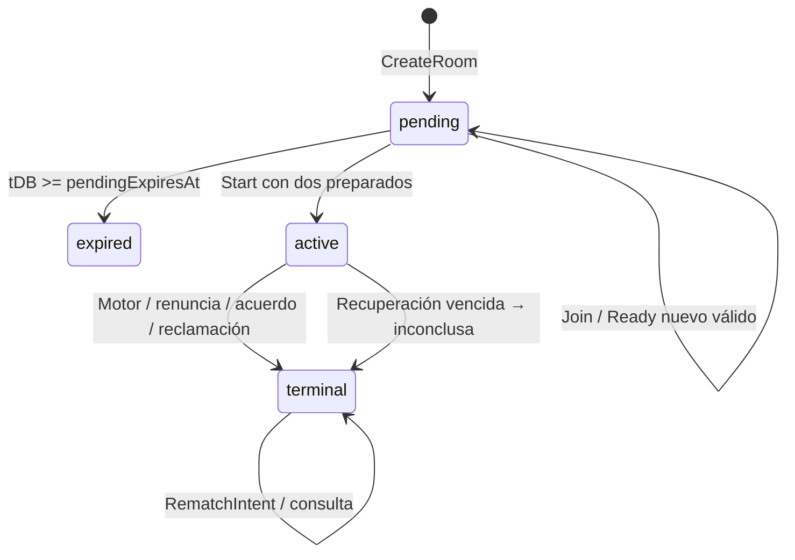

# 06.01 — Salas, invitaciones y ciclo clasificatorio

## 1. Identificación y estado

| Campo | Valor |
|---|---|
| ID | `06.01` |
| Dominio | `06 — Multijugador` |
| Versión | `0.1` |
| Fecha | `2026-10-21` |
| Estado documental | `EN_REVISIÓN` |
| Owner | `S — servicios`; especialista multijugador asignado por coordinación |
| Lote | `3` |
| Naturaleza | Decisiones fuente `APROBADO`; formas, parámetros nuevos y protocolo digital `PROPUESTA`; producto, seguridad e infraestructura `POR_VERIFICAR` |

## 2. Objetivo, alcance y valor

Permitir que dos identidades verificables entren en una sala privada, consientan su modalidad y comiencen una partida oficial con colores estables. Separar invitación, pertenencia, preparación, inicio, final y revancha evita apropiaciones, clasificación retroactiva y derrotas inventadas por ausencia.

Incluye enlace/código, caducidad pendiente, consentimiento, cupo, sorteo, elegibilidad, renuncia, tablas, reclamación y revancha nueva. Conserva el lanzamiento base y ampliado. No incluye espectadores, matchmaking abierto, relojes competitivos ni otra modalidad de correspondencia. Las convenciones temporales son técnicas y no modifican `TK-N1-1.0.0`.

El permiso de [AGENTS](../../../AGENTS.md)/[PLANS](../../../PLANS.md#lote-3) es exclusivamente documental. No se crean salas reales, secretos, código, infraestructura o verificadores ejecutables; no se conectan proveedores ni ejecutan pruebas de producto. Markdown y casos previstos no acreditan funcionalidad.

## 3. Decisiones fuente y autoridad

| Decisión canónica exacta | Aplicación de esta spec |
|---|---|
| [PRE-06.A1](../../decision-register.md#pre-06-a1) | Invitación de alta entropía y código alternativo protegidos por expiración y cuotas; §§7–8 |
| [PRE-06.A2](../../decision-register.md#pre-06-a2) | Sala pendiente:30 min iniciales de inactividad, configurables, separados del juego iniciado; §§5/7/12 |
| [PRE-06.A3](../../decision-register.md#pre-06-a3) | Máximo dos jugadores, sin espectadores; §§5–8 |
| [PRE-06.A4](../../decision-register.md#pre-06-a4) | Revancha nueva relacionada y colores reasignados; §§7–8 |
| [PRE-06.D1](../../decision-register.md#pre-06-d1) | Solo ranked explícita entre registrados; elegibilidad fija al inicio; §§5/7/12 |
| [PRE-06.D4](../../decision-register.md#pre-06-d4) | Renuncia es derrota; archivo inconcluso por desconexión no modifica Elo; §§7/12 |

El [REG](../../decision-register.md) y el [maestro íntegro](../../sources/TOGUZ_PROMPT_MAESTRO_CODEX.md), Anexo A PRE-06, conservan el texto canónico. Cruces: [PRE-03.A4](../../decision-register.md#pre-03-a4), blancas y asignación online; [PRE-03.A1](../../decision-register.md#pre-03-a1)/[PRE-03.A2](../../decision-register.md#pre-03-a2)/[PRE-03.C4](../../decision-register.md#pre-03-c4), repetición/acuerdo/resultado; [PRE-06.C1](../../decision-register.md#pre-06-c1)/[PRE-06.C2](../../decision-register.md#pre-06-c2), recuperación; [PRE-07.A3](../../decision-register.md#pre-07-a3)/[PRE-07.E4](../../decision-register.md#pre-07-e4), vínculo/atomicidad. Citarlos no reasigna su dueño.

[ADR-0004](../../adr/ADR-0004-postgres-authority-and-postcommit-ably.md), [ADR-0005](../../adr/ADR-0005-session-and-service-trust-boundaries.md) y [ADR-0008](../../adr/ADR-0008-ranked-results-and-elo-ownership.md) fijan autoridad, confianza y efectos competitivos. [AD-NORM-001](../../decision-register.md#ad-norm-001), R-01–R-08 y los [14 ACC-N1](../03-game-engine/03.01-normative-rules-and-corpus.md#14-criterios-de-aceptación) gobiernan íntegramente el perfil. No se consulta otra norma o motor ni se reabre atsyrau/repetición/precedencia. Gobierno por [11.01](../11-orchestration/11.01-document-standard-and-change-control.md)/[11.02](../11-orchestration/11.02-ownership-delegation-and-context.md).

## 4. Precondiciones, dependencias y consumidores

Dependencias exactas del [inventario](../../index.md#spec-06-01), entregadas y consolidadas para redacción: [05.04](../05-backend/05.04-event-schemas-and-postcommit-publication.md), catálogo cerrado/Notice/postcommit; [07.04](../07-identity-data/07.04-elo-leaderboard-and-statistics.md), admisión/efectos/estadísticas. Ambas v0.1 `EN_REVISIÓN`; consolidación no es aprobación humana.

Contexto leído: [05.02](../05-backend/05.02-http-openapi-and-errors.md), rutas/DTO/recibos/JoinRoomByCode; [05.03](../05-backend/05.03-transactions-data-and-migrations.md), guardas/locks/custodia/revisión única; [07.01](../07-identity-data/07.01-oidc-guests-and-session-lifecycle.md), UUID/48 h guest/horizonte/vínculo; [07.02](../07-identity-data/07.02-tokens-authorization-and-service-identity.md), JWT/CSRF/cuotas; [07.03](../07-identity-data/07.03-profiles-history-and-data-rights.md), barreras/perfiles/privacidad. [03.02](../03-game-engine/03.02-state-indices-and-invariants.md)–[03.04](../03-game-engine/03.04-outcomes-repetition-and-replay.md) y [02.01](../02-product/02.01-scope-and-modes.md) están documentalmente `APROBADO`.

Consumidores siguientes: [06.02](../../index.md#spec-06-02), sincronización, y [06.03](../../index.md#spec-06-03), recuperación, `EN_REVISIÓN`. [04.01](../../index.md#spec-04-01)/[04.03](../../index.md#spec-04-03), `PENDIENTE_LOTE_4`, representarán controles accesibles y confirmación; [09.01](../../index.md#spec-09-01)/[09.02](../../index.md#spec-09-02)/[10.02](../../index.md#spec-10-02), `PENDIENTE_LOTE_5`, verificarán contratos y cuotas. No crear destinos vacíos.

## 5. Invariantes y entidades

- Game/PostgreSQL es autoridad exclusiva. Un código, enlace, alias, canal o rol admin no demuestra ser un participante ni autoriza recuperar su identidad.
- Sala y game pending se crean juntos 1:1 y comparten un único `gameRevision`. Plazas 0/1 son pertenencia, no colores; color=null hasta Start y estable desde ese commit.
- Online tiene dos humanos UUID distintos al iniciar; máximo dos plazas y ninguna de espectador. Una sesión no ocupa ambas por repetir Join.
- `competition=casual|ranked` expresa intención inmutable de la sala. `rankedEligible` es null antes del inicio y booleano fijo después. No convertir una solicitud ranked inválida en casual silenciosamente.
- Blancas comienzan. Sortear en Start una vez, fuera del motor puro, y persistir asignación; reconexión/retry no vuelve a sortear.
- Pending aplica 30 min de inactividad; active aplica recuperación 24 h por participante; terminal no se vence de nuevo. Ninguna ausencia produce derrota automáticamente.
- Cada final deportivo y sus efectos elegibles se confirman una vez; resultado/causa/ganador son distintos. Inconclusa no es empate, abandono ni provisional completada.
- Revancha mantiene intacta la partida anterior, crea nuevos IDs/canal/inicio y necesita consentimiento de ambos sobre la modalidad nueva. No hereda elegibilidad o colores.

Entidades **PROPUESTA**: Room, ParticipantSeat, InvitationVerifier, InvitationCustody, RoomCodeIndex, ReadyConsent, GameLifecycle y RematchIntent. Los datos secretos no forman parte de RoomView, Notice o receipt consultable. La proyección de perfil solo usa los datos públicos de 07.03, sin correo.

## 6. Requisitos funcionales y no funcionales

| ID | Requisito y naturaleza |
|---|---|
| SAL-01 | `APROBADO`: invitación privada/código alternativo con expiración y controles server-side; formatos de §7 son `PROPUESTA` |
| SAL-02 | `APROBADO`: pendientes caducan inicialmente 30 min tras inactividad, configurable; no aplicar ese plazo a una iniciada |
| SAL-03 | `APROBADO`: cupo 2, sin espectadores, estado visible y pertenencia verificable |
| SAL-04 | `PROPUESTA`: readiness bilateral, Start explícito, revisión común y sorteo CSPRNG persistido |
| SAL-05 | `APROBADO`: ranked explícita entre registrados y elegibilidad inmutable; admisión 3 / 24 h de 07.04 es `PROPUESTA` |
| SAL-06 | `APROBADO`: renuncia voluntaria derrota, acuerdo bilateral, reclamación exacta del perfil y archivo inconcluso sin Elo |
| SAL-07 | `APROBADO`: revancha nueva relacionada y colores reasignados; TTL/metadata/consentimiento de §7 son `PROPUESTA` |
| SAL-08 | `POR_VERIFICAR`: concurrencia, no filtración, custodia, cuotas, clocks y recuperación efectiva; ninguna capacidad o latencia medida |

Todas las formas, parámetros o políticas digitales nuevos siguientes son **PROPUESTA para revisión**, incluso cuando se expresen como obligaciones comprobables. No se introducen Redis, cola, outbox obligatorio, cuarto servicio o pago.

## 7. Diseño técnico y responsabilidades

### Estados y transiciones propuestas



`expired` pendiente no es un resultado deportivo: sala cerrada y game nunca iniciado, sin asignar ganador, movimientos, apariciones, Elo o contribución de partida finalizada. Persiste `RoomUpdated(change=pending_expired)` y revisión común según 05.04. Solo active puede terminar `inconclusive/recovery_expired`. Una sala pendiente no se puede renunciar como si hubiese comenzado; sin ruta de cancelación añadida, se deja caducar. Terminal permanece terminal aunque se acuerde revancha.

CreateRoom autoriza creador guest/user y competencia, reserva su plaza, genera recursos/credenciales y fija `lastPendingActivityAt=tDB`, `pendingExpiresAt=tDB+30 min` en un commit. Para ranked exige creador registrado/onboarding completo; el segundo deberá satisfacerlo también antes de Start. Pending todavía no inicializa una aparición oficial o turno jugable. Su revisión inicial registra RoomCreated; no se confunde el snapshot inicial candidato con una partida iniciada.

Join con credencial válida admite un UUID distinto en la segunda plaza. La primera admisión consume ambos medios de invitación y deshabilita su custodia: no hay sustitución de participantes ni hueco reutilizable por vínculo/logout. Ya miembro con otro Join nuevo no consume plaza ni renueva actividad; retry reconocido recupera su receipt. Dos entrantes compiten por la misma plaza y solo uno confirma. ReadRoom solo permite miembros; el futuro entrante no necesita una revisión privada para Join.

Ready es consentimiento explícito del propio participante sobre la modalidad visible, ligado a la sala; body no elige otro UUID. Solo un cambio real false↔true aceptado avanza revisión y actividad pendiente. Repetir ready=true con una intención nueva devuelve decisión sin cambio, y no prolonga la sala por sondeo disfrazado. Ready=false revoca preparación antes del Start; Start concurrente serializa y prevalece la primera transición aplicable. No hay límite deportivo nuevo a cambios de preparación; cuota 07.02 limita solicitudes.

Start puede solicitarlo cualquiera de los dos miembros, con revisión vigente, ambos ready y consentimiento de la modalidad. Revalida identidad/clase/readiness y barreras, plazo pendiente, admisión ranked y margen recuperable. Para el actor se verifica JWT/horizonte actual. Para ambos se conserva ReadyConsent, evidencia creada por el servidor después de verificar el principal firmado, sin persistir el JWT: sujeto/clase/profileReady, accessIssuedAt, accessExpiry y sessionRecoverableUntil. Bajo locks y con tDB fresco, cada evidencia debe corresponder al mismo participante/modalidad, seguir ready=true, cumplir `tDB < accessExpiry + 30 s` y `tDB + 24 h <= sessionRecoverableUntil`. En igualdad del primer límite ya no es válida; la igualdad del horizonte sí reserva exactamente las 24 h. Se comprueban además guardas/barreras de ambos. La tolerancia de 30 s se consume de 07.02, sin ampliar su política.

Si falta evidencia vigente, Start devuelve ROOM_NOT_READY con razón segura readiness_evidence_expired o readiness_margin_insufficient, sin iniciar ni cambiar resultado. El participante afectado debe renovar en Identity cuando esté disponible y enviar **otra intención** Ready con nuevo commandId y expectedRevision actual, usando su nueva emisión firmada. Ready=true nuevo solo actualiza la evidencia si accessIssuedAt es estrictamente mayor que el conservado y el token/horizonte son válidos; este caso avanza revisión y renueva pending una vez. Retry del mismo ID/hash devuelve su receipt anterior, nunca captura una emisión nueva. Repetir el mismo estado con la misma emisión no renueva. Una emisión en el mismo segundo puede requerir esperar otra emisión con iat posterior; timestamps del body no fuerzan el orden. No hay consulta Identity por movimiento ni se acepta una evidencia expirada para compensar su caída.

El commit Start sortea un bit no sesgado con CSPRNG de Go fuera del motor, asigna blanco/negro a las plazas, fija rankedEligible/participantes/consentimiento/startedAt y crea inicial reglamentario 162, turno blanco y aparición inicial 1. Inicializa lastActivityAt de ambos en tDB y sus deadlines=tDB+24 h, sin sumar movimiento. La prueba reciente de Ready de ambos es el consentimiento técnico para activar esas ventanas al Start autorizado. Estado pendiente vencido o prueba sin margen no inicia. Receipt previo conserva colores/IDs aunque cambie fase; no vuelve a sortear o reservar inicio.

La fábrica pura aprobada conserva candidato inicial revision0. Game alinea solo su metadata revision con el gameRevision confirmado por Start, por ejemplo r4 tras las acciones pending. El checkpoint/header inicial oficial y primer movimiento parten de r4; el tablero sigue inicial y cuenta1. History entries pending se conservan como lifecycle sin sumar apariciones; R-07 excluye la revisión técnica de su clave. Esta adaptación del agregado no altera la fábrica03.02 ni añade otra revisión de sala.

### Invitaciones, código y custodia propuestos

Token de invitación: 256 bits CSPRNG, base64url sin padding (43 caracteres), verificadores HMAC-SHA-256 con clave Game de propósito/entorno propia y comparación segura. Enlace web de forma `/room/<roomUUID>#invite=<opaco>`: retirar fragmento de la barra/historia tras capturarlo en memoria y enviar exclusivamente en body JSON a JoinRoom. No query/referrer/log/localStorage, no JWT de usuario como invitación. No incluir scripts externos que puedan leer el fragmento antes de retirarlo; controles de origen/CSP se verificarán con la presentación futura.

Código alternativo **PROPUESTA**: prefijo de versión de clave `K01-` seguido de 12 símbolos CSPRNG de alfabeto Crockford `0123456789ABCDEFGHJKMNPQRSTVWXYZ`, por ejemplo `K01-000000000000` solo como forma sintética, no credencial real. Los 12 símbolos aportan 60 bits; el prefijo no añade entropía. Formato wire cerrado `K[0-9]{2}-[0123456789ABCDEFGHJKMNPQRSTVWXYZ]{12}`; exactamente 16 caracteres. UI puede aceptar ASCII minúscula convirtiéndola a mayúscula antes de enviar; wire rechaza espacios, guiones adicionales, Unicode y sustituciones I/L/O/U. La canonicalización de código ocurre antes de construir la petición; el servidor verifica forma canónica y fingerprint exacto de 05.02, sin normalización oculta después del hash.

`K01` selecciona exactamente un key_id de la allowlist Game; no probar el código contra todas las claves. Índice global `UNIQUE(key_id,code_mac)` donde code_mac es HMAC-SHA-256 con clave Klookup sobre bytes UTF-8 de JCS del objeto cerrado `{purpose:"room-code-lookup/1",env,keyId,code}`. El code es el canónico exacto; finalidad propia distinta del verificador del token. Guardar FK room y estado/expiry. Colisión de generación viola UNIQUE y regenera código antes de publicar; no sustituye la sala existente. Prefijo desconocido usa denegación uniforme y nunca consulta un servicio de claves elegido por cliente. Rotación conserva descifrado/verificación de credenciales todavía válidas o las invalida de forma visible; no cambia su plazo. Es formato de producto propuesto, no estándar de autenticación.

Ambos medios localizan la misma invitación pendiente y se consumen juntos al aceptar Join. Quien conoce solo el código usa JoinRoomByCode; no hay resolver GET o vista previa pública. Antes del lookup se aplican cuotas persistidas 07.02 (propuesta 10/min por sujeto y 30/min por IP confiable pseudonimizada); body hasta 8 KiB según 05.02. Credencial inválida/caducada/consumida, sala inexistente/no admisible o ajena devuelve 404 uniforme sin IDs, participantes, existencia o razón privada; 429 según admisión. No afirmar indistinguibilidad temporal probada. Miembro ya autorizado puede consultar estado/expiry por ReadRoom; la invitación nunca habilita recuperación de otra identidad.

Custodia consume 05.03: sobre AES-256-GCM con clave Game separada, nonce único y AAD ligada inequívocamente a propósito/entorno/roomId/invitationId/expiry. Contiene token/código recuperables solo por creador actualmente autorizado, pending, no bloqueado y credencial utilizable. CreateRoom receipt conserva únicamente IDs/resultado; el adjunto temporal se recupera aparte en creación/retry/ReadRoom. Consumida/vencida/iniciada devuelve invitationStatus=unavailable sin reemitir secretos. No prometer bytes de respuesta idénticos tras perder autorización.

### Cronología pendiente e iniciada

Pending 30 min es decisión aprobada; los eventos que cuentan como actividad son la propuesta técnica anterior: Create, Join aceptado y Ready nuevo efectivo, incluida evidencia más reciente comprobable. Cada uno admitido con `tDB < pendingExpiresAt` fija lastPendingActivityAt=tDB y nuevo deadline=tDB+30 min. GET, duplicados, error, acceso ajeno, Ably o intento ready sin cambio/evidencia nueva no renuevan. Start cambia de política a active, sin prolongar una sala vencida. Si una renovación deja invitación aún utilizable, actualizar sala/verificador y volver a sellar custodia con nonce nuevo/AAD del nuevo deadline en la misma transacción; no reutilizar ciphertext/AAD antiguos. Si ya se consumió no reconstruirla por renovar la sala.

En igualdad `tDB>=pendingExpiresAt` vence antes de Join/Ready/Start; archivo pendiente oportunista y limpieza posterior son distintos. Materializar expiry toma las guardas/locks completos; consulta puede observar vencimiento lógico antes de materializarlo. No requiere cron frecuente ni confía en detectar el instante real de desconexión.

Active consume 05.03 y futura 06.03: cada participante tiene deadline=lastActivityAt+24 h, expiresAt=min(deadlines). Solo actividad nueva autorizada propia renueva su fila; GET/Ably/rival/receipt duplicado no. Reloj DB fresco después de locks y comparación antes de renovar: en igualdad o después se confirma cierre interno inconclusive/recovery_expired una vez, sin Elo. Heartbeat/resume no avanzan gameRevision/ordinal/ledger. Terminal previo nunca se reemplaza por ese cierre. Identity guest usa únicamente la propuesta 48 h sliding de 07.01, access de 900 s y skew de 30 s según 07.02 y horizonte firmado; ningún TTL nuevo aquí. No se concede una ventana cuyo final exceda el horizonte verificable.

### Competición y finalización

Ranked requiere intención de sala y consentimiento explícito de ambos, dos UUID registrados distintos con profileReady y permiso vigente antes de Start. No basta alias, vínculo o rol admin. Se fija rankedEligible una vez; invitado/casual/IA/local/práctica/inconclusa no produce Elo. Promoción posterior o vínculo G→U no reclasifica; vínculo solo terminado congelado no transfiere activa/receipt G a U. Si U ya era rival de G, cada credencial continúa representando únicamente su propio UUID.

Start consume política **PROPUESTA ranked-pair-admission/1 de 07.04**, máximo 3 inicios por pareja no ordenada en 24 h móviles. Con guardas de ambos cuenta startedAt>tDB−24 h y<=tDB antes de iniciar. Dos starts competidores no reservan el cuarto; rollback no consume. Rechazo 409 RANKED_PAIR_LIMIT no inicia ni transforma a casual. Reserva inconclusa sigue contando; receipt no reserva de nuevo. No imponer una sola activa por jugador ni veto retroactivo a finalizar una admitida legalmente. Rating inicial 1200 / K32/10 provisionales y cálculo/ledgers conservan dueño 07.04.

Tras movimiento completo rige target≥82→equal81–81→turno rival→atsyrau→aparición activa. No barrido/adicional ni derrota por quedar vacío el actor cuando el siguiente puede jugar. Renuncia autorizada sin requisito de turno produce victoria rival/resignation; acuerdo exige oferta y aceptación del rival. Ofrecer/rechazar no suma aparición ni cierra por sí mismo la ventana R-07. Reclamación de cualquiera de los dos, tenga o no turno, exige historia/posición/umbral/revisión actuales y fase activa; primera operación aceptada frente a movimiento/cierre prevalece. Terminal definitivo prima dentro de la transición; no se acepta reclamar tras cierre. Rechazo no penaliza.

Game confirma cierre/efectos elegibles/receipt con 05.03 y luego publica 05.04 sin locks. Barrera de cuenta bloquea al titular, preserva acciones legales del rival y ambos efectos elegibles bajo política 07.03; no crea account_deleted, renuncia o inconclusa artificial. Falta de política de supresión deja borrado pendiente, no un resultado nuevo.

### Revancha completa sin modificar el terminal anterior

Protocolo **PROPUESTA rematch/1** sobre RequestRematch/ConfirmRematch 05.02. Solo participantes originales con permiso actual y sin barrera, sobre predecessor terminado, incluido inconcluso. Concesión de historial/replay no otorga consentimiento de participante. Request lleva competition nueva explícita y crea intent UUID con requesterUUID, responderUUID, predecessorGameId, terminalRevision, createdAt y expiresAt=tDB+10 min. TTL 10 min es propuesta de consentimiento, no reloj deportivo. No hereda modalidad silenciosamente; ranked requiere condiciones actuales.

Un solo intent abierto por predecessor; ambos requests simultáneos serializan: el segundo devuelve el intent existente y su autor, sin aceptar automáticamente. Si la modalidad difiere, conflicto seguro; el solicitante puede esperar expiry y crear otra intención. No se añade ruta de cancelación. En igualdad al deadline ya no puede confirmar; retry de confirm aceptado recupera su resultado original aunque el intent luego expire. Otra intención requiere otro commandId/rematchId; jamás resucita uno vencido.

Confirm exige al responder distinto del requester, rematchId exacto, rematchVersion vigente y misma competition explícita. Se revalidan terminal del predecessor y ambos permisos. Confirma intent→accepted y crea, en una transacción, **nueva** sala/game pending con ambos participantes originales en plazas, ready=false para ambos, colores=null, rankedEligible=null, relación predecessorGameId y pending 30 min. No genera invitación: sala completa, no terceros. Cada uno debe expresar Ready nuevo y luego Start con admisión/clases/sorteo nuevos. Ser revancha no garantiza colores inversos: sorteo independiente puede repetirlos.

Request/Confirm/expiry del intent son metadata separada con `rematchVersion` propia y receipts no deportivos; no modifican oldGameRevision, terminal, movimientos, apariciones, ratings o historia semántica anterior. RematchVersion es decimal uint64, inicialmente 0, y aumenta una vez al aceptar o materializar expiry; lecturas/retries no la avanzan y overflow rechaza sin wrap. `expectedRevision` de estas dos operaciones es solo aserción de la terminalRevision inmutable; no se incrementa por el intent. La comparación mutable de Confirm usa rematchVersion. Request de intent existente no renueva 10 min y confirm duplicado no crea otra sala. UNIQUE(rematchId→newRoomId/newGameId) y receipts protegen creación única.

Catálogo 05.04 permanece cerrado: no tipos RematchRequested/Accepted ni Notice del predecessor. ReadGame terminal incluye RematchView autorizado separado, con serverTime/rematchVersion y no-store; ReadCommandResult recupera la intención propia. **PROPUESTA de descubrimiento acotado**: mientras pantalla terminal visible y usuario decidió buscar revancha, una lectura inmediata y luego hasta una cada 15 s, máximo 40 lecturas automáticas / 10 min por pestaña; al límite/ocultarse/expirar detener y permitir actualización manual. Un fetch en vuelo, sin bucle de retries infinito; presupuesto agregado/quotas se verifica con 06.02/10.02. Foco permite una lectura coalescida. No renovar intent/partida por polling ni garantizar aviso instantáneo al rival ausente.

La nueva sala produce RoomCreated en su canal nuevo; el nuevo inicio produce GameStarted con Notice normal. Quien aún no conoce el nuevo gameId lo descubre por ReadGame del predecessor/receipt autorizado, no por suscripción a un canal terminal. Ambos IDs solo se divulgan a participantes actualmente autorizados.

### Transacciones y orden de recursos

Toda ruta mutante y expiry: descubrir conjunto→account_guards de todos los humanos UUID ASC→rooms ASC→games ASC→ratings ASC cuando aplica→derivados por tipo/clave de 05.03. Releer miembros/barreras/recursos; si cambió conjunto, rollback/reinicio desde arriba. Tiempo DB fresco después de esperas. No bloquear primero código/intent y después buscar una guarda faltante. Receipt autorizado se reconoce antes de stale/fase/credencial consumida; otra carga/op/recurso con mismo ID es 409.

CreateRoom y ConfirmRematch insertan recursos nuevos todavía privados bajo guardas de sus humanos y, en revancha, locks ordenados del predecessor existente. No adquieren un lock compartido de otra sala/game preexistente después del nivel derivado: los UUID nuevos se reservan y sus filas se insertan como parte de la creación indivisible, sin publicarlas antes del commit. Nadie puede descubrirlas ni competir por ellas sin las guardas comunes; unicidad/FK son defensas adicionales. Si aparece una referencia a otro recurso **existente**, se vuelve al descubrimiento y se toman todos en orden, sin invocar la excepción de inserción privada. Operaciones posteriores sobre la nueva sala usan la jerarquía ordinaria. No red/espera de usuario dentro de TX.

## 8. Contratos, tipos, errores y versiones

Superficie consumida de 05.02, bajo `/api/v1`, cookies propias/Origin/CSRF de 07.02; formas concretadas aquí **PROPUESTA** para alinear el futuro OpenAPI, sin crear otra ruta:

| Operación | Input → output y regla |
|---|---|
| CreateRoom POST `/rooms` | commandVersion=1,commandId UUID,competition → receipt IDs +RoomView; adjunto InvitationGrant temporal separado si permitido |
| ReadRoom GET `/rooms/{roomId}` | Miembro original autorizado → RoomView; adjunto solo creador pending/válido; no renueva |
| JoinRoom POST `/rooms/{roomId}/join` | commandVersion,commandId e invitation o code exactamente uno; sin expectedRevision → receipt/RoomView tras admitir |
| JoinRoomByCode POST `/rooms/join-by-code` | commandVersion,commandId,code canónico → igual negocio; no roomId/revisión previa; fingerprint de operación propia |
| SetRoomReady POST `/rooms/{roomId}/ready` | commandVersion,commandId,expectedRevision,ready boolean → receipt/RoomView; consentimiento propio/evidencia verificada, nunca claims enviados por body |
| StartRoom POST `/rooms/{roomId}/start` | commandVersion,commandId,expectedRevision → receipt/GameView; ambos preparados y controles de §7 |
| RequestRematch POST `/games/{gameId}/rematches` | commandVersion,commandId,expectedRevision terminal,competition explícita → receipt/RematchView sin alterar revisión deportiva |
| ConfirmRematch POST `/games/{gameId}/rematches/{rematchId}/confirm` | commandVersion,commandId,expectedRevision terminal,rematchVersion,competition → receipt con nueva sala/game +RematchView |
| ReadGame GET `/games/{gameId}` | Estado autorizado; terminal añade RematchView separado; no-store, sin 304 por gameRevision |
| Resign/OfferDraw/AcceptDraw/RejectDraw/ClaimRepetition | Rutas 05.02 con commandVersion/commandId/expectedRevision; ofertaID donde corresponde, actor por sesión; perfil 03.04 |

| DTO propuesto | Campos/tipos/invariantes |
|---|---|
| RoomView | roomId,gameId UUID; gameRevision decimal uint64; status pending/active/expired/terminal; competition; rankedEligible boolean/null; participants[{seat:0 o 1,playerId,profile público permitido,ready,color:null/white/black}]; lastPendingActivityAt,pendingExpiresAt ISO 8601 UTC o null tras inicio; serverTime; allowedActions; invitationStatus available/unavailable sin secretos |
| InvitationGrant separado | invitationId,roomId,invitationToken,code,expiresAt; solo adjunto creador autorizado, no receipt/history/Notice. unavailable omite secretos |
| ReadyConsent interno | subjectId,competition,ready,verifiedAt,accessIssuedAt,accessExpiry,sessionRecoverableUntil,identityKind/profileReady verificados; nunca JWT completo ni prueba cliente soberana |
| RematchView | rematchSchemaVersion=1,rematchId,predecessorGameId,terminalRevision,rematchVersion decimal,requesterId,responderId,competition,status pending/accepted/expired,createdAt/expiresAt,serverTime,newRoomId/newGameId null hasta aceptar; solo participantes |
| GameView | Contrato05.02; phase pending/active/expired/terminal del agregado, igual a RoomView.status online; pending no admite moves. Participantes/color/rankedEligible fijos desde Start, estado/versiones TK-N1-1.0.0, lastMove/recovery; RematchView no cambia gameRevision |

UUID/revisiones/JSON cerrado/bytes/fingerprint/status consumen 05.02/05.03. Los DTO de respuesta no se aceptan como comando. Canonicalización del código no es normalización general JCS; un retry conserva endpoint/body original. Se rechazan color/UUID/resultado/rating/board/expiry aportados como autoridad por el cliente.

Errores 05.02:400 INVALID_REQUEST, 401 token/sesión, 403 origen/CSRF, 404 uniforme de admisión, 409 STALE_REVISION/COMMAND_ID_REUSED/GAME_ALREADY_ENDED/RANKED_PAIR_LIMIT, 410 ROOM_EXPIRED / RECOVERY_EXPIRED para miembro autorizado, 429 RATE_LIMITED, 503 dependencias/validación/cuota. Precisiones propuestas: 409 ROOM_NOT_READY/ROOM_STATE_CONFLICT/REMATCH_CONFLICT/REMATCH_STALE_VERSION y 410 REMATCH_EXPIRED; margen de sesión insuficiente conserva código SESSION_RECOVERY_MARGIN_INSUFFICIENT de 07.01/07.02 y exige renovar antes de una nueva ventana. Problem seguro con requestId/effect; timeout no demuestra rollback.

Separación de errores: evidencia ReadyConsent de cualquiera de los participantes caducada o sin margen produce ROOM_NOT_READY con razón readiness_evidence_expired/readiness_margin_insufficient según §7. SESSION_RECOVERY_MARGIN_INSUFFICIENT se reserva a la credencial actual del actor de una petición que necesita reservar ventana. No confundir evidencia conservada del rival con una autenticación HTTP fallida del solicitante.

Un no-miembro no recibe ROOM_FULL/ROOM_EXPIRED diferenciados por probar código; las condiciones se colapsan en 404. Receipt aceptado de Join se puede recuperar por actor actualmente autorizado sin exigir de nuevo credencial vigente. No devuelve token/código desde receipt aunque CreateRoom tenga adjunto temporal. Rechazos persistidos/idempotencia/commit incierto siguen 05.03; no usar ID nuevo para resolver una intención cuyo efecto se desconoce.

## 9. Metodología de implementación futura

1. Obtener permiso de implementación y revisar propuestas de formatos, consentimientos, TTL y privacidad; no instalar o conectar ahora.
2. Alinear OpenAPI 05.02 con RoomView/ReadyConsent/RematchView, revisión terminal frente a metadataVersion y errores; conservar catálogo cerrado 05.04.
3. Implementar/verificar generación CSPRNG, HMAC por propósito/prefijo y custodia AES-GCM; probar colisiones, logs y recuperación del adjunto sin secretos en receipt.
4. Implementar Create/Join/Ready/Start con conjunto completo de guardas/locks, relectura, receipts antes de precondiciones mutables y reloj fresco.
5. Implementar pending 30 min, reseal atómico y expiry oportunista sin cron; diferenciar nunca iniciado de inconclusa activa.
6. Integrar prueba reciente/horizonte de ambos Ready, sorteo único y motor inicial Go con TK-N1-1.0.0, sin motor de reglas cliente.
7. Integrar admisión competitiva 07.04 y cierres 03.04 con dos efectos/transacción; barreras 07.03 sin veto al rival o resultado nuevo.
8. Implementar RematchIntent/receipt/proyección terminal/cupo de polling y creación nueva privada bajo guardas; no publicar evento no catalogado del predecessor.
9. Probar positivos, negativos, concurrencia, respuesta perdida y límites con PostgreSQL/navegadores autorizados; registrar versiones/evidencias antes de afirmar seguridad o capacidad.

## 10. Justificación y alternativas

Token 256 bits reduce adivinación; código 60 bits mejora entrada manual a cambio de necesitar cuotas/verificadores y evaluación de abuso. Prefijo key_id impide búsqueda ambigua en rotación. Resolver y admitir juntos evita un endpoint que divulgue salas a quien prueba códigos. Custodia cifrada separa recuperación de respuesta del almacenamiento de decisiones; añade complejidad de claves/nonces/AAD que debe demostrarse.

Readiness explícita permite comprobar modalidad, identidad reciente y margen de ambos antes del Start; una invitación no basta para consentir ranked o reservar 24 h. Revisión única evita dos contadores incoherentes en pending. Plazas/color separados permiten sorteo justo solo al inicio; no se afirma aleatoriedad medida por describir CSPRNG.

Revancha con metadata propia conserva catálogo e historia anteriores. Polling terminal acotado aporta descubrimiento cuando ya no se emiten capacidades Ably; cuesta lecturas y tiene demora visible. Añadir un tipo Rematch requeriría cambiar catálogo/versiones 05.04 y sus consumidores: no se impone silenciosamente. Crear otra sala con confirmación bilateral conserva identidad y evita reutilizar invitaciones antiguas.

No se adoptan derrota por desconexión, reloj competitivo, espectador, sustitución por enlace, una única activa global, veto competitivo al cierre, motor TypeScript o transporte que declare resultado. Las alternativas técnicas futuras necesitan impacto/aprobación si cambian estos compromisos.

## 11. Ejemplos técnicos explicados

Ejemplo sintético **PROPUESTA**, sin credenciales reales ni partida ejecutada. Ambos registrados y pruebas Ready con margen suficiente. Cada intención conserva su ID al reintentar:

```text
10:00 CreateRoom(A, casual) -> R/G pending r0, expiry 10:30, plaza A sin color.
10:05 Ready(A, true, prueba P1, r0) -> r1, expiry 10:35; reseal si procede.
10:10 JoinByCode(B, code) -> r2, expiry 10:40; ambos medios consumidos.
10:11 Ready(B, true, prueba P2, r2) -> r3, expiry 10:41.
10:12 Start(A, r3) -> r4 active, A negro/B blanco sorteados y persistidos.
Ambos deadlines = mañana 10:12; turno blanco; 162; count inicial 1; moveOrdinal 0.
Retry Start mismo ID/hash -> receipt r4; no sortea, renueva o publica otro aviso.
```

Si Start recibe una prueba Ready expirada exige preparación nueva con acceso propio renovado. Para un pending que vence a las 10:41:00, una acción puede admitirse a las 10:40:59 y ya no en la igualdad o después. Una solicitud HTTP que llegó antes pero adquirió los locks después también encuentra la sala vencida. Son instantes de un ejemplo de contrato; no expresan precisión observada de detección de red.

Ejemplo JSON documental de consentimiento de revancha, valores ficticios y body cerrado:

```json
{"commandVersion":1,"commandId":"00000000-0000-4000-8000-000000001201","expectedRevision":"37","rematchVersion":"0","competition":"casual"}
```

Es input ConfirmRematch sobre un intent pendiente del rival. oldGame r37 continúa terminal r37; nueva sala/game quedan r0 pending, participantes ambos ready=false y sin colores. Confirm duplicado devuelve esos mismos IDs. Nueva Start usa su revisión propia, otro sorteo y admisión; un cierre anterior inconcluso no produce Elo por aceptar revancha.

En R-07 posición activa r36 con umbral 3: A o B puede reclamar 36. Si primero confirma movimiento a 37, claim 36 recibe rechazo sin penalización; si primero acepta claim, draw/repetition_claim y movimiento encuentra terminal. La rama target/equal/atsyrau terminal ya confirmada no ofrece otra reclamación. Esto ilustra concurrencia de contrato, no un ciclo de repetición alcanzable probado.

## 12. Casos límite, fallos y seguridad

| Caso | Conducta exigida / recuperación |
|---|---|
| Dos Join o mismo UUID intenta ambas plazas | Un asiento nuevo por UUID/cupo; otro sin metadatos privados; retry aceptado recupera receipt |
| Código adivinado, prefijo desconocido, Unicode/normalización ambigua | Rechazo/404 uniforme con cuota antes de lookup; sin resolver o canal autorizado |
| Create commit/respuesta perdida | Mismo ID conserva R/G; creador pending recupera adjunto desde custodia; consumida/vencida → unavailable, no otra sala |
| Ready renueva mientras Join/expiry/Start esperan | Misma jerarquía/revisión y tiempo DB fresco; no AAD viejo con deadline nuevo ni resurrección |
| Ready antiguo o reintento tras perder respuesta | Sin renuevo por prueba/estado iguales; nueva evidencia requiere JWT propio actual y chequeo de margen |
| Start duplicado o ambos Start simultáneos | Un inicio/asignación/registro de admisión; receipt/conflicto, sin nuevo sorteo o inicialización Elo |
| Registered sin onboarding o guest llega a ranked | Rechazo antes de Start; no downgrade o cambio de identidad inferido por alias |
| Tres starts/par y cuarto simultáneo | Política 07.04 antes del inicio; rechazado no modifica elegibilidad; varias activas permitidas por jugador |
| Renuncia versus jugada ganadora/acuerdo/claim | Primera transición aplicable serializada; un terminal/Elo, sin reinterpretar R-05 o penalizar reclamación |
| Active sin actividad de B mientras A consulta/actúa | A no extiende B; en deadline mínimo archivo inconcluso sin Elo, nunca derrota por red |
| Terminal leído días después | Mismo resultado y causa; no reemplazar por recovery_expired ni renovar por GET |
| Link G→U, U rival, alias igual o cookies perdidas | UUID/prueba originales; no transferencia activa/receipt, no apropiación por invitación |
| Cuenta bloqueada/borrado parcial | Actor bloqueado, rival y efectos elegibles íntegros; política pendiente no inventa final o anonimización |
| Rematch Request/Confirm simultáneos o en expiry exacto | Intent único, consentimiento rival explícito y una nueva sala; expired no confirma, aceptado se recupera sin recrear |
| Polling terminal/Ably caído/HTTP tarde | Lectura privada acotada; metadata Rematch puede cambiar con misma oldGameRevision; sin 304 ni Notice inventado |
| Commit SQL incierto o fallo Ably postcommit | Resolver misma intención/REST; no nueva ID, rollback supuesto o doble juego/Elo |

No prometer detección exacta de desconexión HTTP/Ably en serverless. Ausencia observable y actividad autenticada son convenciones distintas. Caída Game/PostgreSQL no suspende automáticamente plazos ni ofrece prueba de archivo confirmado; recuperación técnica excepcional requiere política/evidencia/autorización, no reloj cliente. Logs de aplicación/proxy excluyen fragmento/token/código, cookies, JWT, datos privados o sobre descifrado.

## 13. Estrategia de pruebas

Actual: inspección documental de fuentes, contratos, rutas, 17 partes, fences y referencias. Futuro autorizado: unitarias de formato/estado, PostgreSQL real para locks/receipts/expiry/creación privada y E2E de dos clientes/pestañas; no afirmar atomicidad mediante mocks solamente. Mantener PRE-09 y los 14 ACC consumidores.

| Caso futuro | Entrada → esperado / evidencia |
|---|---|
| F-SAL-01 | Token/código válidos, adivinados, prefijo/forma alterados y claves rotadas → admisión propia o rechazo uniforme, cuotas/sin secretos; fixtures/trazas seguras |
| F-SAL-02 | Create respuesta perdida/retry/ReadRoom antes/después consumo/expiry → mismos IDs/adjunto permitido o unavailable; ningún secreto en receipt/log |
| F-SAL-03 | Actividad pending válida/GET/duplicado/ready igual/prueba nueva y fronteras −ε / igualdad / +ε → plazo/renovación/reseal correctos o expiry sin deporte; DB/AAD/nonces |
| F-SAL-04 | Dos entrantes/mismo UUID/miembros cambian antes del lock → cupo 2/UUID distintos/reinicio de guardas, sin color por plaza; PostgreSQL |
| F-SAL-05 | Dos Ready/Start, prueba expirada/margen insuficiente, retry con hash alterado → consentimiento/verificación o rechazo; un sorteo persistido/una aparición inicial |
| F-SAL-06 | Ranked/casual×guest/registered/onboarding/vínculo×W/D/L/inconclusive → elegibilidad inicial y efectos únicos según 07.04, nunca retroactivos |
| F-SAL-07 | Dos previos/par y dos starts competidores, límite 24 h exacto, rollback/inconclusa → solo tercero admitido/reservas correctas/sin una activa obligatoria |
| F-SAL-08 | Renuncia/acuerdo/claim/move concurrentes con participante fuera de turno/tercero/terminal → perfil/consentimiento/primera aceptada correctos, sin penalización; 14 ACC |
| F-SAL-09 | Request de ambos/Confirm propio/rival/modalidad cambiada/TTL 10 min exacto/HTTP perdido → intent/consentimiento/nueva sala únicos; oldRevision/historia/Elo intactos |
| F-SAL-10 | Confirm crea recursos privados mientras otras rutas/cleanup compiten → guardas/orden/UNIQUE y ningún recurso existente bloqueado fuera de orden; traza SQL |
| F-SAL-11 | A consulta/heartbeat, B ausente, recovery en el límite, terminal antiguo y cron apagado → B no extendido/inconclusa única/sin Elo/terminal intacto |
| F-SAL-12 | Rematch metadata cambia con oldRevision igual, Ably sin aviso, pantalla oculta y límite 40 lecturas → no-store/proyección actual/poll acotado/sin Notice de tipo nuevo |
| F-SAL-13 | Barrera actor/rival legal/link U/G, pérdida cookie y admin ajeno → permisos originales/ambos efectos cuando es elegible, sin apropiación o resultado inventado |
| F-SAL-14 | Fallo antes/después del commit, receipts SQL desconocidos, Ably fallido → misma intención/unidades atómicas/REST sin doble inicio/final/Elo |

| Verificación documental / decisión | Control → aceptación |
|---|---|
| `VP-06.01-PRE-06.A1` | Entropía/prefijo/HMAC/custodia/admisión uniforme/cuotas/secretos → AC-01/AC-02 |
| `VP-06.01-PRE-06.A2` | Pending 30 min/actividad real/reseal/frontera/cron frente a active 24 h → AC-03/AC-08 |
| `VP-06.01-PRE-06.A3` | Cupo 2/UUID/plazas/color/permiso/sin espectadores → AC-04/AC-05 |
| `VP-06.01-PRE-06.A4` | Consentimiento/TTL/metadata/nueva sala/sorteo/Notice y concurrencia → AC-07 |
| `VP-06.01-PRE-06.D1` | Modalidad/clases/readiness/elegibilidad/admisión previa/vínculo → AC-05/AC-06 |
| `VP-06.01-PRE-06.D4` | Renuncia vs archivo/causa/Elo/terminal y carreras reglamentarias → AC-08/AC-09 |

## 14. Criterios de aceptación

| ID / fuente | Entrada → resultado verificable → evidencia exigida y negativo |
|---|---|
| AC-01 / PRE-06.A1 | Invitación/código propios frente a adivinación/caducidad/prefijo/ajeno → admisión privada limitada o 404 uniforme → F-SAL-01/04; sin metadatos, resolver público o identidad por enlace |
| AC-02 / PRE-06.A1 | Creación confirmada/respuesta perdida/retry/renovación del deadline → IDs estables y custodia autorizada/reseal o unavailable → F-SAL-02/03; sin secreto en receipt o ampliación por retry |
| AC-03 / PRE-06.A2 | Pending antes/en/después de 30 min y actividad nueva/GET/duplicado → renovar una vez o vencer antes de actuar → F-SAL-03; sin cron obligatorio o derrota deportiva pendiente |
| AC-04 / PRE-06.A3 | Entrantes simultáneos/mismo UUID/tercero → dos plazas humanas distintas y autorizadas → F-SAL-04/13; sin espectador/control de otro participante |
| AC-05 / PRE-06.A3/PRE-06.D1 | Dos preparados/inicio con evidencia/horizonte vigente → sorteo único, blancas, inicial 162/count 1 y elegibilidad fija → F-SAL-05/06; sin colores por plaza o ranked por alias |
| AC-06 / PRE-06.D1 | Admisión por par 3/24 h/casual/guest/vínculo/inconclusa → límites propuestos previos y efectos según 07.04 exactos → F-SAL-06/07; sin veto retroactivo/una activa/Elo retroactivo |
| AC-07 / PRE-06.A4 | Consentimiento rival/TTL/retry/concurrencia → nueva sala/game vinculados y ready=false/sorteo nuevo al Start → F-SAL-09/10/12; oldRevision/terminal/catálogo 05.04 intactos |
| AC-08 / PRE-06.D4 y cruce PRE-06.C2 | Renuncia/desconexión/lectura/expiración → derrota voluntaria o inconclusa sin Elo según causa → F-SAL-08/11; rival/sondeo no prolongan ausente ni reemplazan terminal |
| AC-09 / PRE-06.D4 y AD-NORM-001 | Claim/move/acuerdo/final/SQL/HTTP/Ably concurrentes → un cierre aplicable y efectos atómicos → F-SAL-08/13/14; ambos pueden reclamar, no empate automático/penalización/doble Elo |

Son criterios futuros previstos; la auditoría Markdown verifica trazabilidad y coherencia, no comportamiento observado o seguridad real.

## 15. Observabilidad, migración y recuperación

Propuesta: registrar decisión/operación/receipt, fase/revisión, permiso/cupo, causa de rechazo minimizada, actividad/expiry con reloj servidor, versión de código/clave sin secreto, disponibilidad de custodia y reintentos/reseal. Métricas agregadas de salas creadas/iniciadas/expiradas, conflictos/cupo, fallos de credencial/cuota, inicios ranked admitidos/rechazados, finales por causa y rematch pending/accepted/expired, solicitudes REST terminales. No logs con credenciales, sobre/código, IP clara o historial privado; IDs son pseudónimos sujetos a 07.03.

Rotar verificadores/custodia por key_id y propósito con lector compatible para credenciales todavía válidas; demostrar unicidad nonce y AAD. Una clave retirada puede volver unavailable un adjunto y debe comunicar límite, sin reemitir automáticamente o reabrir sala. Expiración lógica precede a purga; retención de verificadores/metadata/receipts/tombstones exige política 07.03/RISK-10, no conservación indefinida implícita.

Rollback de renderer/adapter no vuelve pendiente una activa, cambia colores, deshace admisión o terminal/Elo, ni revive invitación/intent. Commit incierto se resuelve por mismo ID y permiso actual. Recuperación excepcional de datos requiere plan autorizado de 10.03/10.04, `PENDIENTE_LOTE_5`; no hay restauración o RPO/RTO medidos.

## 16. Riesgos, referencias y cuestiones pendientes

| Riesgo / dueño | Tratamiento y cierre futuro |
|---|---|
| [RISK-05](../../conflicts.md#risk-05), S | Readiness reciente de ambos/horizonte 48 h y renovación requieren F-SAL-05/13; conservar prueba original y límites de cookies |
| [RISK-12](../../conflicts.md#risk-12), S | 30 min/24 h / 10 min/inicios por par y espera de locks exigen reloj controlado/PostgreSQL; ventana no es detección de desconexión |
| [RISK-07](../../conflicts.md#risk-07)/[RISK-08](../../conflicts.md#risk-08), S/Q | Jerarquía universal/creación privada/receipts/finales necesitan F-SAL-04/07/10/14; ninguna atomicidad o antifraude probado |
| [RISK-03](../../conflicts.md#risk-03)/[RISK-04](../../conflicts.md#risk-04), A/S | Polling terminal/cuotas/renovaciones/Ably requieren presupuesto conjunto 06.02/10.02; coste 0 USD no demostrado |
| [RISK-10](../../conflicts.md#risk-10), propietario/S | Custodia/metadatos/pares/retención/borrado requieren política aprobada; pseudónimos no son anonimización |
| Propuestas de contrato, coordinación/S | Alinear DTO/ReadyConsent/RematchVersion/errores y polling con 05.02; no cambiar padres durante autoría ajena |

Referencias normativas y técnicas son los contratos internos citados, sus fuentes primarias verificadas por sus dueños y sus límites declarados. Para esta spec no se consultan fuentes deportivas externas o motores. Formatos de código/invitación/readiness/rematch son propuestas del producto, no hechos atribuidos a un estándar o integración. La factibilidad criptográfica/browser y retención siguen por verificar antes de implementación autorizada.

## 17. Evidencias de cierre y trazabilidad

Cierre documental exigido: ruta/ID/17 secciones, seis PRE canónicos con VP→AC, dependencias 05.04/07.04 consolidadas, temporalidad/credenciales/cupo/consentimiento/elegibilidad/renuncia/inconclusa/revancha explícitos, contratos/riesgos y enlaces/fences revisados. Coordinación integra [TRZ](../../traceability.md), IDX/CONF/PLANS y evidencia observada; esta spec no reasigna decisiones de otro dueño.

Cierre funcional futuro exige F-SAL-01–14 y los 14 ACC consumidores, con PostgreSQL/navegadores/versión/entorno/fallos/resultados reales y revisión independiente. Producto, generación de secretos, criptografía, sesiones, SQL, aleatoriedad, cuotas, infraestructura, recuperación y eficacia antiabuso permanecen **POR_VERIFICAR / no ejecutados**.

Documento `EN_REVISIÓN`; solo aprobación humana posterior del lote 3 aprueba su contenido. El autor entrega exclusivamente esta ruta y cesa escritura. No autoriza fusión, implementación, lote 4, proveedores o pagos.
